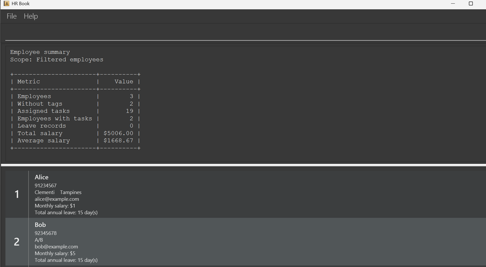

# HR Book

[](https://github.com/AY2627S1-CS2103T-T16-3/tp/actions/workflows/gradle.yml)

**Employee administration, one command at a time.**

HR Book is a desktop application for HR Operations Managers at small startups. Manage employee records,
salaries, leave, and tasks by typing commands, while a graphical interface keeps employee details and results
visible.

[User Guide](https://ay2627s1-cs2103t-t16-3.github.io/tp/UserGuide.html) · [Developer Guide](https://ay2627s1-cs2103t-t16-3.github.io/tp/DeveloperGuide.html) · [Download](https://github.com/AY2627S1-CS2103T-T16-3/tp/releases)



## Features

| Feature | What you can do |
| --- | --- |
| Employee records | Add, edit, and delete employees; maintain contact details, monthly salary, annual leave entitlement, and tags. |
| Search and organisation | Find employees by name, combine field filters, and sort the displayed list. |
| Leave management | Record and cancel leave, check remaining annual leave, and view upcoming, ongoing, and past records. Requests are checked for working days, entitlement, and overlaps. |
| Task tracking | Add, list, delete, complete, and reopen tasks concerning individual employees. |
| Workforce summaries | View employee, tag, task, and leave-record counts, plus total and average salary for all employees or a selected group. |

Employees may share names, but phone numbers and email addresses must be unique. Data is saved locally
between sessions. HR Book focuses on internal employee administration work.
Features such as employee messaging are outside its scope.

## Getting started

1. Install **Java 25 or later**. See the [setup notes](https://ay2627s1-cs2103t-t16-3.github.io/tp/UserGuide.html#quick-start), including the macOS requirements.
2. Download the application JAR from the [releases page](https://github.com/AY2627S1-CS2103T-T16-3/tp/releases).
3. Place it in a folder where HR Book can create its data, preferences, and log files.
4. Open a terminal in that folder and run:

   ```text
   java -jar [CS2103T-T16-3][HRBook].jar
   ```

Once the app opens, try:

| Command | Result |
| --- | --- |
| `list` | Display all employees. |
| `find Alice` | Find employees with the name keyword `Alice`. |
| `summary` | Summarise the currently displayed employees. |
| `leave list` | Show current-year remaining leave balances and leave records for displayed employees. |

See the [User Guide](https://ay2627s1-cs2103t-t16-3.github.io/tp/UserGuide.html) for complete command syntax, examples, and data-file guidance.

## For developers

Start with the [setup guide](https://ay2627s1-cs2103t-t16-3.github.io/tp/SettingUp.html) to prepare your environment and run the project.
The [Developer Guide](https://ay2627s1-cs2103t-t16-3.github.io/tp/DeveloperGuide.html) covers architecture, implementation, requirements, and manual testing.

## Acknowledgements

HR Book is based on AddressBook-Level3, created by the [SE-EDU initiative](https://se-education.org).
