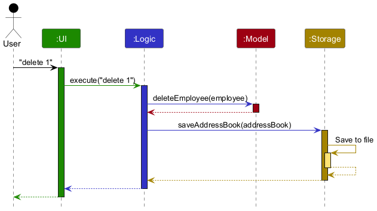
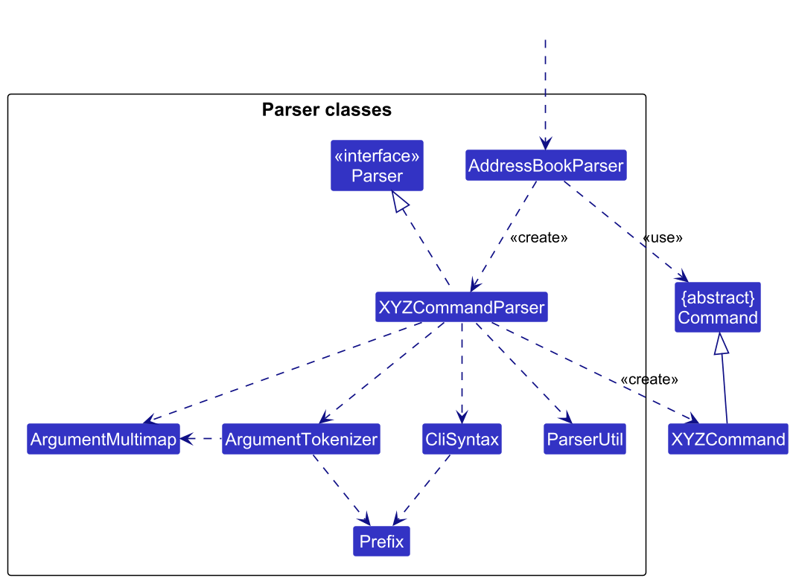
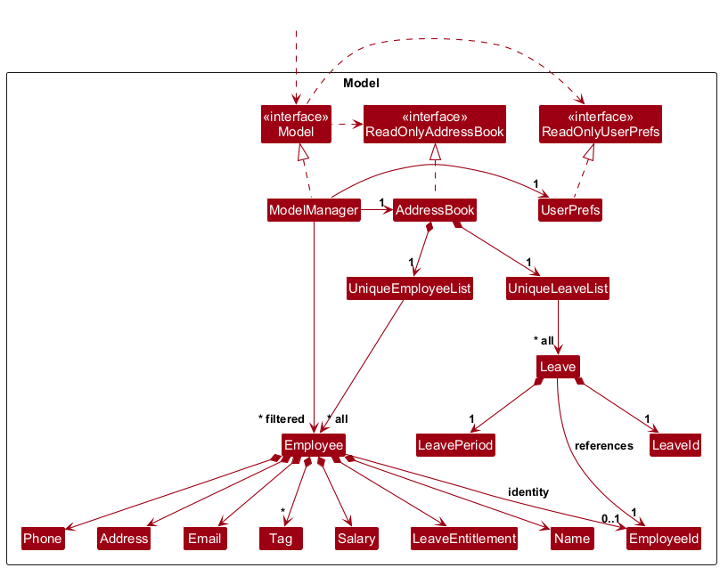
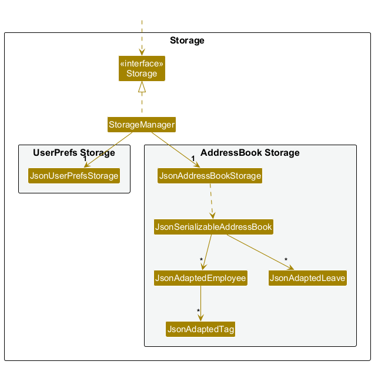
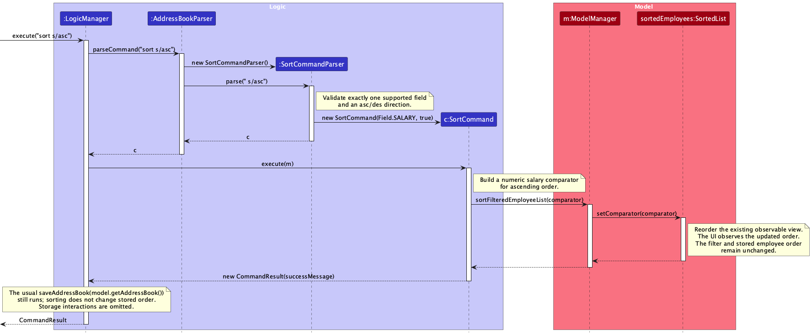
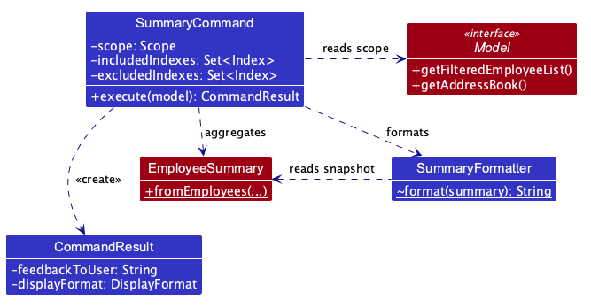

* Table of Contents
{:toc}

--------------------------------------------------------------------------------------------------------------------

## **Acknowledgements**

* _{List the sources of reused or adapted ideas, code, documentation, and third-party libraries here, with links to the originals.}_

--------------------------------------------------------------------------------------------------------------------

## **Setting up, getting started**

Refer to the guide [_Setting up and getting started_](SettingUp.md).

--------------------------------------------------------------------------------------------------------------------

## **Design**

<div markdown="span" class="alert alert-primary">

:bulb: **Tip:** The `.puml` files used to create diagrams are in `docs/diagrams`. Refer to the [_PlantUML Tutorial_ at se-edu/guides](https://se-education.org/guides/tutorials/plantUml.html) to learn how to create and edit diagrams.
</div>

### Architecture


The ***Architecture Diagram*** given above explains the high-level design of the App.

The following provides a quick overview of the main components and their interactions.

**Main components of the architecture**

**`Main`** (consisting of classes [`Main`](https://github.com/AY2627S1-CS2103T-T16-3/tp/tree/master/src/main/java/seedu/address/Main.java) and [`MainApp`](https://github.com/AY2627S1-CS2103T-T16-3/tp/tree/master/src/main/java/seedu/address/MainApp.java)) is in charge of the app launch and shut down.
* At app launch, it initializes the other components in the correct sequence, and connects them up with each other.
* At shut down, it shuts down the other components and invokes cleanup methods where necessary.

The bulk of the app's work is done by the following four components:

* [**`UI`**](#ui-component): The UI of the App.
* [**`Logic`**](#logic-component): The command executor.
* [**`Model`**](#model-component): Holds the data of the App in memory.
* [**`Storage`**](#storage-component): Reads data from, and writes data to, the hard disk.

[**`Commons`**](#common-classes) represents a collection of classes used by multiple other components.

**How the architecture components interact with each other**

The *Sequence Diagram* below shows how the components interact with each other for the scenario where the user issues the command `delete 1`.



Each of the four main components (also shown in the diagram above),

* defines its *API* in an `interface` with the same name as the Component.
* provides its functionality through a concrete `{Component Name}Manager` class that implements the corresponding API interface.

For example, the `Logic` component defines its API in `Logic.java` and implements it in `LogicManager.java`. Other components interact with a component through its interface rather than its concrete class, preventing them from coupling to that component's implementation, as illustrated in the following partial class diagram.


The sections below give more details of each component.

### UI component

The **API** of this component is specified in [`Ui.java`](https://github.com/AY2627S1-CS2103T-T16-3/tp/tree/master/src/main/java/seedu/address/ui/Ui.java)


The UI consists of a `MainWindow` and its parts, such as `CommandBox`, `ResultDisplay`, `EmployeeListPanel`, and `StatusBarFooter`. All of these, including `MainWindow`, inherit from the abstract `UiPart` class, which captures common behavior among classes that represent visible GUI parts.

The `UI` component uses the JavaFX UI framework. The layouts of these UI parts are defined in matching `.fxml` files in `src/main/resources/view`. For example, [`MainWindow.fxml`](https://github.com/AY2627S1-CS2103T-T16-3/tp/tree/master/src/main/resources/view/MainWindow.fxml) specifies the layout of [`MainWindow`](https://github.com/AY2627S1-CS2103T-T16-3/tp/tree/master/src/main/java/seedu/address/ui/MainWindow.java).

The `UI` component,

* executes user commands using the `Logic` component.
* listens for changes to `Model` data so that the UI can be updated with the modified data.
* keeps a reference to the `Logic` component, because the `UI` relies on the `Logic` to execute commands.
* depends on some classes in the `Model` component because it displays `Employee` objects from the model.

### Logic component

**API** : [`Logic.java`](https://github.com/AY2627S1-CS2103T-T16-3/tp/tree/master/src/main/java/seedu/address/logic/Logic.java)

Here's a (partial) class diagram of the `Logic` component:


The sequence diagram below illustrates the interactions within the `Logic` component, taking `execute("delete 1")` API call as an example.


<div markdown="span" class="alert alert-info">:information_source: **Note:** The lifeline for `DeleteCommandParser` should end at the destroy marker (X), but due to a limitation of PlantUML, it continues to the end of the diagram.
</div>

How the `Logic` component works:

1. When `Logic` is called upon to execute a command, the command is passed to an `AddressBookParser` object, which in turn creates a parser that matches the command (e.g., `DeleteCommandParser`) and uses it to parse the command.
1. This results in a `Command` object (more precisely, an object of one of its subclasses e.g., `DeleteCommand`) which is executed by the `LogicManager`.
1. The command can communicate with the `Model` when it is executed (e.g. to delete an employee).<br>
   Note that although this is shown as a single step in the diagram above for simplicity, the code can require several interactions between the command object and the `Model` to complete the operation.
1. The result of the command execution is encapsulated as a `CommandResult` object which is returned from `Logic`.

Here are the other classes in `Logic` (omitted from the class diagram above) that are used for parsing a user command:



How the parsing works:
* When called upon to parse a user command, the `AddressBookParser` class creates an `XYZCommandParser` (`XYZ` is a placeholder for the specific command name, e.g., `AddCommandParser`). The parser uses the other classes shown above to parse the user command and create an `XYZCommand` object (e.g., `AddCommand`). The `AddressBookParser` returns that object as a `Command` object.
* All `XYZCommandParser` classes, such as `AddCommandParser` and `DeleteCommandParser`, implement the `Parser` interface so they can be treated similarly where appropriate, for example during testing.

### Model component
**API** : [`Model.java`](https://github.com/AY2627S1-CS2103T-T16-3/tp/tree/master/src/main/java/seedu/address/model/Model.java)




The `Model` component,

* stores the address book data i.e., all `Employee` objects (which are contained in a `UniqueEmployeeList` object).
* sorts employees using a JavaFX `SortedList<Employee>` and wraps it in a `FilteredList<Employee>` for display. `getFilteredEmployeeList()` exposes this unmodifiable observable view, so the UI receives filter, sort, and employee update notifications without changing the stored employee order.
* stores a `UserPrefs` object that represents the user’s preferences (currently, just the GUI settings). This is exposed to the outside as a `ReadOnlyUserPrefs` object.
* does not depend on any of the other three components (as the `Model` represents data entities of the domain, they should make sense on their own without depending on other components)

### Storage component

**API** : [`Storage.java`](https://github.com/AY2627S1-CS2103T-T16-3/tp/tree/master/src/main/java/seedu/address/storage/Storage.java)



The `Storage` component,
* saves employee data, leave data, the next employee ID, the next leave ID, and user preferences in JSON format, and
  reads them back into corresponding model objects.
* is implemented by `StorageManager`, which delegates the actual JSON file access to `JsonAddressBookStorage` and `JsonUserPrefsStorage` (one class per data file).
* depends on some classes in the `Model` component (because the `Storage` component's job is to save/retrieve objects that belong to the `Model`)

Saved data is treated as untrusted input because files may be edited accidentally or modified maliciously. The
defensive validation starts with `null` entries inside the saved leave list, preventing these
entries from causing an uncaught exception during startup. This check specifically covers null leave records.
On startup, such an entry is rejected with an `IllegalValueException`, which
`JsonAddressBookStorage` wraps in a `DataLoadingException`. A missing or null leave-list field remains supported for
legacy files. `MainApp` handles loading failures by creating an empty model and, after starting the UI, calling
`Ui#setFeedbackToUser`. `UiManager` forwards the message through `MainWindow` to the existing `ResultDisplay`,
identifying the data file and explaining recovery.
Neither loading nor closing the app rewrites the address-book file; the next successfully executed command saves the
current model. A missing file instead starts with sample data and does not show a loading error.

### Common classes

Classes used by multiple components are in the `seedu.address.commons` package.

--------------------------------------------------------------------------------------------------------------------

## **Implementation**

### Save failures and model rollback

After parsing a command, `LogicManager` captures a `ModelSnapshot` before execution. The model snapshot copies
the address book (including leave records and next-ID counters) and retains the employee filter and comparator.
If saving throws `IOException` or `AccessDeniedException`, Logic restores the snapshot through `Model` and
reports the existing save error. Restoration updates the existing observable collections, preserving UI bindings.
Snapshots rely on employee and leave values being immutable and on display predicates/comparators remaining unchanged.

`JsonAddressBookStorage` writes JSON directly to the destination using the original storage workflow.
Rollback restores memory only: a failed write can leave the destination incomplete or containing rejected data.
A later successful save in the same session writes the restored model, but restarting before that save does
not guarantee recovery. There are no backups or power-loss guarantees. Existing startup behavior opens an empty
address book after a data-loading error; a later save can overwrite the unreadable file.

`AddressBookSnapshotTest` covers independent copies, exhausted ID counters, and retained observable lists.
`ModelManagerTest` covers snapshot restoration and `LogicManagerTest` covers rollback after save errors.
Storage tests inject failures before writing and after a partial direct write. They verify model restoration
and that a later successful command saves only accepted changes.

#### Limits of the current save structure

* **Concurrency:** There is no cross-process lock or conflict detection. Multiple app instances or external edits
  can overwrite one another. Commands are assumed to execute serially.
* **Rollback scope:** The snapshot covers address-book data and employee display rules, not user preferences,
  GUI selection/scroll state, or external side effects. Model listeners can observe changes before save succeeds
  and notifications during restoration. This is not an isolated transaction across the UI and disk.
* **Exception scope:** Rollback handles save-time `IOException` (including access-denied errors). Runtime errors,
  memory exhaustion, partially mutating commands that throw before saving, or failure inside restoration are
  outside this guarantee. Even a failed save may already have changed the disk file.
* **Cost and snapshot assumptions:** Every parsed command takes a full snapshot, and successful commands still
  save the entire JSON file, including read-only commands such as help/list. Snapshot creation and restoration
  copy validated collections
  without repeating duplicate or leave-overlap checks. Copying is linear in the number of records; loading
  external data still performs full validation. Saving and observable-list updates remain synchronous.
  Shared employee/leave values must remain immutable, and
  stored predicate/comparator objects must not be mutated after snapshot capture.

See [save safety testing](Testing.md#save-safety-regression-and-stress-tests) for the tested cases and exclusions.

This section describes some noteworthy details on how certain features are implemented.

### Employee identifier allocation

`AddressBook` assigns each employee an internal positive integer ID from 1 to `Integer.MAX_VALUE`. The next-ID counter
is stored as a `long`, allowing `Integer.MAX_VALUE + 1` to represent an exhausted ID sequence without numeric overflow.
If an `add` command reaches this state, `AddressBook` throws `EmployeeIdExhaustedException`, which `AddCommand` converts
into a user-facing command error instead of allowing the exception to terminate command execution.

### Employee salary management

The `salary INDEX s/SALARY` command replaces the salary of the employee identified by their displayed index. For example, `salary 1 s/5000` sets the first employee's salary in the current list to 5000.

`AddressBookParser` routes the command to `SalaryCommandParser`, which parses the index and the compulsory `s/` prefix. It rejects invalid indices, missing or repeated salary prefixes, and salary values that are not whole numbers from 0 to 50000. Valid input produces a `SalaryCommand` containing an `Index` and a validated `Salary` value object.

At execution, the command follows these steps:

1. Retrieves the currently filtered employee list through `Model#getFilteredEmployeeList` and checks that the index is within its bounds.
2. Compares the selected employee's salary with the requested `Salary`. If they are equal, returns feedback stating that the salary is already set and no changes were made, without replacing the employee or changing the displayed view. Leading zeros do not affect equality.
3. If the salary differs, calls `Employee#withSalary` to create a replacement employee. The employee's internal ID and all other fields, including tasks and leave entitlement, are preserved.
4. Replaces the original employee through `Model#setEmployee`.
5. Resets the employee filter to show all employees, retaining the active sort, and returns feedback containing the employee's name and the old and new salaries.

This approach preserves the immutability of `Employee` and keeps salary validation within the `Salary` value object. The usual application-wide save still runs after command execution, including when the salary is unchanged.

### Filtering employees

`filter` searches all stored employees using `EmployeeMatchesCriteriaPredicate` and combines all
supplied criteria with AND. `FilterCommandParser` validates field prefixes, rejects empty criteria
and repeated scalar fields, and uses `ParserUtil` to validate numeric thresholds. Salary thresholds
must be whole numbers from 0 to 50000; annual leave entitlement thresholds must be whole numbers
from 0 to 365. Leading zeros are normalized before constructing the predicate.

Both numeric fields accept exact values (no operator), `<`, `<=`, `>`, and `>=`. The parser checks
for the two-character inclusive operators before splitting the operator from its amount. It rejects
missing thresholds and malformed operators such as `=`, `=<`, `=>`, or `<==` through the existing
field validation errors. `EmployeeMatchesCriteriaPredicate#matchesAmount` likewise checks inclusive
operators first, compares integer values, and includes equality only for `<=` and `>=` (or an exact
match). Leave filtering uses annual entitlement, irrespective of leave already taken.

`FilterCommand#execute` updates the model's filtered employee list and reports the number of matches.
For example, `filter s/<=4000 le/>=14` includes employees earning exactly 4000 with exactly 14 days
of entitlement, provided they satisfy both criteria. Employee records are unchanged.

`FilterCommandParserTest` covers all operators, normalized values, valid limits, and invalid input.
`FilterCommandTest` exercises parsing through execution, checking equality at inclusive thresholds,
strict comparisons, limits (0/50000 salary and 0/365 days), and combinations with other criteria.
### Task management

Users can keep track of tasks for each employee. The `Task` class stores the description and completion status.
The constructor rejects blank descriptions and descriptions longer than 120 characters. In the command syntax, `INDEX`
and `TASK_INDEX` are one-based indexes chosen by the user. The task commands use an employee's position in
`Model#getFilteredEmployeeList` and a task's position in `Employee#getTasks` to identify the records being changed.

`Employee#getTasks` returns a read-only view of the tasks for each `Employee`. `Task` is immutable: methods such as
`Task#markDone` and `Task#markUndone` return a new `Task` instead of changing the existing object. Similarly,
`Employee#addTask`, `Employee#deleteTask`, and `Employee#updateTask` return a new `Employee`. The replacement preserves
the original employee's other details, including salary, leave entitlement, tags, and unrelated tasks.

`AddressBookParser` passes commands beginning with task to `TaskCommandParser`. The available subcommands are:

* `task list INDEX` displays the selected employee's tasks without changing the model.
* `task add INDEX d/DETAILS` adds a new incomplete task to the selected employee.
* `task delete INDEX i/TASK_INDEX` deletes a task.
* `task mark INDEX i/TASK_INDEX` marks a task as complete.
* `task unmark INDEX i/TASK_INDEX` marks a task as incomplete.

Each mutating task command reads `Model#getFilteredEmployeeList` when its `execute` method runs. This ensures that
`AddTaskCommand`, `DeleteTaskCommand`, `MarkTaskCommand`, and `UnmarkTaskCommand` use the same employee ordering shown
after `find`, `filter`, or `sort`. The commands validate the employee index and the task index, if applicable, before
calling `Model#setEmployee` with the replacement employee.

`Employee#addTask` rejects duplicate tasks by calling `Task#hasSameDetails`. That method compares normalized details:
it trims the description, combines repeated Unicode whitespace, and ignores letter case. The original
description remains available through `Task#getDetails` for display.

Tasks are saved as part of the employee record. `JsonAdaptedEmployee` converts each `Task` to `JsonAdaptedTask`, which
stores the task's `details` and `isDone` fields. Since tasks belong to `Employee`, deleting an employee also deletes
its tasks.

When loading data, `JsonAdaptedTask#toModelType` reconstructs each `Task` and applies the constructor's validation.
`JsonAdaptedEmployee#toModelType` then checks the reconstructed tasks with `Task#hasSameDetails` and rejects duplicates.
Invalid task data therefore cannot be used to create an invalid `Employee`.

### Sorting displayed employees

`sort FIELD/ORDER` orders the current displayed list without changing its filter or the stored employee order.
`AddressBookParser` dispatches the command to `SortCommandParser`, which requires exactly one supported
prefix (`n/`, `p/`, `e/`, `a/`, `s/`, or `le/`) and the lowercase direction `asc` or `des`.
Missing values, unknown fields, unsupported directions, extra arguments, and multiple fields are rejected
with `SortCommand.MESSAGE_USAGE`. Tags and tasks are not sortable because each employee can have multiple values.

`SortCommand` stores a `Field` enum and an ascending flag. At execution time it creates a comparator:

* Name, email, and address use `String.CASE_INSENSITIVE_ORDER`.
* Salary and annual leave entitlement use integer comparison. Leave sorting uses annual entitlement,
  rather than remaining leave or leave dates.
* Phone numbers use `BigInteger` comparison, supporting differing digit lengths, leading zeros,
  and numbers too large for primitive integer types.
* Descending order reverses the field comparator. Tied values use the order maintained by the shared sorted view.

The model maintains this observable transformation chain:

`AddressBook.getEmployeeList()` → `SortedList<Employee>` → `FilteredList<Employee>` → UI

`ModelManager.sortFilteredEmployeeList` sets the comparator on the existing sorted view.
`getFilteredEmployeeList()` returns the existing filtered view of that list, preserving references held by the UI and logic.
The filter predicate is unchanged, hidden employees stay hidden, and an empty list can be sorted normally.
Employee updates propagate through the chain, so changing a salary repositions the employee as needed.
Index-based commands read the sorted view and therefore act on the employee at the displayed index.

The comparator remains active across `find`, `filter`, `list`, and employee changes until another sort replaces it.
`list` clears the filter but retains the sort. Sorting is display state only: no JSON fields or stored
employee order are changed. The usual save after command execution still occurs. Restarting creates a
new sorted view without a comparator and restores the stored employee order.

A sorted observable view was chosen over sorting the address book in place to preserve stored order,
and over copying the visible list to keep subsequent edits and filter changes observable.
`SortCommandParserTest` covers field/direction validation. `SortCommandTest` covers both directions for
all supported fields, numeric ordering, long and padded phone numbers, ties, filtered/empty lists,
shared view references, unchanged stored order, and index-based salary changes and deletion after sorting.

The following sequence diagram illustrates a successful `sort s/asc` command. It shows parsing,
command execution, and the comparator update on the existing sorted view. The usual storage save
is omitted from the diagram for clarity.



### Workforce summary

The `summary` command (alias `/summary`) produces a read-only overview of employees in the selected scope:
headcount, employees without tags, employee counts by tag, assigned tasks, employees with tasks, saved leave records,
and total/average recorded salary.

The partial class diagram below shows how scope selection, aggregation, and table formatting are separated.
Dashed arrows indicate usage (`use`) or creation (`create`) dependencies; only members relevant to the summary are shown.



`AddressBookParser` routes both spellings to `SummaryCommandParser`. The parser accepts an optional
`scope/all` or `scope/filtered` followed by optional `i/` and `e/` whitespace-separated index lists.
`ArgumentTokenizer` separates the two prefixes, and `ParserUtil.parseIndex` validates positive integers.
Each prefix may occur once; repeated indexes are deduplicated. Malformed inputs report usage errors,
while repeated prefixes use the shared duplicate-prefix error.
The command stores a `SummaryCommand.Scope` enum and immutable inclusion/exclusion index sets, not employee snapshots.
At execution time the command reads
`model.getFilteredEmployeeList()` for the default/filtered scope, or
`model.getAllEmployeesInDisplayOrder()` for explicit `scope/all`. The latter returns a snapshot of all employees
by copying the shared `SortedList` before filtering. Both scopes therefore use the same ordering for tied
values, including after repeated sorts. Without an active sort, the full list follows stored order.
Creating the snapshot does not change stored records or the filter. Indexes refer to positions in this collection.
Every supplied index is checked against its current size; out-of-range indexes throw `CommandException`.
An empty inclusion set selects everyone, and exclusions take precedence over inclusions. The resulting collection is
passed to `EmployeeSummary.fromEmployees` together with `model.getAddressBook().getLeaveList()`, so all
statistics share the same employee selection. The command labels
the multiline result `Scope: All employees` or
`Scope: Filtered employees`, followed by any inclusion/exclusion lists in ascending order.
Empty selections remain empty; no fallback or filter mutation occurs.
`SummaryFormatter` renders the essential figures as ASCII tables with dynamically sized columns and
right-aligned values. The tag table is omitted when there are no tags. Explanatory notes remain in the User Guide.
`CommandResult.DisplayFormat.TABLE` carries the presentation choice to `ResultDisplay`, which applies
the `table` CSS pseudo-class for a monospaced font. Ordinary feedback and errors restore the normal font.
No new window or storage fields are needed.

`EmployeeSummary.fromEmployees` owns aggregation independently of presentation:

* Each stored employee contributes once to the total; an empty tag set contributes to the untagged count.
* Tag names are lowercased using `Locale.ROOT`, avoiding dependence on the system locale.
* Normalized tags are deduplicated per employee before counting, so case variants on one employee
  do not inflate that tag's count. Different tag groups may overlap.
* A `TreeMap` provides alphabetical ordering. The snapshot exposes an unmodifiable copy of the counts.
* An empty input produces zero counts. If no tags exist, the formatter omits the tag table.

Aggregation is recomputed on each invocation, without stored counters, new JSON fields, or changes to
employees, tags, user preferences, or the current filter. The existing application-wide automatic
save after command execution remains unchanged. This feature does not infer attendance, active
employment, or departments.

Tests in `EmployeeSummaryTest` cover counting, ordering, case deduplication, locale independence, and
snapshot immutability. `SummaryCommandTest` checks formatting, filtered and empty views, preservation
of the filter predicate, and fresh results after add/edit/delete. Parser tests cover both spellings,
surrounding whitespace, and rejection of unexpected arguments. `SummaryScopeCommandTest` covers scope
selection, empty matches, execution-time reads, and preservation of the filter predicate.
`SummaryIndexCommandTest` covers index selection in both scopes, overlap, empty selections, invalid indexes,
execution-time resolution, and preservation of employee records and filters. Logic tests
exercise both spellings after `find` and `filter`, checking that saved data and the visible list remain unchanged.
`SummarySortCommandTest` covers sorted inclusion/exclusion, hidden employees, ties after repeated sorts,
and sort/data changes after parsing. `ModelManagerTest` checks that the full sorted snapshot preserves
the filter and stored order, and matches the displayed list after filtering and employee changes.
`LogicManagerTest` checks the repeated-sort regression through real commands without changing saved data.
`SummaryFormatterTest` checks exact table layouts, omitted detail, long tags, and large totals.
`CommandResultTest` checks presentation metadata. `ResultDisplayTest` checks equal-width table characters,
normal/error font restoration, caret reset, and null input handling on the JavaFX thread.
Linux CI runs these tests with Xvfb to provide a virtual display.
The JavaFX result-panel preview was checked with synthetic data
for aligned columns, empty results, and restoration of the normal feedback font.

#### Leave-record counts

`EmployeeSummary.fromEmployees(employees, leaves)` builds a set of the selected employees' stable IDs,
then counts each leave record whose employee ID belongs to that set. Employee names and displayed indexes
are not used to match records. Employees without an ID contribute no leave records.
This takes O(E + L) time for E selected employees and L stored leave records.

Each saved period counts once regardless of its duration, year, or whether it is in the past or future.
The result is stored as a `long` in the immutable snapshot and displayed as `Leave records`.
Empty selections and selections without matching records produce zero. The one-argument factory assumes
no leave records. Neither factory retains or changes the input lists.
The existing leave records are the source of truth after restart: the count is recalculated rather than
saved separately. Changes to leave or employee records are reflected the next time `summary` runs.

`EmployeeSummaryLeaveTest` checks record counting across years, stable IDs after renaming, empty and
unmatched inputs, null inputs, and snapshot independence. `SummaryLeaveCommandTest` checks both aliases,
filtered/all scopes, inclusion/exclusion selections, displayed indexes after sorting, and fresh counts
after leave or employee deletion. `LogicManagerTest` exercises real leave commands and verifies that
summaries preserve the active filter and saved data, and that changes persist correctly.

#### Task counts

`EmployeeSummary` captures the sum of `Employee.getTasks().size()` as a `long`, the number of employees
with nonempty task lists, and the maximum per-employee task count in the same pass as tag aggregation.
Employees without tasks are derived from headcount minus employees with tasks. Empty input yields
zero for all task statistics; identical descriptions on different employees count separately.

`SummaryFormatter` displays assigned tasks and employees with tasks in the metrics table, even when
there are no tags. Derived counts and per-employee maxima remain available in the snapshot but are not displayed.
The snapshot contains counts only and remains unchanged when source records are replaced.
Tests cover mixed and empty lists, tied maxima, repeated descriptions across employees, filtered views,
unchanged records, and fresh snapshots after task and employee changes. No completion or due-date
semantics, storage fields, or task commands are introduced by this feature.

#### Salary statistics

`EmployeeSummary` also captures salary statistics from the same employee collection. Its private
`IntSummaryStatistics` is constructed locally and never exposed or modified after snapshot creation.
The total is a `long`; minimum and maximum are `OptionalInt` values, empty for an empty collection.
The average is an optional `BigDecimal`, calculated directly from the integer total and employee count
with scale 2 and `RoundingMode.HALF_UP`, without converting to floating point. Zero salaries are included.

`SummaryFormatter` displays total and average salary in the metrics table. An empty collection displays
`$0.00` for the total and `N/A` for the average. Minimum and maximum remain available in the snapshot but are not displayed.
No currency period, benefits, or payroll assumptions are added. Tests cover empty/single inputs,
zero/maximum amounts, half-cent rounding, totals beyond `int`, snapshot independence, filtered views,
and recomputation after a salary command.

### Leave management

The leave feature is implemented as a `leave` command group with the `add`, `list`, and `delete` subcommands.
`AddressBookParser` passes the remaining input to `LeaveCommandParser`, which selects the matching subcommand parser.
The `list` subcommand must be spelled exactly, while any arguments after it are ignored like those of other commands
that take no parameters.

#### Recording leave

`leave add INDEX from/START_DATE to/END_DATE` follows this flow:

1. `AddLeaveCommandParser` parses a displayed employee index and two `DD-MM-YYYY` dates into an `Index` and immutable
   `LeavePeriod`. Dates use exactly four year digits and accept valid past and future dates in years `0001` to `9999`;
   year `0000` is rejected.
2. `AddLeaveCommand` resolves the index against `Model#getFilteredEmployeeList`. This lets a user run `find` or
   `filter` before selecting an employee without exposing the employee's internal ID.
3. `AddressBook#addLeave` finds the employee through its internal `EmployeeId`, rejects an overlapping period, and
   checks the requested weekdays against the employee's remaining entitlement for that year.
4. The model creates the record with the next `LeaveId`, adds it to `UniqueLeaveList`, and increments the ID counter.
5. The command reports the assigned leave ID, employee, period, charged weekdays, and recalculated balance.

`LeavePeriod` enforces an inclusive, ordered range within one calendar year. It counts Mondays to Fridays and requires
at least one such day. Public holidays are not excluded, so a public holiday on a weekday is
charged as a working leave day. Overlap detection uses every calendar date in the inclusive range, not only charged
weekdays.

Remaining leave is derived as:

`max(0, annual entitlement - recorded working leave days in that calendar year)`

This avoids a second mutable balance that could drift out of sync. An employee's annual entitlement is compulsory when
the employee is added, is editable, and accepts whole numbers from 0 to 365. `ParserUtil#parseLeaveEntitlement`
accepts digit-only input with leading zeros and removes that padding before constructing `LeaveEntitlement`; an
all-zero input is normalized to 0. Validation of the normalized value still rejects entitlements outside 0 to 365.
For backward compatibility, employees in older data files with no entitlement load with an entitlement of 0.

#### Listing and deleting leave

`leave list` reads the currently filtered employee list from `Model`, collects those employees' internal IDs, and
retains only matching records from the central leave list. It then sorts the records by `LeaveId`, resolves each
internal employee ID to the employee's current name, and returns a multiline result. Consequently, `find` and `filter`
also scope the following `leave list`, while running `list` first restores an all-employee scope. The status is derived
using `LocalDate.now(clock)` on every invocation. Production commands use the system-default clock, while tests inject
a fixed clock for deterministic status checks:

* `Upcoming` when today is before the start date.
* `Past` when today is after the end date.
* `Ongoing` otherwise, including a weekend contained within the recorded period.

The status is presentation data and is not persisted.

`leave delete LEAVE_ID` removes one record by its stable ID. The ID counter is not decremented, so an ID removed using
`leave delete` is not reused while the current address book remains in use. No balance mutation is required; the next
balance calculation automatically excludes the deleted record.

`ClearCommand` has broader semantics than deleting records individually. It replaces the model data with a new
`AddressBook`, removing all employee and leave records and resetting both identifier counters to 1. Employee and leave
IDs used before `clear` may therefore be assigned again in the fresh address book.

Employee deletion cascades through `AddressBook#removeEmployee`, which removes the employee and all records with the
same internal `EmployeeId`. During bulk replacement, `removeOrphanedLeaves` provides the equivalent safeguard. Storage
loading rejects leave records that refer to an unknown employee, overlap another record for the same employee, or use
invalid identifiers or periods.

#### Design considerations

**Aspect: Where leave records are stored**

* **Alternative 1 (current choice):** Store leave records in one central `UniqueLeaveList`, linked by `EmployeeId`.
  * Pros: IDs, overlap checks, chronological status, persistence, and listing all leave have one source of truth.
  * Cons: Employee names must be resolved when displaying leave and referential integrity must be enforced explicitly.
* **Alternative 2:** Store a leave list inside each `Employee`.
  * Pros: An employee and their leave are naturally grouped.
  * Cons: Listing and identifying leave across the workforce becomes more complex, and editing an employee risks
    replacing or duplicating nested leave state.

**Aspect: How users identify records**

* Employees use the displayed list index because users already rely on that workflow for edit and delete operations.
* Leave records use a stable, public `LeaveId` because their position in a workforce-wide list must not change the
  target of a later delete command.

--------------------------------------------------------------------------------------------------------------------

## **Documentation, logging, testing, dev-ops**

* [Documentation guide](Documentation.md)
* [Testing guide](Testing.md)
* [Logging guide](Logging.md)
* [DevOps guide](DevOps.md)

--------------------------------------------------------------------------------------------------------------------

## **Appendix: Requirements**

### Product scope

**Target user profile**:

* HR officer who has to manage a significant number of employee contacts by themselves
* HR officer who can use the contact book to help them carry out her administrative tasks
* HR officer who is reasonably comfortable using CLI apps and types fast compared to using mouse interactions
* HR officer that needs help tracking and managing employee records, onboarding, attendance, leave, and other day-to-day administrative matters

**Value proposition**: Helps HR officers keep employee information organised and up to date while reducing repetitive administrative work.


### User stories

Priorities: High (must have) - `* * *`, Medium (nice to have) - `* *`, Low (unlikely to have) - `*`

| Priority | As a …​                    | I want to …​                                                                   | So that I can…​                                                                          |
|----------|----------------------------|--------------------------------------------------------------------------------|------------------------------------------------------------------------------------------|
| `* * *`  | First time user of HR Book | see usage instructions                                                         | refer to instructions when I forget how to use the App and learn its capabilities        |
| `* * *`  | HR Officer                 | edit employee contact details and annual leave entitlement                     | keep employee records up to date                                                         |
| `* * *`  | HR Officer                 | add a new employee profile with an annual leave entitlement                    | record a new hire and enforce their leave allowance                                      |
| `* * *`  | HR Officer                 | add a task for an employee                                                     | record work that needs to be completed                                                   |
| `* * *`  | HR Officer                 | list the tasks for an employee                                                 | review the work related to that employee                                                  |
| `* * *`  | HR Officer                 | delete a task for an employee                                                  | remove completed or obsolete work                                                        |
| `* * *`  | HR Officer                 | mark a task as done                                                            | keep track of completed work                                                             |
| `* * *`  | HR Officer                 | mark a task as pending                                                         | keep track of work that still needs to be completed                                       |
| `* * *`  | HR Officer                 | record an employee's leave                                                     | track used and remaining annual leave                                                    |
| `* * *`  | HR Officer                 | list all leave with its current status                                         | see upcoming, ongoing, and past absences                                                 |
| `* * *`  | HR Officer                 | cancel a recorded leave                                                        | correct mistakes and restore the employee's available leave                              |
| `* * *`  | HR Officer                 | delete an employee profile and their leave records                             | remove former employees without retaining orphaned data                                 |
| `* * *`  | HR Officer                 | filter through a list of employees                                             | easily find employees that match specific criteria                                      |
| `* * *`  | HR Officer                 | change an employee's salary                                                    | keep employee salary records up to date                                                  |
| `* * *`  | HR Officer                 | view an employee's salary                                                      | check their current pay when handling payroll enquiries                                  |
| `* * *`  | HR Officer                 | shift employees between different departments                                  | keep track of changing roles within the startup                                          |
| `* * *`  | HR Officer                 | view an employee's department, role, employment status, or other details       | keep track of information relevant to HR administration                                  |
| `* *`    | Experienced HR Officer     | sort employees by department                                                   | locate personnel within a department easily                                              |
| `* *`    | HR Officer                 | have local storage for employee contact and details                            | have a persistent and secure database for all relevant information                       |
| `* *`    | HR Officer                 | have automatic local backups for employee contact and details                  | back up employee information locally                                                     |
| `*`      | Experienced HR Officer     | tag employees together                                                         | easily group employees based on similar tags                                             |
| `*`      | Experienced HR Officer     | generate a list of administrative actions                                      | show logs during audits or reviews                                                       |

### Use cases

(For all use cases below, the **System** is the `HR Book` and the **Actor** is the `HR manager`, unless specified otherwise)

**Use case: UC1 - Add an employee**

**MSS**

1. HR manager requests to add an employee, providing the employee's details and annual leave entitlement.
2. System adds the employee and saves the employee information.
3. System displays the added employee and confirms that the employee was added.

    Use case ends.

**Extensions**

* 1a. The HR manager does not provide one or more required fields.

    * 1a1. System informs the HR manager to provide all required fields.
    * 1a2. System does not add the employee.

      Use case ends.

* 1b. The HR manager provides an invalid field.

    * 1b1. System informs the HR manager that the field does not exist.
    * 1b2. System does not add the employee.

      Use case ends.

* 1c. The HR manager provides more fields than required.

    * 1c1. System informs the HR manager that there are too many fields.
    * 1c2. System does not add the employee.

      Use case ends.

* 1d. One or more provided employee details are invalid.

    * 1d1. System informs the HR manager that the details are invalid.
    * 1d2. System does not add the employee.

      Use case ends.

* 1e. The provided email address or contact number belongs to an existing employee.

    * 1e1. System informs the HR manager that the provided email address or contact number belongs to an existing employee.
    * 1e2. System does not add the employee.

      Use case ends.

* 2a. An error occurs while saving employee information into storage.

    * 2a1. System informs the HR manager that the employee could not be added.
    * 2a2. System does not add the employee.

      Use case ends.

**Use case: UC2 - Delete employee**

**MSS**

1.  HR manager requests to list employees.
2.  System displays the list of employees.
3.  HR manager requests to delete a specific employee using the employee's displayed index.
4.  System deletes the selected employee and all leave records belonging to that employee.
5.  System confirms that the employee has been deleted.

    Use case ends.

**Extensions**

* 2a. The list is empty.

    * 2a1. System informs the HR manager that there are no employees to delete.

      Use case ends.

* 3a. The provided index is invalid.

    * 3a1. System informs the HR manager that the index is invalid.

      Use case resumes at step 3.

**Use case: UC3 - List employee tasks**

**MSS**

1. HR manager requests for the list of tasks for an employee.
2. System displays the list of tasks for the employee.

    Use case ends.

**Extensions**

* 1a. The employee does not exist.

    * 1a1. System informs the HR manager that the employee does not exist.

      Use case ends.

* 1b. The employee does not have any task.

    * 1b1. System informs the HR manager that the employee does not have any task.

      Use case ends.

**Use case: UC4 - Add employee task**

**MSS**

1. HR manager specify details of a task to add to an employee.
2. System adds the task to the employee.
3. System confirms that the task was added.

    Use case ends.

**Extensions**

* 1a. The employee does not exist.

    * 1a1. System informs the HR manager that the employee does not exist.
    * 1a2. System does not add the task.

      Use case ends.

* 1b. The index of the task to be deleted is invalid.

    * 1b1. System informs the HR manager that the task index is invalid.
    * 1b2. System does not add the task.

      Use case ends.

* 1c. The task already exists.

    * 1c1. System informs the HR manager that the task already exists.
    * 1c2. System does not add the task.

      Use case ends.

**Use case: UC5 - Delete employee task**

**MSS**

1. HR manager requests to delete a task from an employee.
2. System deletes the selected task.
3. System confirms that the task was deleted.

    Use case ends.

**Extensions**

* 1a. The employee does not exist.

    * 1a1. System informs the HR manager that the employee does not exist.

      Use case ends.

* 1b. The task does not exist.

    * 1b1. System informs the HR manager that the task does not exist.

      Use case ends.

**Use case: UC6 - Find employees by attribute**

**MSS**

1. HR manager requests for the list of employees with a specific value for an attribute
2. System displays the list of employees with the specified value for the attribute

    Use case ends.

**Extensions**

* 1a. HR manager did not specify an attribute.

    * 1a1. System informs the HR manager to specify an attribute.
    * 1a2. System does not display a filtered list of employees.

      Use case ends.

* 1b. HR manager specified multiple attributes.

    * 1b1. System informs the HR manager it does not support multiple attributes.
    * 1b2. System does not display a filtered list of employees.

      Use case ends.

* 1c. HR manager specified an attribute which does not exist.

    * 1c1. System informs the HR manager the attribute does not exist.
    * 1c2. System does not display a filtered list of employees.

      Use case ends.

* 1d. HR manager did not specify a value.

    * 1d1. System informs the HR manager to specify a value.
    * 1d2. System does not display a filtered list of employees.

      Use case ends.

* 1e. HR manager specified multiple values.

    * 1e1. System informs the HR manager it does not support multiple values.
    * 1e2. System does not display a filtered list of employees.

      Use case ends.

* 1f. HR manager specified a value which is invalid.

    * 1f1. System informs the HR manager the specified value is invalid.
    * 1f2. System does not display a filtered list of employees.

      Use case ends.

* 1g. None of the employees match the specified value and attribute.

    * 1g1. System informs the HR manager that no employees match the specified value and attribute.
    * 1g2. System displays an empty list with no employees.

      Use case ends.

**Use case: UC7 - Filter employees**

**MSS**

1. HR manager requests to filter employees that meets a certain criteria(s)
2. System identifies employees who match all supplied criteria.
3. System displays the matching employees and the number of matches.

    Use case ends.

**Extensions**

* 1a. The HR manager does not provide any criteria.

    * 1a1. System informs the HR manager that at least one criterion is required.
    * 1a2. System keeps the currently displayed employee list.

      Use case ends.

* 1b. The HR manager provides an unsupported field prefix.

    * 1b1. System informs the HR manager of the valid command format.
    * 1b2. System keeps the currently displayed employee list.

      Use case ends.

* 1c. The HR manager repeats a field that may appear only once, such as name or salary.

    * 1c1. System informs the HR manager that the field cannot be repeated.
    * 1c2. System keeps the currently displayed employee list.

      Use case ends.

* 1d. The HR manager provides an invalid salary value.

    * 1d1. System informs the HR manager that salary must be a whole number from 0 to 50000.
    * 1d2. System keeps the currently displayed employee list.

      Use case ends.

* 1e. The HR manager provides an empty criterion.

    * 1a1. System informs the HR manager that supplied criteria must not be empty.
    * 1a2. System keeps the currently displayed employee list.

      Use case ends.

* 2a. No employees match all supplied criteria.

    * 2a1. System displays an empty employee list and reports zero matches.

      Use case ends.

**Use case: UC8 - Record employee leave**

**MSS**

1.  HR manager requests to record a leave period for an employee selected by their displayed index, providing the
    start and end dates.
2.  System records the leave period and assigns it a unique leave ID.
3.  System displays the recorded leave and the employee’s remaining leave for the relevant calendar year.

    Use case ends.

**Extensions**

* 1a. The request is missing required information or contains duplicated or unrecognized information.

    * 1a1. System informs the HR manager that the request is invalid.
    * 1a2. System does not record the leave.

      Use case ends.

* 1b. The provided employee index is invalid.

    * 1b1. System informs the HR manager that the displayed index is invalid.
    * 1b2. System does not record the leave.

      Use case ends.

* 1c. Either provided date is not a valid calendar date.

    * 1c1. System informs the HR manager that the provided date is invalid.
    * 1c2. System does not record the leave.

      Use case ends.

* 1d. The start date is later than the end date.

    * 1d1. System informs the HR manager that the date range is invalid.
    * 1d2. System does not record the leave.

      Use case ends.

* 1e. The start and end dates are in different calendar years.

    * 1e1. System informs the HR manager that the leave period must fall within one calendar year.
    * 1e2. System does not record the leave.

      Use case ends.

* 1f. The leave period does not contain any working day.

    * 1f1. System informs the HR manager that the leave period must contain at least one working day.
    * 1f2. System does not record the leave.

      Use case ends.

* 1g. The specified leave period overlaps an existing leave period belonging to the employee.

    * 1g1. System informs the HR manager about the overlapping leave period.
    * 1g2. System does not record the leave.

      Use case ends.

* 1h. The employee does not have sufficient remaining leave for the specified period.

    * 1h1. System informs the HR manager of the employee’s remaining leave and the number of leave days required.
    * 1h2. System does not record the leave.

      Use case ends.

* 2a. System is unable to save the leave information.

    * 2a1. System informs the HR manager that the leave could not be recorded.
    * 2a2. System leaves all existing employee and leave information unchanged.

      Use case ends.

**Use case: UC9 - List employee leave**

**MSS**

1. HR manager requests to list leave records for the currently displayed employees.
2. System displays matching leave records in leave ID order, including the employee name, dates, charged working days,
   and status relative to today's date.

    Use case ends.

**Extensions**

* 2a. None of the currently displayed employees has a leave record.

    * 2a1. System informs the HR manager that no leave records were found.

      Use case ends.

**Use case: UC10 - Delete employee leave**

**MSS**

1. HR manager lists leave records to obtain a leave ID.
2. HR manager requests to delete the record using its leave ID.
3. System deletes the leave record and displays the employee's recalculated remaining leave for that year.

    Use case ends.

**Extensions**

* 2a. The leave ID is malformed, zero, or negative.

    * 2a1. System informs the HR manager that the command is invalid and displays the correct usage.
    * 2a2. System leaves all employee and leave information unchanged.

      Use case ends.

* 2b. The leave ID is a valid positive integer, but no matching record exists.

    * 2b1. System informs the HR manager that no leave record was found with that ID.
    * 2b2. System leaves all employee and leave information unchanged.

      Use case ends.

**Use case: UC11 - Sort employees**

**MSS**

1. HR manager requests to sort the currently displayed employees by one supported field
   (name, phone number, email, address, salary, or annual leave entitlement) in ascending or descending order.
2. System displays the employees in the requested order and confirms the sort.
   Name, email, and address are sorted alphabetically, ignoring case;
   phone number, salary, and annual leave entitlement are sorted numerically.
   Any active filter remains applied.

    Use case ends.

**Extensions**

* 1a. The request omits the sort field or order, specifies an unsupported field or order,
  or specifies more than one sort criterion.

    * 1a1. System informs the HR manager that the command is invalid and displays the correct usage.
    * 1a2. System leaves the displayed employee order and active filter unchanged.

      Use case ends.

* 2a. The currently displayed employee list is empty.

    * 2a1. System confirms the sort and keeps the displayed list empty without restoring filtered-out employees.

      Use case ends.

**Use case: UC12 - Change an employee's salary**

**MSS**

1. HR manager requests to change an employee's salary, and provides the employee's details.
2. System changes the employee's salary.
3. System displays the employee with the new salary.

   Use case ends.

**Extensions**

* 1a. The HR manager does not provide one or more required fields.

    * 1a1. System informs the HR manager to provide all required fields.
    * 1a2. System does not change the employee's salary.

    Use case ends.

* 1b. The HR manager provides an invalid salary value.

    * 1b1. System informs the HR manager that the salary value is invalid.
    * 1b2. System does not change the employee's salary.

    Use case ends.

* 1c. The HR manager provides more fields than required.

    * 1c1. System informs the HR manager that there are too many fields.
    * 1c2. System does not change the employee's salary.

    Use case ends.

* 1d. The HR manager provides an invalid index.

    * 1d1. System informs the HR manager that the index is invalid.
    * 1d2. System does not change the employee's salary.

    Use case ends.

* 2a. An error occurs while saving new salary of employee into storage.

    * 2a1. System informs the HR manager that the salary could not be changed.
    * 2a2. System does not change the employee's salary.

    Use case ends.


### Non-Functional Requirements

1.  HR Book should work on any _mainstream OS_ as long as it has Java `25` installed.
2.  HR Book should be able to hold up to 1000 employees.
3.  A user with above average typing speed for regular English text (i.e. not code, not system admin commands) should be able to accomplish most of the tasks faster using commands than using the mouse.
4.  The HR Book should respond to every command under 2 seconds.
5.  HR Book should be able to carry out its functionality without internet access.


### Glossary

* **Employee**: A staff member whose employment, contact, and leave information is managed in HR Book
* **Displayed index**: A temporary number shown beside an employee in the current list, used to select that employee in
  commands; it can change after `find`, `filter`, or `list`
* **Employee attribute**: A stored field such as an employee's name, phone, email, address, salary, annual leave
  entitlement, or tag
* **Employee ID**: A private, stable identifier used internally to associate leave with an employee; users do not enter
  it in commands
* **HR Book**: The application used by HR managers to manage employee records and routine administrative work
* **HR manager**: The primary user of HR Book who manages employee records and leave information
* **Leave**: A period of absence recorded for an employee and counted against their leave entitlement
* **Leave ID**: A public, stable positive integer identifying one leave record, shown by `leave list` and used by
  `leave delete`
* **Mainstream OS**: Windows, Linux, Unix, or macOS
* **Working day**: A Monday through Friday counted against annual leave entitlement; public holidays are not excluded

--------------------------------------------------------------------------------------------------------------------

## **Appendix: Instructions for manual testing**

Given below are instructions to test the app manually.

<div markdown="span" class="alert alert-info">:information_source: **Note:** These instructions only provide a starting point for testers to work on;
testers are expected to do more *exploratory* testing.

</div>

### Launch and shutdown

1. Initial launch

   1. Download the JAR file and copy it into an empty folder.

   1. Double-click the JAR file.<br>
      Expected: The GUI opens with a set of sample employees. The window size may not be optimal.

1. Saving window preferences

   1. Resize the window to an optimal size. Move the window to a different location. Close the window.

   1. Relaunch the app by double-clicking the JAR file.<br>
       Expected: The most recent window size and location are retained.


### Deleting an employee

1. Deleting an employee while all employees are being shown

   1. Prerequisites: List all employees using the `list` command, with multiple employees in the list.

   1. Test case: `delete 1`<br>
      Expected: The first employee and all their leave records are deleted from the list. The status message shows the
      deleted employee's details.

   1. Test case: `delete 0`<br>
      Expected: No employee is deleted. The status message shows error details.

   1. Other incorrect delete commands to try: `delete`, `delete x`, `...` (where x is larger than the list size)<br>
      Expected: Similar to previous.

### Managing employee salaries

Use a separate copy of the application with test data. Before each test, note the selected employee's name and
current salary. Recheck displayed indexes after commands that change the list.

1. Updating a salary

   1. Prerequisites: Run `list`. Choose an employee whose salary differs from the test amount and note their
      displayed index.

   2. Test case: `salary INDEX s/5000`, replacing `INDEX` with the selected employee's index.<br>
      Expected: Their monthly salary becomes `$5000`. Feedback identifies the employee and their previous and new
      salaries. Their other details and other employees remain unchanged.

   3. Repeat with `s/0` and `s/50000`, rechecking the employee's index before each command.<br>
      Expected: Both boundary amounts are accepted.

   4. Test case: Set the employee's salary to a different amount, then use `s/005000`.<br>
      Expected: Their salary is stored as `5000` and displayed as `Monthly salary: $5000`.

2. Rejecting invalid requests

   1. Prerequisites: Run `list` with at least one employee displayed. Note the existing salaries.

   2. Test cases: `salary 1 s/50001`, `salary 1 s/-1`, `salary 1 s/abc`, and `salary 1 s/1.5`.<br>
      Expected: Each command reports the salary constraints. No salary changes.

   3. Test cases: `salary 0 s/5000`, `salary x s/5000`, `salary 1`, and `salary 1 s/`.<br>
      Expected: Each command reports an invalid command format or salary value. No salary changes.

   4. Test case: `salary INDEX s/5000`, using a positive index larger than the displayed list size.<br>
      Expected: An invalid employee-index error is shown. No salary changes.

   5. Test case: `salary 1 s/5000 s/6000`.<br>
      Expected: The repeated salary field is rejected. No salary changes.

   6. Test cases: `salary 1 s/5000 n/Alice` and `salary 1 s/abc n/Alice`.<br>
      Expected: Both report `Unsupported field. The salary command only accepts s/.` No salary changes.

3. Updating an employee from search results

   1. Prerequisites: Have multiple employees. Run `find NAME` using a name that matches exactly one employee whose
      salary is not `$6000`.

   2. Test case: `salary 1 s/6000`.<br>
      Expected: The employee in the search results receives the new salary. All employees are displayed afterward,
      retaining the active sort. Other employees remain unchanged.

4. Requesting an unchanged salary

   1. Prerequisites: Run `find NAME` to display exactly one employee. Note their salary.

   2. Test case: Run `salary 1 s/AMOUNT` using their current salary, then repeat with leading zeros added to the
      amount.<br>
      Expected: Both commands report that the salary is already set and no changes were made. The search results
      remain displayed.

5. Updating a salary in a sorted list

   1. Prerequisites: Have at least two employees with different salaries below `$50000`. Run `list`, then
      `sort s/asc`. Note the employee at index 1.

   2. Test case: `salary 1 s/50000`.<br>
      Expected: The employee previously shown at index 1 receives the new salary and moves to their position in
      ascending salary order. Other employees' salaries remain unchanged.

6. Retaining a salary after restarting

   1. Prerequisites: Successfully change an employee's salary to `$5000`. Note their name.

   2. Test case: Exit and relaunch the application using the same data file.<br>
      Expected: The same employee still has a monthly salary of `$5000`.

### Managing tasks

1. Listing an employee's tasks

   1. Prerequisites: Use `list` and choose an employee with at least two tasks,
      including one pending and one completed task. Note the employee's displayed
      index.

   1. Test case: `task list 1`<br>
      Expected: The selected employee's tasks are displayed in the order they
      were added. Pending tasks show `[ ]` and completed tasks show `[x]`.

   1. Test case: `task list 0`<br>
      Expected: No task list is shown. The status message shows invalid command format.

2. Adding a task

   1. Prerequisites: Use `list` and note the index of an employee. Ensure the
      employee does not already have the task used below.

   1. Test case: `task add 1 d/Prepare monthly report`<br>
      Expected: The task is added as pending. The status message confirms the
      task was added, and `task list 1` shows it.

   1. Test case: `task add 1 d/  prepare   MONTHLY report  `<br>
      Expected: The task is rejected as a duplicate because task comparison
      ignores surrounding whitespace, repeated whitespace, and capitalization.

   1. Other incorrect add commands to try: `task add`, `task add 0 d/Test`,
      `task add 1`, and a task description longer than 120 characters.<br>
      Expected: No task is added. The status message shows invalid command format.

3. Deleting a task

   1. Prerequisites: Use `task list 1` for an employee with at least two tasks.

   1. Test case: `task delete 1 i/1`<br>
      Expected: The first task is deleted. The remaining tasks keep their
      relative order and the status message confirms the deleted task.

   1. Test case: `task delete 1 i/0`<br>
      Expected: No task is deleted. The status message shows invalid command format.

   1. Other incorrect delete commands to try: `task delete`,
      `task delete 1`, and `task delete 1 i/x`.<br>
      Expected: No task is deleted. The status message shows invalid command format.

4. Marking and unmarking a task

   1. Prerequisites: Use `task list 1` for an employee with a pending task and
      note its task index.

   1. Test case: `task mark 1 i/1`<br>
      Expected: The task becomes completed. `task list 1` displays it with
      `[x]`.

   1. Test case: Run `task mark 1 i/1` again.<br>
      Expected: The command succeeds without changing the task's completed
      state.

   1. Test case: `task unmark 1 i/1`<br>
      Expected: The task becomes pending. `task list 1` displays it with
      `[ ]`.

   1. Test case: Run `task unmark 1 i/1` again.<br>
      Expected: The command succeeds without changing the task's pending state.

   1. Other incorrect mark/unmark commands to try: `task mark 0 i/1`,
      `task unmark 1 i/0`, and `task mark 1 1`.<br>
      Expected: No task state changes. The status message shows invalid command format.

5. Operating on tasks after filtering

   1. Prerequisites: Ensure at least two employees exist, and one employee has
      a distinctive name such as `Alex`.

   1. Test case: `find Alex`, followed by `task add 1 d/Submit access request`<br>
      Expected: The task is added to the first employee in the filtered list,
      and the filtered employee list remains displayed.

   1. Test case: Run `task mark 1 i/1`, `task unmark 1 i/1`, or
      `task delete 1 i/1` after a `find` or `filter` command.<br>
      Expected: The command operates on the employee and task shown in the
      current filtered view, which remains in place.

6. Saving task changes

   1. Prerequisites: Add or modify a task, then close the application normally.

   1. Test case: Relaunch the app and run `list`, followed by `task list 1` for
      the affected employee.<br>
      Expected: The task, its order, and its completed/pending state are
      preserved.

### Managing leave

1. Recording valid leave

   1. Prerequisites: Add an employee with at least 5 days of leave entitlement, then run `list` and note their index.

   1. Test case: `leave add 1 from/19-10-2026 to/23-10-2026`<br>
      Expected: Five working days are recorded. The result shows a leave ID and the remaining entitlement.

   1. Test case: Run the same command again.<br>
      Expected: No leave is recorded because it overlaps the first record.

   1. Test case: `leave add 1 from/24-10-2026 to/25-10-2026`<br>
      Expected: No leave is recorded because the period contains only weekend days.

2. Listing and deleting leave

   1. Prerequisites: Record leave periods for at least two employees and note the IDs returned by `leave add`.

   1. Test case: Run `list`, followed by `leave list`.<br>
      Expected: All leave records appear in leave ID order with employee name, period, working days, and a status of
      `Upcoming`, `Ongoing`, or `Past` based on today's date.

   1. Test case: Use `find` or `filter` to display one of the employees, followed by `leave list`.<br>
      Expected: Only leave records belonging to the displayed employee appear.

   1. Test case: Use `find` or `filter` so that no displayed employee has a leave record, followed by `leave list`.<br>
      Expected: The result reports that no leave records were found.

   1. Test case: `leave delete 1` (replace `1` with the recorded ID)<br>
      Expected: That record is deleted and the result shows the employee's restored remaining leave.

   1. Test case: Repeat the same `leave delete` command.<br>
      Expected: No record is deleted because that leave ID no longer exists.

### Sorting employees

1. With employees having different salaries, run `sort s/asc`, then `sort s/des`.
   Expected: the displayed salaries increase, then decrease. Try `sort p/des` and `sort le/asc` as well.
2. Run `filter t/friends`, then `sort s/asc`.
   Expected: only employees with the `friends` tag remain, ordered by salary.
   Run `list`: all employees return, still sorted by salary.
3. Run `salary 1 s/50000` after sorting by ascending salary.
   Expected: the employee previously shown at index 1 receives the new salary and moves to its sorted position.
4. Try `sort`, `sort s/`, `sort s/up`, and `sort s/asc p/des`.
   Expected: an error with sort usage instructions; the displayed order and filter remain unchanged.
5. Run `filter n/NoMatchingEmployee`, then `sort n/asc`.
   Expected: successful sorting of an empty list without restoring hidden employees.
6. Close and reopen the app after sorting.
   Expected: the stored employee order returns; sorting has not changed employee details or saved order.

### Workforce summary

Use a separate, empty test folder and launch the JAR as described in the
[User Guide](UserGuide.md#quick-start). Create these fictional records in the order shown:

```text
clear
add n/Summary Beta p/90000001 e/beta@example.com a/One le/14 s/3000 t/remote
add n/Summary Alpha p/90000002 e/alpha@example.com a/Two le/14 s/1000 t/engineering
task add 2 d/Prepare report
leave add 2 from/06-01-2025 to/06-01-2025
leave add 2 from/05-01-2026 to/09-01-2026
leave add 1 from/04-01-2027 to/05-01-2027
```

1. Run `summary`, then `/summary`.
   Expected: both show two employees, one assigned task, one employee with tasks, three leave records,
   total salary `$4000.00`, average salary `$2000.00`, and one employee in each tag group.
   The leave count is three records, rather than the eight working days covered by those records.
2. Run `summary i/2`, `summary e/2`, and `summary i/1 2 e/1`.
   Expected: total salaries are `$1000.00`, `$3000.00`, and `$1000.00`; leave counts are two, one, and two.
   `summary i/2 2` produces the same counts as `summary i/2`.
3. Run `filter t/remote`, then `summary`, then `summary scope/all`.
   Expected: the default summary shows one employee, `$3000.00`, and one leave record. The full-scope summary
   shows two employees, `$4000.00`, and three leave records. Only Summary Beta remains displayed.
4. Run `find NoSuchEmployee`, then `summary`.
   Expected: zero employees, zero tasks, zero leave records, total salary `$0.00`, and average salary `N/A`.
   `summary scope/all` still includes both employees. After `list`, `summary e/1 2` also produces zero counts.
5. Try `summary i/0`, `summary i/`, `summary i/1 i/2`, `summary scope/unknown`, and `summary scope/all i/3`.
   Expected: a format, duplicate-prefix, or invalid-index error as applicable. The last command reports index 3,
   the full-scope size of two, and valid indexes `1-2`. Employee data and the current filter stay unchanged.
6. Run `sort n/asc`, then `list`.
   Expected: Summary Alpha is displayed first. `summary i/1` and `summary scope/all i/1` both show `$1000.00`,
   one task, and two leave records. `summary e/1` and `summary scope/all e/1` both show `$3000.00`, zero tasks,
   and one leave record. Only the scope labels differ between the matching results.
7. Run `salary 2 s/1000`, then `sort s/asc`, then `list`.
   Expected: after the earlier name sort, the tied salaries leave Summary Alpha first. Both forms of `i/1`
   still select Alpha's one task and two leave records; both forms of `e/1` select Beta's zero tasks and one
   leave record. Run `summary` without selections: total salary is now `$2000.00`, with an average of `$1000.00`.
8. Run `find Alpha`, then `summary scope/all i/2`, then `summary i/1`.
   Expected: the full-scope selection includes Beta's one leave record; the displayed selection includes
   Alpha's two. The displayed list still contains only Alpha. Run `task mark 1 i/1`, then `summary`:
   the assigned-task count remains one, and `task list 1` shows that task as completed.
9. Run `leave delete 1`, then `summary`.
   Expected: Alpha's leave count falls to one. Run `edit 1 n/Summary Alicia`, then `find Alicia`, then `summary`:
   the count remains one because records are matched by employee ID. Run `delete 1`, then `summary scope/all`:
   only Beta remains, with one leave record. Alpha's remaining leave record has also been removed.
10. Close and reopen the app from the same test folder, then run `summary`.
    Expected: Beta still has one leave record, total salary `$1000.00`, and no tasks. Run `leave delete 3`,
    then `summary`: the leave count becomes zero. The count is derived from the saved records after restart.

For every summary command above, check that the employee list and saved data are unchanged by the summary itself.
Run the command again after a change to see updated counts; summaries are not refreshed automatically.

### Saving data

1. Dealing with missing/corrupted data files

   1. Prerequisites: Use a disposable copy of the application and back up `data/addressbook.json`. Close the app
      before editing the file. Restore the backup between cases.

   1. Test case: Simulate a maliciously modified data file by replacing its contents with
      `{"persons":[],"leaves":[null]}`, then relaunch.<br>
      Expected: The window opens with an empty address book and an error in the usual command results box. It identifies
      the data file, explains that it could not be loaded, and advises closing the app to correct or restore it before
      running a command. Closing the app without commands leaves the file unchanged.

   1. Test case: In the previous case, execute `list`.<br>
      Expected: The saved file is replaced with the empty address book, as explained in the message. The results box
      displays the command result normally.

   1. Test case: Repeat with malformed JSON, then with a valid data file and with a missing data file.<br>
      Expected: Malformed JSON produces the same error message and recovery behaviour. Valid data loads normally. A missing
      file starts with sample data. Neither a valid file nor a missing file produces a data-loading error message.
