* Table of Contents
{:toc}

--------------------------------------------------------------------------------------------------------------------

## **Acknowledgements**

* HR Book is based on [AddressBook-Level3](https://github.com/se-edu/addressbook-level3),
  developed by the [SE-EDU initiative](https://se-education.org).
* We used [ChatGPT](https://chatgpt.com/) by OpenAI extensively throughout the project to generate and refine
  substantial portions of the code, UML diagrams, test cases, and content in the User Guide and Developer Guide.
  We also used it to review implementations and documentation, identify potential defects, and suggest improvements.
  The team reviewed, adapted, and integrated the AI-generated output and validated the resulting implementation
  using tests and project quality checks.

--------------------------------------------------------------------------------------------------------------------

## **Setting up, getting started**

Refer to the guide [_Setting up and getting started_](SettingUp.md).

--------------------------------------------------------------------------------------------------------------------

## **Design**

<div markdown="span" class="alert alert-primary">

:bulb: **Tip:** The `.puml` files used to create diagrams are in `docs/diagrams`. Refer to the [_PlantUML Tutorial_ at se-edu/guides](https://se-education.org/guides/tutorials/plantUml.html) to learn how to create and edit diagrams.
</div>

### Architecture


The ***Architecture Diagram*** given above explains the high-level design of the App.

The following provides a quick overview of the main components and their interactions.

**Main components of the architecture**

**`Main`** (consisting of classes [`Main`](https://github.com/AY2627S1-CS2103T-T16-3/tp/tree/master/src/main/java/seedu/address/Main.java) and [`MainApp`](https://github.com/AY2627S1-CS2103T-T16-3/tp/tree/master/src/main/java/seedu/address/MainApp.java)) is in charge of the app launch and shut down.
* At app launch, it initializes the other components in the correct sequence, and connects them up with each other.
* At shut down, it shuts down the other components and invokes cleanup methods where necessary.

The bulk of the app's work is done by the following four components:

* [**`UI`**](#ui-component): The UI of the App.
* [**`Logic`**](#logic-component): The command executor.
* [**`Model`**](#model-component): Holds the data of the App in memory.
* [**`Storage`**](#storage-component): Reads data from, and writes data to, the hard disk.

[**`Commons`**](#common-classes) represents a collection of classes used by multiple other components.

**How the architecture components interact with each other**

The *Sequence Diagram* below shows how the components interact with each other for the scenario where the user issues the command `delete 1`.

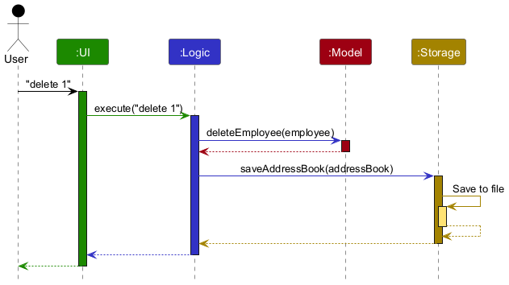

Each of the four main components (also shown in the diagram above),

* defines its *API* in an `interface` with the same name as the Component.
* provides its functionality through a concrete `{Component Name}Manager` class that implements the corresponding API interface.

For example, the `Logic` component defines its API in `Logic.java` and implements it in `LogicManager.java`. Other components interact with a component through its interface rather than its concrete class, preventing them from coupling to that component's implementation, as illustrated in the following partial class diagram.


The sections below give more details of each component.

### UI component

The **API** of this component is specified in [`Ui.java`](https://github.com/AY2627S1-CS2103T-T16-3/tp/tree/master/src/main/java/seedu/address/ui/Ui.java)

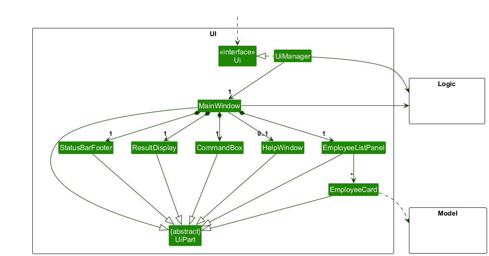

The UI consists of a `MainWindow` and its parts, such as `CommandBox`, `ResultDisplay`, `EmployeeListPanel`, and `StatusBarFooter`. All of these, including `MainWindow`, inherit from the abstract `UiPart` class, which captures common behavior among classes that represent visible GUI parts.

The `UI` component uses the JavaFX UI framework. The layouts of these UI parts are defined in matching `.fxml` files in `src/main/resources/view`. For example, [`MainWindow.fxml`](https://github.com/AY2627S1-CS2103T-T16-3/tp/tree/master/src/main/resources/view/MainWindow.fxml) specifies the layout of [`MainWindow`](https://github.com/AY2627S1-CS2103T-T16-3/tp/tree/master/src/main/java/seedu/address/ui/MainWindow.java).

The `UI` component,

* executes user commands using the `Logic` component.
* listens for changes to `Model` data so that the UI can be updated with the modified data.
* keeps a reference to the `Logic` component, because the `UI` relies on the `Logic` to execute commands.
* depends on some classes in the `Model` component because it displays `Employee` objects from the model.

### Logic component

**API** : [`Logic.java`](https://github.com/AY2627S1-CS2103T-T16-3/tp/tree/master/src/main/java/seedu/address/logic/Logic.java)

Here's a (partial) class diagram of the `Logic` component:


The sequence diagram below shows a successful `execute("delete 1")` call, including command parsing,
snapshot capture, and execution. The `Employee deletion cascade` reference frame expands the work inside
`Model#deleteEmployee` in the [employee deletion cascade](#employee-deletion-cascade) diagram. Here, `e` is the first
employee in the displayed list. Repeated command text is abbreviated with `...`, and unlabelled arrows into newly introduced
participant boxes are constructor calls. Formatting helpers, parser disposal, and the storage save between the
command result and the final return are omitted; see [save failures and model rollback](#save-failures-and-model-rollback).

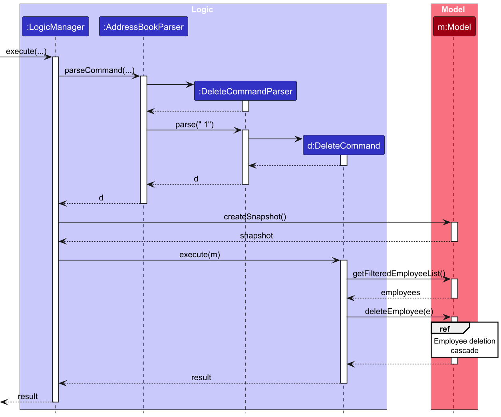

How the `Logic` component works:

1. When `Logic` is called upon to execute a command, the command is passed to an `AddressBookParser` object, which in turn creates a parser that matches the command (e.g., `DeleteCommandParser`) and uses it to parse the command.
1. This results in a `Command` object (more precisely, an object of one of its subclasses e.g., `DeleteCommand`) which is executed by the `LogicManager`.
1. The command reads the currently displayed employees from `Model`, validates the requested index, and passes the
   selected `Employee` to `Model#deleteEmployee`. The model removes that employee and their leave records.
1. The command returns a success `CommandResult` to `LogicManager`. `LogicManager` saves the updated address book
   before returning the result to the caller. The diagram shows this successful path only; a save failure instead
   restores the snapshot and reports an error.

Here are the other classes in `Logic` (omitted from the class diagram above) that are used for parsing a user command:

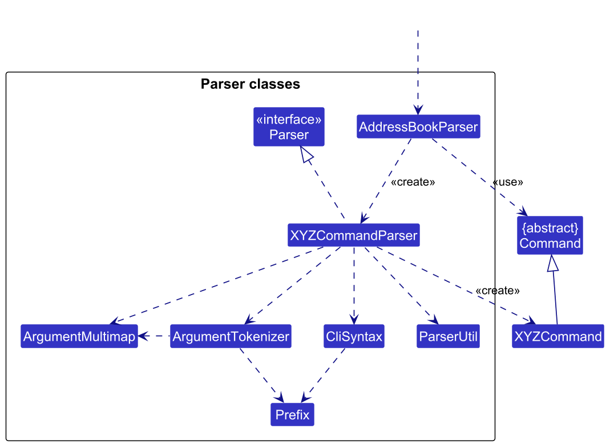

How the parsing works:
* For commands such as `add` and `delete`, `AddressBookParser` creates an `XYZCommandParser` (`XYZ` is a placeholder
  for a specific command, such as `AddCommandParser`). That parser uses the shared helpers to create an
  `XYZCommand`, which `AddressBookParser` returns as a `Command`.
* `XYZCommandParser` and `XYZCommand` are placeholders for command-specific classes. This partial diagram shows
  the direct parser-to-command pattern and shared helpers, not every parser or every helper dependency.
* Command-group parsers also implement `Parser`, but may delegate to another parser. The leave-specific view
  below shows this additional routing step without duplicating the concrete classes in the generic overview.

#### Leave command routing

This partial class diagram shows only the creation dependencies that distinguish the nested leave dispatcher.
The final creation of `AddLeaveCommand` and `DeleteLeaveCommand` by their argument parsers follows the generic
parser-to-command pattern above and is omitted here. Parser-interface realizations and shared helpers are also
omitted. Each `create` dependency identifies which class instantiates its target; it is not a stored reference.

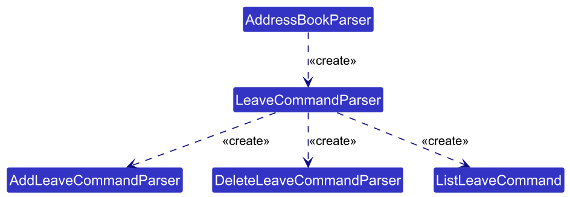

* `AddressBookParser` separates the `leave` command word and passes the remaining input to `LeaveCommandParser`.
* For `add`, `LeaveCommandParser` creates `AddLeaveCommandParser`, which validates the index syntax and date range
  before creating `AddLeaveCommand`. The command checks that the employee index exists when it executes.
* For `delete`, it creates `DeleteLeaveCommandParser`, which validates the public leave ID before creating
  `DeleteLeaveCommand`.
* For `list`, it creates `ListLeaveCommand` directly; there is no `ListLeaveCommandParser`. The subcommand must be
  spelled exactly, but arguments after it are ignored like those of other commands that take no parameters.
* Missing or unknown subcommands produce a `ParseException` with the available leave-command formats. Invalid
  add/delete arguments are rejected by their parsers. Commands are returned through the two routing layers to
  `LogicManager` for execution. See [leave management](#leave-management) for their execution behavior.

### Model component
**API** : [`Model.java`](https://github.com/AY2627S1-CS2103T-T16-3/tp/tree/master/src/main/java/seedu/address/model/Model.java)

The following partial class diagram shows the model's main interfaces, managers, and stored collections.
Employee details and leave identity are shown separately below to keep each view readable.

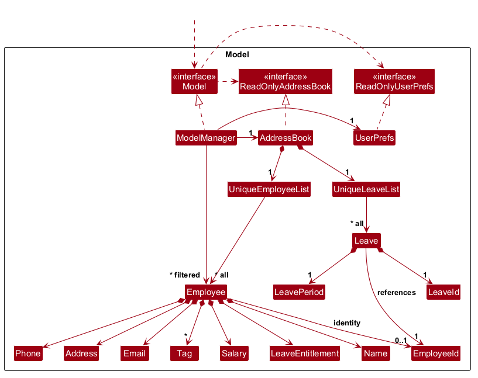

The `Model` component,

* stores employees in a `UniqueEmployeeList` and leave records in a separate `UniqueLeaveList`, both held by `AddressBook`.
* sorts employees using a JavaFX `SortedList<Employee>` and wraps it in a `FilteredList<Employee>` for display. `getFilteredEmployeeList()` exposes this unmodifiable observable view, so the UI receives filter, sort, and employee update notifications without changing the stored employee order.
* stores a `UserPrefs` object that represents the user’s preferences (currently, just the GUI settings). This is exposed to the outside as a `ReadOnlyUserPrefs` object.
* does not depend on any of the other three components (as the `Model` represents data entities of the domain, they should make sense on their own without depending on other components)

**Employee details**

The detail diagrams below use composition to express ownership within employee and leave records.

This partial class diagram shows the details owned by an `Employee`. Each employee has one name, phone number,
email address, postal address, salary, and annual leave entitlement, together with zero or more tags and tasks.
The employee's internal identifier is omitted here and shown in the leave identity diagram below.

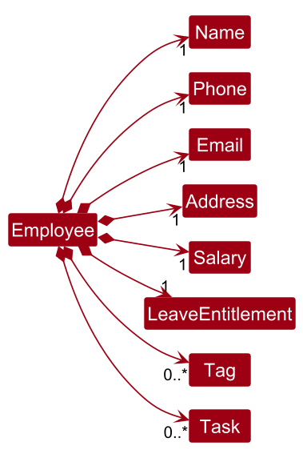

**Leave identity and records**

This partial class diagram shows how leave records identify their employee without holding an `Employee` reference.
An employee owns its assigned `EmployeeId`, and a leave record owns its `LeaveId`.
The ordinary association from `Leave` to `EmployeeId` links the leave to its employee.
`Leave` also has an ordinary association to `LeavePeriod` because separate leave records can share the same immutable
period object.

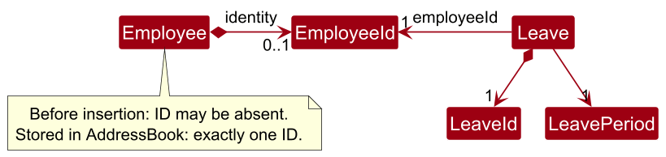

* `Employee` has `0..1` `EmployeeId` because `Employee.createUnassigned` creates an instance before its ID is allocated.
  Every employee stored in `AddressBook` has exactly one internal ID; the optional multiplicity describes all
  `Employee` instances, including those not yet added to the book.
* Each `Leave` has exactly one `EmployeeId`, one `LeaveId`, and one `LeavePeriod`. A leave belongs to the employee
  whose assigned `EmployeeId` contains the same integer identifier as the leave's `EmployeeId`.
  For example, two distinct `EmployeeId` objects containing `7` identify the same employee in that address book.
  The comparison uses `EmployeeId.equals`, not Java object identity, names, or displayed indexes.
  Multiple leave records may refer to the same employee.
* Employee replacements preserve their internal ID when details, salary, or tasks change, so leave records continue
  to identify the same employee. Loading a save file rejects leave records whose employee ID has no matching employee.

#### Employee deletion cascade

The following sequence diagram shows the interactions inside Model after the delete command has selected a valid
employee from the displayed list. Here, `e` is that employee and `id` is its assigned `EmployeeId`. Access to that ID
is omitted from the diagram. This expands the `Employee deletion cascade` reference frame in the
[Logic component](#logic-component) diagram. Its `m:Model` participant is the `m:ModelManager` instance shown here.
The caller is `DeleteCommand`; snapshot capture and saving are outside this view.

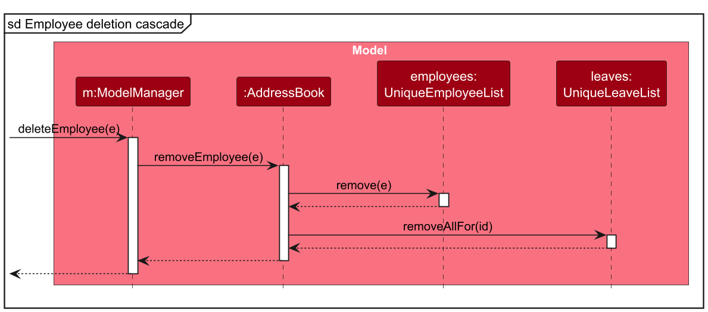

1. `ModelManager#deleteEmployee` delegates to `AddressBook#removeEmployee`.
2. `AddressBook` obtains the employee's ID and removes the employee from `UniqueEmployeeList`.
3. It calls `UniqueLeaveList#removeAllFor` with that ID. Every record with an equal `EmployeeId` value is removed;
   other employees' leave is retained. Having no matching leave records is valid.

`AddressBook` coordinates both removals; `Employee` does not invoke `Leave`. Object-destruction markers are omitted
because removal from a collection does not necessarily make an object unreachable; the snapshot may still refer to it.
The next successful save contains neither the employee nor their leave. A failed save instead restores both
collections from the snapshot, as described under [save failures and model rollback](#save-failures-and-model-rollback).

### Storage component

**API** : [`Storage.java`](https://github.com/AY2627S1-CS2103T-T16-3/tp/tree/master/src/main/java/seedu/address/storage/Storage.java)

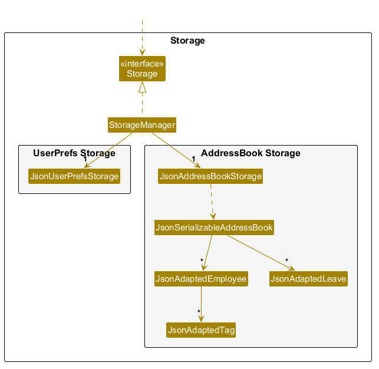

The `Storage` component,
* saves employee data, leave data, the next employee ID, the next leave ID, and user preferences in JSON format, and
  reads them back into corresponding model objects.
* is implemented by `StorageManager`, which delegates the actual JSON file access to `JsonAddressBookStorage` and `JsonUserPrefsStorage` (one class per data file).
* depends on some classes in the `Model` component (because the `Storage` component's job is to save/retrieve objects that belong to the `Model`)

`AppPaths` resolves data, preferences, and logs relative to the running JAR's parent folder, using its code-source
URI rather than the launch folder. Converting the URI to a `Path` preserves spaces and Unicode filenames.
When running unpackaged classes from an IDE or Gradle, the working folder remains the development home.
The resolver rejects absolute filenames and paths that climb out of the home folder.
`MainApp` uses it for both JSON files. `LogsCenter` uses it before creating the first log file and escapes
literal percent signs for `FileHandler`. If the log file cannot be opened, logging continues on the console.
Files outside the JAR's home folder are not imported automatically.

Saved address-book data is treated as untrusted input because files may be edited accidentally or modified maliciously.
Before deserializing the file, `JsonAddressBookStorage` scans its JSON tokens and rejects every explicit `null` with an
`IllegalValueException`, wrapped in a `DataLoadingException`. This applies to all employee and leave fields, internal
IDs and counters, nested task and tag data, array entries, unknown fields, and the root document itself. Validation
happens before deserialization can turn nulls into default values. Omitted fields retain their existing compatibility
defaults; an explicit `null` is always rejected. The quoted text `"null"` is a string rather than a JSON null and remains
subject to the existing field validation. This check applies to `hrbook.json`.
`MainApp` handles loading failures by creating an empty model and, after starting the UI, calling
`Ui#setFeedbackToUser`. `UiManager` forwards the message through `MainWindow` to the existing `ResultDisplay`,
identifying the data file and explaining recovery.
Neither loading nor closing the app rewrites the address-book file; the next successfully executed command saves the
current model. A missing file instead starts with sample data and does not show a loading error.

### Common classes

Classes used by multiple components are in the `seedu.address.commons` package.

--------------------------------------------------------------------------------------------------------------------

## **Implementation**

### Save failures and model rollback

After parsing a command, `LogicManager` captures a `ModelSnapshot` before execution. The model snapshot copies
the address book (including leave records and next-ID counters) and retains the employee filter and comparator.
If saving throws `IOException` or `AccessDeniedException`, Logic restores the snapshot through `Model` and
reports the existing save error. Restoration updates the existing observable collections, preserving UI bindings.
Snapshots rely on employee and leave values being immutable and on display predicates/comparators remaining unchanged.

`JsonAddressBookStorage` writes JSON directly to the destination using the original storage workflow.
Rollback restores memory only: a failed write can leave the destination incomplete or containing rejected data.
A later successful save in the same session writes the restored model, but restarting before that save does
not guarantee recovery. There are no backups or power-loss guarantees. Existing startup behavior opens an empty
address book after a data-loading error; a later save can overwrite the unreadable file.

`AddressBookSnapshotTest` covers independent copies, exhausted ID counters, and retained observable lists.
`ModelManagerTest` covers snapshot restoration and `LogicManagerTest` covers rollback after save errors.
Storage tests inject failures before writing and after a partial direct write. They verify model restoration
and that a later successful command saves only accepted changes.

#### Limits of the current save structure

* **Concurrency:** There is no cross-process lock or conflict detection. Multiple app instances or external edits
  can overwrite one another. Commands are assumed to execute serially.
* **Rollback scope:** The snapshot covers address-book data and employee display rules, not user preferences,
  GUI selection/scroll state, or external side effects. Model listeners can observe changes before save succeeds
  and notifications during restoration. This is not an isolated transaction across the UI and disk.
* **Exception scope:** Rollback handles save-time `IOException` (including access-denied errors). Runtime errors,
  memory exhaustion, partially mutating commands that throw before saving, or failure inside restoration are
  outside this guarantee. Even a failed save may already have changed the disk file.
* **Cost and snapshot assumptions:** Every parsed command takes a full snapshot, and successful commands still
  save the entire JSON file, including read-only commands such as help/list. Snapshot creation and restoration
  copy validated collections
  without repeating duplicate or leave-overlap checks. Copying is linear in the number of records; loading
  external data still performs full validation. Saving and observable-list updates remain synchronous.
  Shared employee/leave values must remain immutable, and
  stored predicate/comparator objects must not be mutated after snapshot capture.

See [save safety testing](Testing.md#save-safety-regression-and-stress-tests) for the tested cases and exclusions.

This section describes some noteworthy details on how certain features are implemented.

### Employee contact uniqueness

`Messages#getContactConflictMessage` reports every conflicting contact value and its existing employee
name. Both add and edit use this formatter; edit excludes its own target before checking conflicts.

Employees may share names, but cannot share a phone number or email address. `Employee#hasContactConflictWith`
checks for either contact conflict; email comparison ignores case and phone comparison uses the trimmed
stored digit string. This conflict relation is not transitive and is separate from internal employee IDs
and `Employee#equals`. `UniqueEmployeeList` enforces it when adding, replacing, and loading employees.
For edits, both the command and model exclude the target employee before checking every other employee,
including those hidden by a filter. This permits unchanged contact details while rejecting either
conflicting field, even when the other contact detail is unchanged. Loading a file with conflicting
contact details fails validation; existing data must satisfy the same uniqueness rules.

### Employee identifier allocation

`AddressBook` assigns each employee an internal positive integer ID from 1 to `Integer.MAX_VALUE`. The next-ID counter
is stored as a `long`, allowing `Integer.MAX_VALUE + 1` to represent an exhausted ID sequence without numeric overflow.
If an `add` command reaches this state, `AddressBook` throws `EmployeeIdExhaustedException`, which `AddCommand` converts
into a user-facing command error instead of allowing the exception to terminate command execution.

### Employee salary management

The `salary INDEX s/SALARY` command changes the monthly salary of the employee at the specified index in the
currently displayed list.

`AddressBookParser` routes the command to `SalaryCommandParser`. The parser rejects unsupported field prefixes
before validating the index and salary. It requires a positive index and exactly one `s/` field. `Salary` accepts
only digits representing an amount from 0 to 50000 inclusive and removes leading zeros.

At execution, the command follows these steps:

1. Retrieves the currently displayed employee list through `Model#getFilteredEmployeeList` and rejects an index
   outside its bounds.
2. Compares the employee's current salary with the requested salary. If they are equal, returns feedback that no
   changes were made, preserving the employee and displayed view. Leading zeros do not affect this comparison.
3. Otherwise, calls `Employee#withSalary` to create a replacement employee, preserving their internal ID, contact
   details, tags, tasks, and annual leave entitlement.
4. Replaces the original employee through `Model#setEmployee`.
5. Resets the filter to show all employees while retaining the active sort, and returns feedback identifying the
   employee and their old and new salaries.

`LogicManager` attempts to save after command execution, including when the salary is unchanged. If saving throws
`IOException`, it restores the model snapshot taken before execution, including the previous salary, filter, and
sort, and reports a save error. This restores the running application's state; it does not guarantee recovery of
the data file. See **Save failures and model rollback** for details.

### Address prefix escaping in add and edit

For the shared prefix and literal-slash rules, see [Filtering employees](#filtering-employees).
`ParserUtil#verifySupportedPrefixes` rejects unknown unescaped prefixes. Its error asks users to check
supported prefixes for a possible typo, or escape the slash if the token is literal address or task text.
`add` and `edit` run this check after validating required fields or the employee index, before parsing values.

Both command parsers pass the raw address value to
`ParserUtil#parseAddress`. That method calls `ParserUtil#unescapeSlashes`, trims surrounding whitespace,
and validates the decoded address. The command parsers must not decode the value first: each address
is decoded exactly once. The helper name is `unescapeSlashes` throughout the parsers.

### Filtering employees

The shared escaping rules are described in the [User Guide](UserGuide.html#escaping-prefix-like-text).
`AddCommandParser`, `EditCommandParser`, `AddTaskCommandParser`, and `FilterCommandParser` all use
`ParserUtil#verifySupportedPrefixes` with their own supported prefixes. `task add` allows `d/`;
`filter` derives its allowed prefixes from its field map. This keeps prefix detection and error hints
consistent without duplicating regular-expression checks.
Unescaped letter-plus-slash tokens at the start of input or after whitespace are treated as prefixes;
unknown prefixes are rejected. Writing `\/` keeps the slash literal during prefix detection.
`ParserUtil#unescapeSlashes` then replaces each escaped slash with `/` before storage or matching.

`FilterCommandParser` decodes address and task criteria after
argument tokenization, then validates those decoded values. Address criteria are checked directly with
`Address#isValidAddress`, rather than passed to `ParserUtil#parseAddress`, to avoid decoding twice.
`AddTaskCommandParser` uses the same `ParserUtil#unescapeSlashes` helper for task descriptions.

`filter` searches all stored employees using `EmployeeMatchesCriteriaPredicate` and combines all
supplied criteria with AND. `FilterCommandParser` validates field prefixes, rejects empty criteria
and repeated scalar fields, and uses `ParserUtil` to validate numeric thresholds. Salary thresholds
must be whole numbers from 0 to 50000; annual leave entitlement thresholds must be whole numbers
from 0 to 365. Leading zeroes are rejected for exact values, comparison thresholds, and both
endpoints of inclusive ranges in salary and annual leave entitlement filters. A single `0` is valid.
For example, `filter s/003000`, `filter le/>014`, and `filter s/03000-5000` are rejected.

Both numeric fields accept exact values (no operator), `<`, `<=`, `>`, and `>=`. The parser checks
for the two-character inclusive operators before splitting the operator from its amount. It rejects
missing thresholds and malformed operators such as `=`, `=<`, `=>`, or `<==` through the existing
field validation errors. `EmployeeMatchesCriteriaPredicate#matchesAmount` likewise checks inclusive
operators first, compares integer values, and includes equality only for `<=` and `>=` (or an exact
match). Leave filtering uses annual entitlement, irrespective of leave already taken.

`FilterCommand#execute` updates the model's filtered employee list and reports the number of matches.
For example, `filter s/<=4000 le/>=14` includes employees earning exactly 4000 with exactly 14 days
of entitlement, provided they satisfy both criteria. Employee records are unchanged.

`FilterCommandParserTest` covers all operators, valid limits, and invalid input.
`FilterCommandTest` exercises parsing through execution, checking equality at inclusive thresholds,
strict comparisons, limits (0/50000 salary and 0/365 days), and combinations with other criteria.

### Task management

Each `Employee` owns an ordered list of `Task` objects. Tasks are stored within employees rather than in a separate
collection. Deleting an `Employee` therefore removes its tasks without requiring separate task identifiers or
references. `Task` and `Employee` objects cannot be changed after they are created. Methods such as `Task#markDone`
and `Employee#updateTask` return new objects instead, preventing a task update from unexpectedly changing an object
used elsewhere in the application.

#### Command parsing

1. When `LogicManager` receives a task command, `AddressBookParser` delegates it to `TaskCommandParser`.
2. `TaskCommandParser` selects the parser for `list`, `add`, `delete`, `mark`, or `unmark`.
3. The selected parser parses and validates the arguments, then creates the corresponding task command.

The following sequence diagram illustrates how `task add 1 d/new` is successfully parsed into an `AddTaskCommand`.
Argument tokenization and invalid-input paths are omitted for clarity.

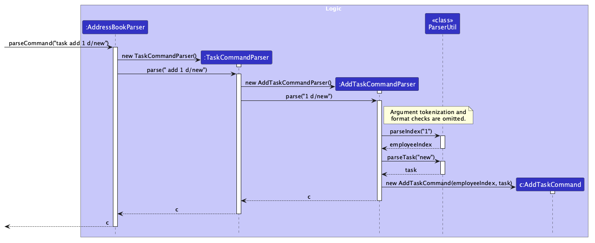

#### Command execution

1. Task commands use the one-based employee index to select an `Employee` from `Model#getFilteredEmployeeList`.
2. If the command targets a task, it uses the one-based task index to select a `Task` from `Employee#getTasks`.
3. `task list` only displays tasks. The other task commands update the selected employee in the `Model`.
4. After successful execution, `LogicManager` asks `Storage` to save the current address book, including each
   employee's tasks.

The following sequence diagram illustrates the successful execution of `AddTaskCommand`. `Employee#addTask` creates
a replacement `Employee`, which the command uses to update the `Model` before returning a `CommandResult`.

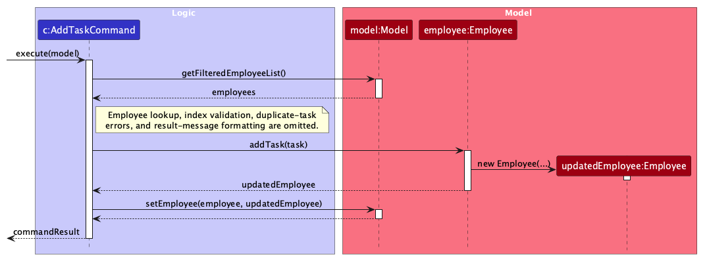

For a command that targets an existing task, suppose `find Alex` displays Alex first and Alex has at least two tasks.
When `task mark 1 i/2` runs, the command retrieves Alex's second `Task`, calls `Task#markDone`, and places the resulting
`Task` in a replacement `Employee`. It then updates the `Model` through `Model#setEmployee` while retaining the
filtered view.

#### Task validation

* During parsing, `TaskCommandParser` and the parser for the selected action reject incorrect command formats.
* During execution, the command rejects indexes outside the displayed employee list or the selected employee's task
  list.
* During task construction, the `Task` constructor rejects blank details and details longer than 120 characters.

`Employee#addTask` uses `Task#hasSameDetails` to reject duplicates. For this comparison, `Task#hasSameDetails`
trims the details, replaces repeated whitespace with a single space, and ignores letter case. The original details
remain unchanged for display.

#### Task storage

`JsonAdaptedTask` stores the `details` and `isDone` fields. When loading data, `JsonAdaptedTask#toModelType`
reconstructs the `Task` from these fields and restores its completion status. It rejects a saved task if its details
are missing, blank, or longer than 120 characters. `JsonAdaptedEmployee#toModelType` checks for duplicate tasks with
`Task#hasSameDetails` before constructing the `Employee`. As a result, invalid tasks cannot be loaded from storage.

### Sorting displayed employees

`sort FIELD/ORDER` orders the current displayed list without changing its filter or the stored employee order.
`AddressBookParser` dispatches the command to `SortCommandParser`, which requires exactly one supported
prefix (`n/`, `p/`, `e/`, `a/`, `s/`, or `le/`) and the lowercase direction `asc` or `des`.
Missing values, unknown fields, unsupported directions, extra arguments, and multiple fields are rejected
with `SortCommand.MESSAGE_USAGE`. Tags and tasks are not sortable because each employee can have multiple values.

`SortCommand` stores a `Field` enum and an ascending flag. At execution time it creates a comparator:

* Name, email, and address use `String.CASE_INSENSITIVE_ORDER`.
* Salary and annual leave entitlement use integer comparison. Leave sorting uses annual entitlement,
  rather than remaining leave or leave dates.
* Phone numbers use `BigInteger` comparison, supporting differing digit lengths, leading zeros,
  and numbers too large for primitive integer types.
* Descending order reverses the field comparator. Tied values use the order maintained by the shared sorted view.

The model maintains this observable transformation chain:

`AddressBook.getEmployeeList()` → `SortedList<Employee>` → `FilteredList<Employee>` → UI

`ModelManager.sortFilteredEmployeeList` sets the comparator on the existing sorted view.
`getFilteredEmployeeList()` returns the existing filtered view of that list, preserving references held by the UI and logic.
The filter predicate is unchanged, hidden employees stay hidden, and an empty list can be sorted normally.
Employee updates propagate through the chain, so changing a salary repositions the employee as needed.
Index-based commands read the sorted view and therefore act on the employee at the displayed index.

The comparator remains active across `find`, `filter`, `list`, and employee changes until another sort replaces it.
`list` clears the filter but retains the sort. Sorting is display state only: no JSON fields or stored
employee order are changed. The usual save after command execution still occurs. Restarting creates a
new sorted view without a comparator and restores the stored employee order.

A sorted observable view was chosen over sorting the address book in place to preserve stored order,
and over copying the visible list to keep subsequent edits and filter changes observable.
`SortCommandParserTest` covers field/direction validation. `SortCommandTest` covers both directions for
all supported fields, numeric ordering, long and padded phone numbers, ties, filtered/empty lists,
shared view references, unchanged stored order, and index-based salary changes and deletion after sorting.

The following sequence diagram illustrates a successful `sort s/asc` command. It shows parsing,
command execution, and the comparator update on the existing sorted view. The usual storage save
is omitted from the diagram for clarity.

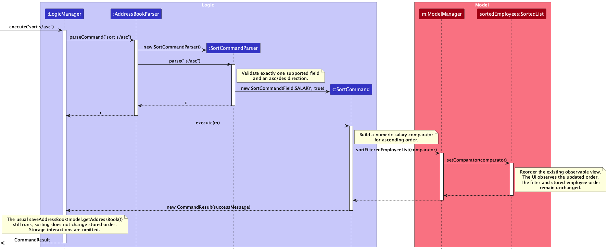

### Workforce summary

The `summary` command (alias `/summary`) produces a read-only overview of employees in the selected scope:
headcount, employees without tags, employee counts by tag, assigned tasks, employees with tasks, saved leave records,
and total/average recorded salary.

The partial class diagram below shows how scope selection, aggregation, and table formatting are separated.
Dashed arrows indicate usage (`use`) or creation (`create`) dependencies; only members relevant to the summary are shown.

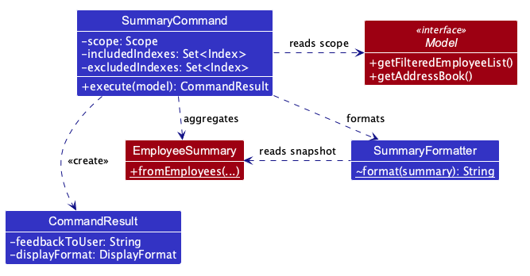

`AddressBookParser` routes the `summary` command and its `/summary` alias to `SummaryCommandParser`.
The parser accepts an optional
`scope/all` or `scope/filtered` followed by optional `i/` and `e/` whitespace-separated index lists.
`ArgumentTokenizer` separates the two prefixes, and `ParserUtil.parseIndex` validates positive integers.
Each prefix may occur once; repeated indexes are deduplicated. Malformed inputs report usage errors,
while repeated prefixes use the shared duplicate-prefix error.
The command stores a `SummaryCommand.Scope` enum and immutable inclusion/exclusion index sets.
It resolves employees when it executes so it uses the latest employee data, filter, and sort order.
Indexes are resolved against the current list, rather than an outdated list captured during parsing.
The command reads
`model.getFilteredEmployeeList()` for the default/filtered scope, or
`model.getAllEmployeesInDisplayOrder()` for explicit `scope/all`. The latter returns an immutable copy of the full
employee list in display order by copying the shared `SortedList` before filtering.
It changes neither the active filter nor the underlying stored order. Both scopes use the same ordering for tied
values, including after repeated sorts. Without an active sort, the full list follows stored order.
Indexes refer to positions in the chosen employee list.
Every supplied index is checked against its current size; out-of-range indexes throw `CommandException`.
An empty inclusion set selects everyone, and exclusions take precedence over inclusions. The resulting collection is
passed to `EmployeeSummary.fromEmployees` together with `model.getAddressBook().getLeaveList()`, so all
statistics share the same employee selection. The command labels
the multiline result `Scope: All employees` or
`Scope: Filtered employees`, followed by any inclusion/exclusion lists in ascending order.
Empty selections remain empty; no fallback or filter mutation occurs.
`SummaryFormatter` renders the essential figures as ASCII tables with dynamically sized columns and
right-aligned values. The tag table is omitted when there are no tags. Explanatory notes remain in the User Guide.
`CommandResult.DisplayFormat.TABLE` carries the presentation choice to `ResultDisplay`, which applies
the `table` CSS pseudo-class for a monospaced font. Ordinary feedback and errors restore the normal font.
No new window or storage fields are needed.

`EmployeeSummary.fromEmployees` calculates the totals, while `SummaryFormatter` formats the tables.
Keeping these separate lets developers change the presentation without changing or repeating the calculations.
The resulting `EmployeeSummary` is immutable:

* Each stored employee contributes once to the total; an empty tag set contributes to the untagged count.
* Tag names are lowercased using `Locale.ROOT`, avoiding dependence on the system locale.
* Normalized tags are deduplicated per employee before counting, so case variants on one employee
  do not inflate that tag's count. Different tag groups may overlap.
* A `TreeMap` provides alphabetical ordering. `EmployeeSummary` exposes an unmodifiable copy of the counts.
* An empty input produces zero counts. If no tags exist, the formatter omits the tag table.

Aggregation is recomputed on each invocation, without stored counters, new JSON fields, or changes to
employees, tags, user preferences, or the current filter. The existing application-wide automatic
save after command execution remains unchanged.

Tests cover the `summary` command and its `/summary` alias, valid and invalid selections, filtered and sorted
views, empty results, and accurate tag, task, leave-record, and salary totals. They also check that commands
use current data and preserve employee records and filters. Computed `EmployeeSummary` values must remain
unchanged after later record updates.
Presentation tests check table alignment and restoration of the normal feedback font.

#### Leave-record counts

`EmployeeSummary.fromEmployees(employees, leaves)` builds a set of the selected employees' stable IDs,
then counts each leave record whose employee ID belongs to that set. Employee names and displayed indexes
are not used to match records. Employees without an ID contribute no leave records.
This takes O(E + L) time for E selected employees and L stored leave records.

Each saved period counts once regardless of its duration, year, or whether it is in the past or future.
The result is stored as a `long` in `EmployeeSummary` and displayed as `Leave records`.
Empty selections and selections without matching records produce zero.
`fromEmployees(employees)` delegates to `fromEmployees(employees, List.of())`, using an empty leave list.
Neither factory retains or changes the input lists.
The existing leave records are the source of truth after restart: the count is recalculated rather than
saved separately. Changes to leave or employee records are reflected the next time `summary` runs.

#### Task counts

`EmployeeSummary` captures the sum of `Employee.getTasks().size()` as a `long`, the number of employees
with nonempty task lists, and the maximum per-employee task count in the same pass as tag aggregation.
Employees without tasks are derived from headcount minus employees with tasks. Empty input yields
zero for all task statistics; identical descriptions on different employees count separately.

`SummaryFormatter` displays assigned tasks and employees with tasks in the metrics table, even when
there are no tags. Derived counts and per-employee maxima remain available in `EmployeeSummary` but are not displayed.
`EmployeeSummary` contains only derived aggregate values and does not retain employee records.
Its values remain unchanged when source records are replaced.

#### Salary statistics

`EmployeeSummary` also captures salary statistics from the same employee collection. Its private
`IntSummaryStatistics` is constructed locally and never exposed or modified after `EmployeeSummary` is created.
The total is a `long`; minimum and maximum are `OptionalInt` values, empty for an empty collection.
The average is an optional `BigDecimal`, calculated directly from the integer total and employee count
with scale 2 and `RoundingMode.HALF_UP`, without converting to floating point. Zero salaries are included.

`SummaryFormatter` displays total and average salary in the metrics table. An empty collection displays
`$0.00` for the total and `N/A` for the average. Minimum and maximum remain available in `EmployeeSummary`
but are not displayed.

### Leave management

The leave feature is implemented as a `leave` command group with the `add`, `list`, and `delete` subcommands.

The nested parser structure is described under [leave command routing](#leave-command-routing).

#### Recording leave

`leave add INDEX from/START_DATE to/END_DATE` follows this flow:

1. `AddLeaveCommandParser` parses a displayed employee index and two `DD-MM-YYYY` dates into an `Index` and immutable
   `LeavePeriod`. Dates use exactly four year digits and accept valid past and future dates in years `0001` to `9999`;
   year `0000` is rejected.
2. `AddLeaveCommand` resolves the index against `Model#getFilteredEmployeeList`. This lets a user run `find` or
   `filter` before selecting an employee without exposing the employee's internal ID.
3. `AddressBook#addLeave` finds the employee through its internal `EmployeeId`, rejects an overlapping period, and
   checks the requested weekdays against the employee's remaining entitlement for that year.
4. The model creates the record with the next `LeaveId`, adds it to `UniqueLeaveList`, and increments the leave ID
   counter.
5. The command reports the assigned leave ID, employee name and email, period, charged weekdays, and recalculated
   balance.

The following sequence diagram shows successful leave creation inside Model. It starts at `AddressBook#addLeave`,
called through `ModelManager` after the command has resolved a valid displayed employee index. The request has no
overlap, fits within the remaining entitlement, and has an available leave ID. Parsing, UI feedback, saving, and
getter calls are outside this view. The nested activation bar shows that `getWorkingDaysUsed` is called inside
`calculateRemainingLeave`, before that helper returns the balance.

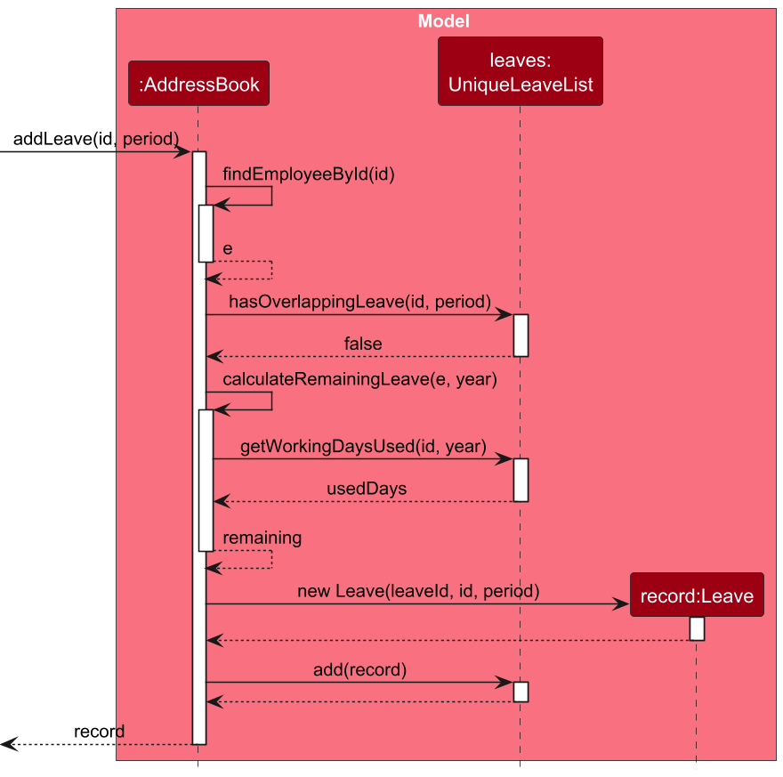

Here, `id` is the selected employee's internal ID, `period` is the validated date range, and `e` is the employee found
by that ID. `year` comes from the period; `remaining` is the result of `calculateRemainingLeave`.
An overlapping period or a request exceeding that balance instead terminates `addLeave` with
`OverlappingLeaveException` or `InsufficientLeaveException`, respectively. `AddLeaveCommand` converts the exception
into a user-facing error. Neither rejection changes the leave list or consumes a leave ID. These failure paths are
omitted from the diagram.

`leaveId` is constructed from `AddressBook.nextLeaveId` before the `Leave` constructor runs; after `add(record)`
succeeds, `nextLeaveId` advances. These value-object and counter steps are omitted from the diagram.
An exhausted counter instead raises `LeaveIdExhaustedException` before record creation,
which the command also converts into an error. The command recalculates the balance after a successful return.

`LeavePeriod` enforces an inclusive, ordered range within one calendar year. It counts Mondays to Fridays and requires
at least one such day. Public holidays are not excluded, so a public holiday on a weekday is
charged as a working leave day. Overlap detection uses every calendar date in the inclusive range, not only charged
weekdays.

Remaining leave is derived as:

`max(0, annual entitlement - recorded working leave days in that calendar year)`

This avoids a second mutable balance that could drift out of sync. An employee's annual entitlement is compulsory when
the employee is added, is editable, and accepts whole numbers from 0 to 365. `ParserUtil#parseLeaveEntitlement`
accepts digit-only input with leading zeros and removes that padding before constructing `LeaveEntitlement`; an
all-zero input is normalized to 0. Validation of the normalized value still rejects entitlements outside 0 to 365.
For backward compatibility, employees in older data files with no entitlement load with an entitlement of 0.

#### Listing and deleting leave

`leave list` reads the currently filtered employee list from `Model` and uses `Model#getRemainingLeave` to report
each employee's balance for `LocalDate.now(clock).getYear()`, in displayed employee order. Each balance line shows the
employee's current name and email, which distinguish employees who share a name. Employees without leave
in that year retain their full entitlement. An empty employee view returns `No employees displayed.`
The command then collects the displayed employees' internal IDs and retains only matching records from the central
leave list, including records from other years. It sorts the records by `LeaveId`, resolves each
internal employee ID to the employee's current name and email, labels the number `Leave ID`, and returns a multiline
result. Consequently, `find` and `filter` also scope the following `leave list`, while running `list` first restores
an all-employee scope. The status is derived
using `LocalDate.now(clock)` on every invocation. Production commands use the system-default clock, while tests inject
a fixed clock for deterministic status checks:

* `Upcoming` when today is before the start date.
* `Past` when today is after the end date.
* `Ongoing` otherwise, including a weekend contained within the recorded period.

Balances and statuses are derived for display and are not persisted.

`leave delete LEAVE_ID` removes one record by its stable leave ID. The result shows the employee's current name and
email. The leave ID counter is not decremented, so the deleted leave ID is not reused while the current address book
remains in use. No balance mutation is required; the next balance calculation automatically excludes the deleted
record.

`ClearCommand` has broader semantics than deleting records individually. It replaces the model data with a new
`AddressBook`, removing all employee and leave records and resetting both identifier counters to 1. Employee and leave
IDs used before `clear` may therefore be assigned again in the fresh address book.

Employee deletion removes all the employee's leave records, following the
[employee deletion cascade](#employee-deletion-cascade). During bulk replacement, `removeOrphanedLeaves` provides
the equivalent referential-integrity safeguard. Storage
loading rejects leave records that refer to an unknown employee, overlap another record for the same employee, or
use invalid identifiers or periods.

#### Design considerations

**Aspect: Where leave records are stored**

* **Alternative 1 (current choice):** Store leave records in one central `UniqueLeaveList`, linked by `EmployeeId`.
  * Pros: IDs, overlap checks, chronological status, persistence, and listing all leave have one source of truth.
  * Cons: Employee names must be resolved when displaying leave and referential integrity must be enforced explicitly.
* **Alternative 2:** Store a leave list inside each `Employee`.
  * Pros: An employee and their leave are naturally grouped.
  * Cons: Listing and identifying leave across the workforce becomes more complex, and editing an employee risks
    replacing or duplicating nested leave state.

**Aspect: How users identify records**

* Employees use the displayed list index because users already rely on that workflow for edit and delete operations.
* Leave records use a stable, public `LeaveId` because their position in a workforce-wide list must not change the
  target of a later delete command.

--------------------------------------------------------------------------------------------------------------------

## **Documentation, logging, testing, dev-ops**

* [Documentation guide](Documentation.md)
* [Testing guide](Testing.md)
* [Logging guide](Logging.md)
* [DevOps guide](DevOps.md)

--------------------------------------------------------------------------------------------------------------------

## **Appendix: Requirements**

### Product scope

**Target user profile**:

* HR officer who has to manage a significant number of employee contacts by themselves
* HR officer who needs to maintain employee contact details, recorded monthly salaries, annual leave records, and assigned tasks
* HR officer who is reasonably comfortable using CLI apps and types fast compared to using mouse interactions

**Value proposition**: Helps HR officers maintain and retrieve employee information, record annual leave, and track assigned tasks through keyboard commands in one desktop application.

### User stories

Priorities: High (must have) - `* * *`, Medium (nice to have) - `* *`, Low (unlikely to have) - `*`

| Priority | As a …​                    | I want to …​                                                                   | So that I can…​                                                                          |
|----------|----------------------------|--------------------------------------------------------------------------------|------------------------------------------------------------------------------------------|
| `* * *`  | First time user of HR Book | see usage instructions                                                         | refer to instructions when I forget how to use the App and learn its capabilities        |
| `* * *`  | HR Officer                 | edit employee contact details and annual leave entitlement                     | keep employee records up to date                                                         |
| `* * *`  | HR Officer                 | add a new employee profile with an annual leave entitlement                    | record a new hire and enforce their leave allowance                                      |
| `* * *`  | HR Officer                 | record a task assigned to me concerning an employee                            | remember work I need to complete concerning that employee                                |
| `* * *`  | HR Officer                 | view tasks assigned to me concerning an employee                               | review work related to that employee                                                     |
| `* * *`  | HR Officer                 | delete a task assigned to me concerning an employee                            | remove obsolete or unnecessary work                                                      |
| `* * *`  | HR Officer                 | mark a task assigned to me as completed or pending                             | keep its completion state accurate                                                       |
| `* * *`  | HR Officer                 | record an employee's leave                                                     | track used and remaining annual leave                                                    |
| `* * *`  | HR Officer                 | view remaining annual leave without recording or cancelling leave              | check an employee's available allowance before entering a request                         |
| `* * *`  | HR Officer                 | list all leave with its current status                                         | see upcoming, ongoing, and past absences                                                 |
| `* * *`  | HR Officer                 | cancel a recorded leave                                                        | correct mistakes and restore the employee's available leave                              |
| `* * *`  | HR Officer                 | delete an employee profile and their tasks and leave records                   | remove former employees without retaining orphaned data                                 |
| `* * *`  | HR Officer                 | filter through a list of employees                                             | easily find employees that match specific criteria                                      |
| `* * *`  | HR Officer                 | change an employee's salary                                                    | keep employee salary records up to date                                                  |
| `* * *`  | HR Officer                 | view an employee's salary                                                      | check their current pay when handling payroll enquiries                                  |
| `* * *`  | HR Officer                 | view employee, task, leave-record, and salary totals for selected employees      | review the workforce without checking each employee separately                           |
| `* *`    | HR Officer                 | have local storage for employee contact and details                            | retain employee information between application sessions                       |
| `* *`    | HR Officer                 | have employee data saved automatically after each successfully executed command | retain my changes between sessions without saving manually                              |
| `*`      | Experienced HR Officer     | tag employees together                                                         | easily group employees based on similar tags                                             |

### Use cases

(For all use cases below, the **System** is the `HR Book` and the **Actor** is the `HR manager`, unless specified otherwise)

**Use case: UC1 - Add an employee**

**MSS**

1. HR manager requests to add an employee, providing the employee's details and annual leave entitlement.
2. System adds the employee and saves the employee information.
3. System displays the added employee and confirms that the employee was added.

    Use case ends.

**Extensions**

* 1a. The HR manager does not provide one or more required fields.

    * 1a1. System informs the HR manager to provide all required fields.
    * 1a2. System does not add the employee.

      Use case ends.

* 1b. The HR manager repeats a field that may only be specified once.

    * 1b1. System informs the HR manager that the field cannot be repeated.
    * 1b2. System does not add the employee.

      Use case ends.

* 1c. One or more provided employee details are invalid.

    * 1c1. System informs the HR manager that the details are invalid.
    * 1c2. System does not add the employee.

      Use case ends.

* 1d. The provided phone number or email address is already used by an existing employee.

    * 1d1. System informs the HR manager that another employee already uses the phone number or email address.
    * 1d2. System does not add the employee.

      Use case ends.

* 2a. An error occurs while saving employee information into storage.

    * 2a1. System informs the HR manager that the employee could not be added.
    * 2a2. System does not add the employee.

      Use case ends.

**Use case: UC2 - Delete employee**

**MSS**

1.  HR manager requests to list employees.
2.  System displays the list of employees.
3.  HR manager requests to delete a specific employee using the employee's displayed index.
4.  System deletes the selected employee and all tasks and leave records belonging to that employee.
5.  System confirms that the employee has been deleted.

    Use case ends.

**Extensions**

* 2a. The list is empty.

    * 2a1. System displays an empty employee list.

      Use case ends.

* 3a. The provided index is invalid.

    * 3a1. System informs the HR manager that the index is invalid.

      Use case resumes at step 3.

**Use case: UC3 - Add employee task**

**MSS**

1. HR manager requests to add a task to an employee and provides the task details.
2. System adds the task to the employee as pending.
3. System confirms that the task was added.

    Use case ends.

**Extensions**

* 1a. System cannot identify the selected employee.

    * 1a1. System informs the HR manager that the employee selection is invalid.
    * 1a2. System does not add the task.

      Use case ends.

* 1b. The provided task details are invalid.

    * 1b1. System informs the HR manager that the task details are invalid.
    * 1b2. System does not add the task.

      Use case ends.

* 1c. An equivalent task already exists for the employee.

    * 1c1. System informs the HR manager that the task already exists.
    * 1c2. System does not add the task.

      Use case ends.

**Use case: UC4 - Delete employee task**

**MSS**

1. HR manager requests to delete a task from an employee.
2. System deletes the selected task.
3. System confirms that the task was deleted.

    Use case ends.

**Extensions**

* 1a. System cannot identify the selected employee.

    * 1a1. System informs the HR manager that the employee selection is invalid.

      Use case ends.

* 1b. System cannot identify the selected task.

    * 1b1. System informs the HR manager that the task selection is invalid.

      Use case ends.

**Use case: UC5 - Find employees by name**

**MSS**

1. HR manager requests to find employees by providing one or more name keywords.
2. System identifies employees whose names contain any of the supplied keywords, using case-insensitive whole-word matching.
3. System displays the matching employees and the number of matches.

    Use case ends.

**Extensions**

* 1a. HR manager does not provide any search keywords.

    * 1a1. System informs the HR manager of the valid command format, which requires at least one keyword.
    * 1a2. System keeps the currently displayed employee list.

      Use case ends.

* 2a. No employees match any of the supplied keywords.

    * 2a1. System displays an empty employee list and reports zero matches.

      Use case ends.

**Use case: UC6 - Filter employees**

**MSS**

1. HR manager requests to filter employees that meets a certain criteria(s)
2. System identifies employees who match all supplied criteria.
3. System displays the matching employees and the number of matches.

    Use case ends.

**Extensions**

* 1a. The HR manager does not provide any criteria.

    * 1a1. System informs the HR manager that at least one criterion is required.
    * 1a2. System keeps the currently displayed employee list.

      Use case ends.

* 1b. The HR manager provides an unsupported field prefix.

    * 1b1. System informs the HR manager of the valid command format.
    * 1b2. System keeps the currently displayed employee list.

      Use case ends.

* 1c. The HR manager repeats a field that may appear only once, such as name or salary.

    * 1c1. System informs the HR manager that the field cannot be repeated.
    * 1c2. System keeps the currently displayed employee list.

      Use case ends.

* 1d. The HR manager provides an invalid salary value.

    * 1d1. System informs the HR manager that salary must be a whole number from 0 to 50000.
    * 1d2. System keeps the currently displayed employee list.

      Use case ends.

* 1e. The HR manager provides an empty criterion.

    * 1e1. System informs the HR manager that supplied criteria must not be empty.
    * 1e2. System keeps the currently displayed employee list.

      Use case ends.

* 2a. No employees match all supplied criteria.

    * 2a1. System displays an empty employee list and reports zero matches.

      Use case ends.

**Use case: UC7 - Record employee leave**

**MSS**

1.  HR manager requests to record a leave period for an employee selected by their displayed index, providing the
    start and end dates.
2.  System records the leave period and assigns it a unique leave ID.
3.  System displays the recorded leave, the employee's name and email, and their remaining leave for the relevant
    calendar year.

    Use case ends.

**Extensions**

* 1a. The request is missing required information or contains duplicated or unrecognized information.

    * 1a1. System informs the HR manager that the request is invalid.
    * 1a2. System does not record the leave.

      Use case ends.

* 1b. The provided employee index is invalid.

    * 1b1. System informs the HR manager that the displayed index is invalid.
    * 1b2. System does not record the leave.

      Use case ends.

* 1c. Either provided date is not a valid calendar date.

    * 1c1. System informs the HR manager that the provided date is invalid.
    * 1c2. System does not record the leave.

      Use case ends.

* 1d. The start date is later than the end date.

    * 1d1. System informs the HR manager that the date range is invalid.
    * 1d2. System does not record the leave.

      Use case ends.

* 1e. The start and end dates are in different calendar years.

    * 1e1. System informs the HR manager that the leave period must fall within one calendar year.
    * 1e2. System does not record the leave.

      Use case ends.

* 1f. The leave period does not contain any working day.

    * 1f1. System informs the HR manager that the leave period must contain at least one working day.
    * 1f2. System does not record the leave.

      Use case ends.

* 1g. The specified leave period overlaps an existing leave period belonging to the employee.

    * 1g1. System informs the HR manager about the overlapping leave period.
    * 1g2. System does not record the leave.

      Use case ends.

* 1h. The employee does not have sufficient remaining leave for the specified period.

    * 1h1. System informs the HR manager of the employee’s remaining leave and the number of leave days required.
    * 1h2. System does not record the leave.

      Use case ends.

* 2a. System is unable to save the leave information.

    * 2a1. System informs the HR manager that the leave could not be recorded.
    * 2a2. System leaves all existing employee and leave information unchanged.

      Use case ends.

**Use case: UC8 - List employee leave**

**MSS**

1. HR manager requests leave balances and records for the currently displayed employees.
2. System displays current-year remaining balances, followed by matching leave records in leave ID order, including
   the employee name and email, dates, charged working days, and status relative to today's date.

    Use case ends.

**Extensions**

* 2a. Employees are displayed, but none has a leave record.

    * 2a1. System displays their current-year balances and informs the HR manager that no leave records were found.

      Use case ends.

* 2b. No employees are displayed.

    * 2b1. System informs the HR manager that no employees are displayed.

      Use case ends.

**Use case: UC9 - Delete employee leave**

**MSS**

1. HR manager lists leave records to obtain a leave ID.
2. HR manager requests to delete the record using its leave ID.
3. System deletes the leave record and displays the employee's name, email, and recalculated remaining leave for that
   year.

    Use case ends.

**Extensions**

* 2a. The leave ID is malformed, zero, or negative.

    * 2a1. System informs the HR manager that the command is invalid and displays the correct usage.
    * 2a2. System leaves all employee and leave information unchanged.

      Use case ends.

* 2b. The leave ID is a valid positive integer, but no matching record exists.

    * 2b1. System informs the HR manager that no leave record was found with that leave ID.
    * 2b2. System leaves all employee and leave information unchanged.

      Use case ends.

**Use case: UC10 - Sort employees**

**MSS**

1. HR manager requests to sort the currently displayed employees by one supported field
   (name, phone number, email, address, salary, or annual leave entitlement) in ascending or descending order.
2. System displays the employees in the requested order and confirms the sort.
   Name, email, and address are sorted alphabetically, ignoring case;
   phone number, salary, and annual leave entitlement are sorted numerically.
   Any active filter remains applied.

    Use case ends.

**Extensions**

* 1a. The request omits the sort field or order, specifies an unsupported field or order,
  or specifies more than one sort criterion.

    * 1a1. System informs the HR manager that the command is invalid and displays the correct usage.
    * 1a2. System leaves the displayed employee order and active filter unchanged.

      Use case ends.

* 2a. The currently displayed employee list is empty.

    * 2a1. System confirms the sort and keeps the displayed list empty without restoring filtered-out employees.

      Use case ends.

**Use case: UC11 - Change an employee's salary**

**MSS**

1. HR manager identifies an employee and requests to change their salary to a specified amount.
2. System changes the employee's salary and confirms the change.

   Use case ends.

**Extensions**

* 1a. The HR manager omits required information.

    * 1a1. System informs the HR manager of the required command format.
    * 1a2. System leaves the employee's salary unchanged.

    Use case ends.

* 1b. The HR manager provides an invalid salary.

    * 1b1. System informs the HR manager that the salary is invalid and states the accepted format and range.
    * 1b2. System leaves the employee's salary unchanged.

    Use case ends.

* 1c. The HR manager provides unsupported information.

    * 1c1. System informs the HR manager that only the salary field is accepted.
    * 1c2. System leaves the employee's salary unchanged.

    Use case ends.

* 1d. The HR manager specifies the salary more than once.

    * 1d1. System informs the HR manager that the salary field cannot be repeated.
    * 1d2. System leaves the employee's salary unchanged.

    Use case ends.

* 1e. The HR manager provides an invalid employee selection.

    * 1e1. System informs the HR manager that the command format or employee selection is invalid.
    * 1e2. System leaves all employee salaries unchanged.

    Use case ends.

* 2a. The employee already has the requested salary.

    * 2a1. System informs the HR manager that no change is needed.

    Use case ends.

* 2b. System cannot save the salary change.

    * 2b1. System leaves the employee's salary unchanged.
    * 2b2. System informs the HR manager that the change could not be saved.

    Use case ends.

**Use case: UC12 - View workforce summary**

**Guarantees**

* Employee data and the current filter remain unchanged in all flows.

**MSS**

1. HR manager requests a summary of the displayed employees or all employees, optionally including or excluding indexes within that scope.
2. System displays employee, tag, task, and leave-record counts, plus total and average salary for the selected employees.

   Use case ends.

**Extensions**

* 1a. The HR manager provides an invalid scope or malformed selection.

    * 1a1. System reports the input error.

      Use case ends.

* 1b. A provided index is outside the chosen scope.

    * 1b1. System identifies the invalid index and shows the valid index range, or indicates that there are no valid indexes.

      Use case ends.

* 2a. The chosen scope is empty or all its employees are excluded.

    * 2a1. System displays zero counts, a total salary of `$0.00`, and an average salary of `N/A`.

      Use case ends.

### Non-Functional Requirements

1.  HR Book should work on any _mainstream OS_ as long as it has Java `25` installed.
2.  HR Book should be able to hold up to 1000 employees.
3.  Users should be able to execute all documented commands from the command box without using the mouse. The mouse
    may still be used to inspect or scroll through results.
4.  With up to 1000 employee records stored, each documented command should have a response time of at most 2 seconds.
5.  HR Book should be able to carry out its functionality without internet access, except for accessing the online
    User Guide.


### Glossary

* **Displayed index**: A temporary number shown beside an employee in the current list, used to select that employee in
  commands; it can change when the displayed list or its ordering changes
* **Employee**: A staff member whose employment, contact, salary, leave, and related task information is managed in
  HR Book
* **Employee attribute**: A stored field such as an employee's name, phone, email, address, salary, annual leave
  entitlement, tag, or task details
* **Employee ID**: A private, stable identifier used internally to associate leave with an employee; users do not enter
  it in commands
* **Equivalent tasks**: Tasks concerning the same employee whose details match after ignoring capitalization,
  surrounding whitespace, and repeated whitespace
* **HR Book**: The application used by HR managers to manage employee records and routine administrative work
* **HR manager**: The primary user of HR Book who manages employee records, salaries, leave information, and their own
  assigned tasks concerning employees
* **Leave**: A period of absence recorded for an employee and counted against their leave entitlement
* **Leave ID**: A public, stable positive integer identifying one leave record, shown by `leave list` and used by
  `leave delete`
* **Mainstream OS**: Windows, Linux, Unix, or macOS
* **Response time**: The time from pressing Enter until a command finishes and its result is displayed (or the app closes
  for `exit`), averaged over five runs
* **Task**: A work item assigned to the HR manager concerning a particular employee, consisting of task details and a
  completion state of pending or completed
* **Task index**: A temporary, one-based number shown beside a task in one employee's task list and used to select that
  task; it can change when an earlier task is deleted
* **Working day**: A Monday through Friday counted against annual leave entitlement; public holidays are not excluded

--------------------------------------------------------------------------------------------------------------------

## **Appendix: Instructions for Manual Testing**

Given below are instructions to test the app manually.

<div markdown="span" class="alert alert-info">:information_source: **Note:** These instructions only provide a starting point for testers to work on;
testers are expected to do more *exploratory* testing.

</div>

### Launch and shutdown

1. Initial launch

   1. Download the JAR file and copy it into an empty folder.

   1. Double-click the JAR file.<br>
      Expected: The GUI opens with a set of sample employees. The window size may not be optimal.

1. Saving window preferences

   1. Resize the window to an optimal size. Move the window to a different location. Close the window.

   1. Relaunch the app by double-clicking the JAR file.<br>
       Expected: The most recent window size and location are retained.

### Adding an employee

Use a separate copy of the application with test data. Run `list` and ensure the names,
phone numbers, and email addresses below are not already in use.
Run the following test cases in order.

1. Adding an employee with valid details

   1. Test case:
      `add n/Alice Tan p/91234567 e/alice@example.com a/123 Clementi Road le/14`<br>
      Expected: The employee appears in the employee list. The status message begins with
      `New employee added:` and shows the employee's details.

2. Adding an employee with the same name but different contact details

   1. Test case:
      `add n/Alice Tan p/98765432 e/anotheralice@example.com a/456 Jurong Road le/20`<br>
      Expected: The employee is added because names may be shared.
      Both employees named Alice Tan remain in the list.

3. Adding an employee with an existing phone number

   1. Test case:
      `add n/Bob Lim p/91234567 e/bob@example.com a/789 Bedok Road le/14`<br>
      Expected: The command is rejected with
      `Phone number 91234567 is already used by Alice Tan.`
      No employee is added and existing records remain unchanged.

4. Adding an employee with an existing email address

   1. Test case:
      `add n/Bob Lim p/92345678 e/alice@example.com a/789 Bedok Road le/14`<br>
      Expected: The command is rejected with
      `Email address alice@example.com is already used by Alice Tan.`
      No employee is added and existing records remain unchanged.

   2. Repeat with:
      `add n/Bob Lim p/92345678 e/ALICE@example.com a/789 Bedok Road le/14`<br>
      Expected: The command is rejected with
      `Email address ALICE@example.com is already used by Alice Tan.`
      Email comparison ignores case. No employee is added and existing records remain unchanged.

5. Adding an employee whose contact details conflict with a hidden employee

   1. Run `find Alice` so that the two Alice Tan records are displayed, then run `find Bob`.
      The Alice Tan records should now be hidden.

   2. Repeat the phone-conflict command from test 3 and the first email-conflict command from test 4.<br>
      Expected: Both commands are rejected even though Alice is hidden.
      Duplicate checks include all stored employees. Existing records remain unchanged.

6. Cleanup

   1. Run `list` and delete the two Alice Tan records created above using `delete INDEX`.
      Identify them by their phone numbers and email addresses.
      Recheck displayed indexes after each deletion because they may change.

### Editing an employee

Use a separate copy of the application with test data. Run `list` and ensure the names,
phone numbers, and email addresses below are not already in use.
If you ran the preceding add tests, complete their cleanup first.
Run the following test cases in order. Replace `INDEX` with the selected employee's
current displayed index, rechecking it before each edit.

1. Preparing employee records

   1. Run:
      `add n/Alice Tan p/91234567 e/alice@example.com a/123 Clementi Road le/14`

   2. Run:
      `add n/Bob Lim p/92345678 e/bob@example.com a/789 Bedok Road le/14`<br>
      Expected: Both employees are added.

2. Editing other details while retaining existing contact details

   1. Run `find Bob` and identify Bob Lim by his phone number and email address.

   2. Test case: `edit INDEX a/456 Jurong Road`.<br>
      Expected: Bob's address changes. His phone number, email address, and
      other details remain unchanged.

3. Changing a phone number to one already in use

   1. Run `find Bob` again and note Bob's displayed index. Alice is hidden.

   2. Test case: `edit INDEX p/91234567`.<br>
      Expected: The command is rejected with
      `Phone number 91234567 is already used by Alice Tan.`
      Bob's details remain unchanged. Alice's phone number cannot be reused
      even though Alice is hidden.

4. Changing an email address to one already in use

   1. Run `find Bob` again and note Bob's displayed index.

   2. Test case: `edit INDEX e/alice@example.com`.<br>
      Expected: The command is rejected with
      `Email address alice@example.com is already used by Alice Tan.`
      Bob's details remain unchanged, even though Alice is hidden.

   3. Repeat with `edit INDEX e/ALICE@example.com`.<br>
      Expected: The command is rejected with
      `Email address ALICE@example.com is already used by Alice Tan.`
      Email comparison ignores case.
      Bob's details remain unchanged.

5. Changing contact details to unused values

   1. Run `find Bob` again and note Bob's displayed index.

   2. Test case: `edit INDEX p/93456789 e/robert@example.com`.<br>
      Expected: Both contact details are updated. Bob's other details remain unchanged.

6. Renaming an employee to an existing name

   1. Run `find Bob` again and note Bob's displayed index.

   2. Test case: `edit INDEX n/Alice Tan`.<br>
      Expected: The edit succeeds because names may be shared.
      Two employees named Alice Tan now exist, with different phone numbers
      and email addresses.

7. Cleanup

   1. Run `list` and delete the two records created above using `delete INDEX`.
      Identify them by phone numbers `91234567` and `93456789`.
      Recheck displayed indexes after each deletion.

### Deleting an employee

1. Deleting an employee while all employees are being shown

   1. Prerequisites: List all employees using the `list` command, with multiple employees in the list.

   1. Test case: `delete 1`<br>
      Expected: The first employee and all their leave records are deleted from the list. The status message shows the
      deleted employee's details.

   1. Test case: `delete 0`<br>
      Expected: No employee is deleted. The status message shows error details.

   1. Other incorrect delete commands to try: `delete`, `delete x`, `...` (where x is larger than the list size)<br>
      Expected: Similar to previous.

### Managing employee salaries

Use a separate copy of the application with test data. Before each test, note the selected employee's name and
current salary. Recheck displayed indexes after commands that change the list.

1. Updating a salary

   1. Prerequisites: Run `list`. Choose an employee whose salary differs from the test amount and note their
      displayed index.

   2. Test case: `salary INDEX s/5000`, replacing `INDEX` with the selected employee's index.<br>
      Expected: Their monthly salary becomes `$5000`. Feedback identifies the employee and their previous and new
      salaries. Their other details and other employees remain unchanged.

   3. Repeat with `salary INDEX s/0` and `salary INDEX s/50000`, replacing `INDEX` with the selected employee's
      current displayed index before each command.<br>
      Expected: Both boundary amounts are accepted.

   4. Test case: Set the employee's salary to an amount other than `$5000`, then run `salary INDEX s/005000`,
      replacing `INDEX` with their current displayed index.<br>
      Expected: Their salary is stored as `5000` and displayed as `Monthly salary: $5000`.

2. Rejecting invalid requests

   1. Prerequisites: Run `list` with at least one employee displayed. Note the existing salaries.

   2. Test cases: `salary 1 s/50001`, `salary 1 s/-1`, `salary 1 s/abc`, and `salary 1 s/1.5`.<br>
      Expected: Each command reports the salary constraints. No salary changes.

   3. Test cases: `salary 0 s/5000`, `salary x s/5000`, `salary 1`, and `salary 1 s/`.<br>
      Expected: Each command reports an invalid command format or salary value. No salary changes.

   4. Test case: `salary INDEX s/5000`, using a positive index larger than the displayed list size.<br>
      Expected: An invalid employee-index error is shown. No salary changes.

   5. Test case: `salary 1 s/5000 s/6000`.<br>
      Expected: The repeated salary field is rejected. No salary changes.

   6. Test cases: `salary 1 s/5000 n/Alice` and `salary 1 s/abc n/Alice`.<br>
      Expected: Both report `Unsupported field. The salary command only accepts s/.` No salary changes.

3. Updating an employee from search results

   1. Prerequisites: Have multiple employees. Run `find NAME` using a name that matches exactly one employee whose
      salary is not `$6000`.

   2. Test case: `salary 1 s/6000`.<br>
      Expected: The employee in the search results receives the new salary. All employees are displayed afterward,
      retaining the active sort. Other employees remain unchanged.

4. Requesting an unchanged salary

   1. Prerequisites: Run `find NAME` to display exactly one employee. Note their salary.

   2. Test case: Run `salary 1 s/AMOUNT` using their current salary, then repeat with leading zeros added to the
      amount.<br>
      Expected: Both commands report that the salary is already set and no changes were made. The search results
      remain displayed.

5. Updating a salary in a sorted list

   1. Prerequisites: Have at least two employees with different salaries below `$50000`. Run `list`, then
      `sort s/asc`. Note the employee at index 1.

   2. Test case: `salary 1 s/50000`.<br>
      Expected: The employee previously shown at index 1 receives the new salary and moves to their position in
      ascending salary order. Other employees' salaries remain unchanged.

6. Retaining a salary after restarting

   1. Prerequisites: Successfully change an employee's salary to `$5000`. Note their name.

   2. Test case: Exit and relaunch the application using the same data file.<br>
      Expected: The same employee still has a monthly salary of `$5000`.

### Managing tasks

Run these tests in order on a disposable copy of the app with fresh sample data.

1. Creating and listing tasks

   1. Test case: Run the following commands:<br>
      `add n/Task Tester p/91234567 e/tasktester@example.com a/1 Test Road le/14 t/taskmanual`<br>
      `add n/Zulu Sorter p/92345678 e/zulusorter@example.com a/2 Test Road le/14 t/taskmanual`<br>
      `find Task Tester`<br>
      `task list 1`<br>
      Expected: The results box states that Task Tester has no tasks.

   1. Test case: Continue with:<br>
      `task add 1 d/Prepare monthly report`<br>
      `task add 1 d/Submit access request`<br>
      `task mark 1 i/2`<br>
      `task list 1`<br>
      Expected: Task Tester's filtered view remains displayed. The task list shows
      `1. [ ] Prepare monthly report` followed by `2. [x] Submit access request`.

2. Rejecting duplicate details and invalid indexes

   1. Test case: `task add 1 d/  prepare   MONTHLY report  `<br>
      Expected: The task is rejected as a duplicate and the two existing tasks remain unchanged.

   1. Test case: `task delete 1 i/99`<br>
      Expected: No task is deleted and the results box reports an invalid task index.

3. Updating and deleting tasks

   1. Test case: Run the following commands:<br>
      `task mark 1 i/1`<br>
      `task unmark 1 i/2`<br>
      `task delete 1 i/1`<br>
      `task list 1`<br>
      Expected: The remaining task is displayed as `1. [ ] Submit access request`.

4. Using the currently displayed employee index

   1. Test case: Run `filter t/taskmanual`, followed by `sort n/des`, and confirm that Zulu Sorter is at index 1.
      Then run:<br>
      `task add 1 d/Sorted-view check`<br>
      `task list 1`<br>
      Expected: Zulu Sorter receives the task and remains at index 1 in the descending name order. Task Tester's tasks
      remain unchanged.

5. Saving task order and completion state

   1. Test case: Run the following commands, then close and relaunch the app:<br>
      `find Task Tester`<br>
      `task add 1 d/Archive invoices`<br>
      `task mark 1 i/2`<br>
      After relaunching, run `find Task Tester`, followed by `task list 1`.<br>
      Expected: The task list shows `1. [ ] Submit access request` followed by
      `2. [x] Archive invoices`.

### Managing leave

1. Recording valid leave

   1. Prerequisites: Add an employee with at least 5 days of leave entitlement, then run `list` and note their index.

   1. Test case: `leave add 1 from/19-10-2026 to/23-10-2026`<br>
      Expected: Five working days are recorded. The result shows a leave ID, employee name and email, and the
      remaining entitlement.

   1. Test case: Run the same command again.<br>
      Expected: No leave is recorded because it overlaps the first record.

   1. Test case: `leave add 1 from/24-10-2026 to/25-10-2026`<br>
      Expected: No leave is recorded because the period contains only weekend days.

2. Listing leave

   1. Prerequisites: Record leave for one employee. Have another employee with no leave for the filtered view checks.

   1. Test case: Run `list`, followed by `leave list`. To check record order, first add another non-overlapping leave
      period for an employee with enough remaining entitlement.<br>
      Expected: Current-year balances appear in displayed employee order, followed by all leave records in leave ID
      order with `Leave ID`, employee name and email, period, working days, and a status based on today's date.
      Only records in the current year reduce its balances; upcoming leave in that year is included.

   1. Test case: Use `find` or `filter` to display the employee with recorded leave, followed by `leave list`.<br>
      Expected: Only the displayed employee's balance and leave records appear; the filter remains active.

   1. Test case: Run `list`, add two employees with the same name and distinct phone numbers and emails, then run
      `list` again. Record leave for each new employee using their displayed indexes, then run `leave list`.<br>
      Expected: Both balances and both leave records show the matching employee's email beside the shared name.

   1. Test case: Use `find` or `filter` to display the employee without leave, followed by `leave list`.<br>
      Expected: Each displayed employee has their full current-year entitlement remaining, followed by
      `No leave records found.`

   1. Test case: Use `find` so that no employee is displayed, followed by `leave list`.<br>
      Expected: The result is `No employees displayed.` No employee or leave records are changed.

3. Deleting leave

   1. Prerequisites: Note a leave ID returned by `leave add`; one recorded leave period is enough.

   1. Test case: `leave delete 1` (replace `1` with the recorded leave ID)<br>
      Expected: That record is deleted and the result shows the employee's name, email, and restored remaining leave.

   1. Test case: Repeat the same `leave delete` command.<br>
      Expected: No record is deleted because that leave ID no longer exists.

### Sorting employees

1. With employees having different salaries, run `sort s/asc`, then `sort s/des`.
   Expected: the displayed salaries increase, then decrease. Try `sort p/des` and `sort le/asc` as well.
2. Run `filter t/friends`, then `sort s/asc`.
   Expected: only employees with the `friends` tag remain, ordered by salary.
   Run `list`: all employees return, still sorted by salary.
3. Run `salary 1 s/50000` after sorting by ascending salary.
   Expected: the employee previously shown at index 1 receives the new salary and moves to its sorted position.
4. Try `sort`, `sort s/`, `sort s/up`, and `sort s/asc p/des`.
   Expected: an error with sort usage instructions; the displayed order and filter remain unchanged.
5. Run `filter n/NoMatchingEmployee`, then `sort n/asc`.
   Expected: successful sorting of an empty list without restoring hidden employees.
6. Close and reopen the app after sorting.
   Expected: the stored employee order returns; sorting has not changed employee details or saved order.

### Workforce summary

Use a separate, empty test folder and launch the JAR as described in the
[User Guide](UserGuide.md#quick-start). Create these fictional records in the order shown:

```text
clear
add n/Summary Beta p/90000001 e/beta@example.com a/One le/14 s/3000 t/remote
add n/Summary Alpha p/90000002 e/alpha@example.com a/Two le/14 s/1000 t/engineering
task add 2 d/Prepare report
leave add 2 from/06-01-2025 to/06-01-2025
leave add 2 from/05-01-2026 to/09-01-2026
leave add 1 from/04-01-2027 to/05-01-2027
```

1. Run `summary`, then `/summary`.
   Expected: both show two employees, one assigned task, one employee with tasks, three leave records,
   total salary `$4000.00`, average salary `$2000.00`, and one employee in each tag group.
   The leave count is three records, rather than the eight working days covered by those records.
2. Run `summary i/2`, `summary e/2`, and `summary i/1 2 e/1`.
   Expected: total salaries are `$1000.00`, `$3000.00`, and `$1000.00`; leave counts are two, one, and two.
   `summary i/2 2` produces the same counts as `summary i/2`.
3. Run `filter t/remote`, then `summary`, then `summary scope/all`.
   Expected: the default summary shows one employee, `$3000.00`, and one leave record. The full-scope summary
   shows two employees, `$4000.00`, and three leave records. Only Summary Beta remains displayed.
4. Run `find NoSuchEmployee`, then `summary`.
   Expected: zero employees, zero tasks, zero leave records, total salary `$0.00`, and average salary `N/A`.
   `summary scope/all` still includes both employees. After `list`, `summary e/1 2` also produces zero counts.
5. Try `summary i/0`, `summary i/`, `summary i/1 i/2`, `summary scope/unknown`, and `summary scope/all i/3`.
   Expected: a format, duplicate-prefix, or invalid-index error as applicable. The last command reports index 3,
   the full-scope size of two, and valid indexes `1-2`. Employee data and the current filter stay unchanged.
6. Run `sort n/asc`, then `list`.
   Expected: Summary Alpha is displayed first. `summary i/1` and `summary scope/all i/1` both show `$1000.00`,
   one task, and two leave records. `summary e/1` and `summary scope/all e/1` both show `$3000.00`, zero tasks,
   and one leave record. Only the scope labels differ between the matching results.
7. Run `salary 2 s/1000`, then `sort s/asc`, then `list`.
   Expected: after the earlier name sort, the tied salaries leave Summary Alpha first. Both forms of `i/1`
   still select Alpha's one task and two leave records; both forms of `e/1` select Beta's zero tasks and one
   leave record. Run `summary` without selections: total salary is now `$2000.00`, with an average of `$1000.00`.
8. Run `find Alpha`, then `summary scope/all i/2`, then `summary i/1`.
   Expected: the full-scope selection includes Beta's one leave record; the displayed selection includes
   Alpha's two. The displayed list still contains only Alpha. Run `task mark 1 i/1`, then `summary`:
   the assigned-task count remains one, and `task list 1` shows that task as completed.
9. Run `leave delete 1`, then `summary`.
   Expected: Alpha's leave count falls to one. Run `edit 1 n/Summary Alicia`, then `find Alicia`, then `summary`:
   the count remains one because records are matched by employee ID. Run `delete 1`, then `summary scope/all`:
   only Beta remains, with one leave record. Alpha's remaining leave record has also been removed.
10. Close and reopen the app from the same test folder, then run `summary`.
    Expected: Beta still has one leave record, total salary `$1000.00`, and no tasks. Run `leave delete 3`,
    then `summary`: the leave count becomes zero. The count is derived from the saved records after restart.

For every summary command above, check that the employee list and saved data are unchanged by the summary itself.
Run the command again after a change to see updated counts; summaries are not refreshed automatically.

### Saving data

1. Dealing with missing/corrupted data files

   1. Prerequisites: Use a disposable copy of the application and back up `data/hrbook.json`. Close the app
      before editing the file. Restore the backup between cases.

   1. Test case: Simulate a maliciously modified data file by replacing its contents with
      `{"persons":[],"leaves":[null]}`, then relaunch.<br>
      Expected: The window opens with an empty address book and an error in the usual command results box. It identifies
      the data file, explains that it could not be loaded, and advises closing the app to correct or restore it before
      running a command. Closing the app without commands leaves the file unchanged.

   1. Test case: In the previous case, execute `list`.<br>
      Expected: The saved file is replaced with the empty address book, as explained in the message. The results box
      displays the command result normally.

   1. Test case: In an otherwise valid file, set each employee or leave field to `null` in turn. Include
      `leaveEntitlement`, `phone`, `salary`, employee and leave IDs, next-ID counters, task details and completion state,
      whole collections, and entries inside task and tag arrays. Also try a file containing only `null`.<br>
      Expected: Every explicit JSON null produces the same loading error in the results box and empty model. Closing
      without running a command preserves the file. Valid zero values, `false`, and empty arrays remain supported.

   1. Test case: Repeat with malformed JSON, then with a valid data file and with a missing data file.<br>
      Expected: Malformed JSON produces the same error message and recovery behaviour. Valid data loads normally. A missing
      file starts with sample data. Neither a valid file nor a missing file produces a data-loading error message.


## **Future Enhancements**

The following improvements are planned for consideration in future versions.
They are not implemented in the current release.

### Broader support for employee names

Employee names currently accept only English letters, digits, and spaces.
A future version could support names containing hyphens, apostrophes, accented
letters, and characters from other writing systems.

### List leave by year

Allow HR managers to view leave records for a
selected year in isolation. Show remaining balances for that year instead
of always showing current-year balances.


### Filter employees by year-specific leave

Allow HR managers to select a year and filter employees by the total number
of working days of leave taken in that year, or by their remaining entitlement
in days. Filtering is based on the amount of leave, not the start or end dates
of leave records. For example, a filter could show employees who have taken
more than 10 working days of leave in the selected year. Keep these criteria
distinct from the existing annual entitlement filter.

### Sort employees by year-specific leave

Allow HR managers to select a year and sort employees by the total number of
working days of leave taken in that year, or by their remaining entitlement
in days, in ascending or descending order. Sorting is based on the amount of
leave, not the start or end dates of leave records. For example, ascending
order by leave taken would place an employee with 5 days taken before one
with 10 days taken in the selected year.

### More resilient local saving

The current implementation writes directly to the JSON data file and restores
the in-memory model if saving fails. This rollback does not repair a partially
written file.

Temporary-file saving with atomic replacement was previously implemented but
removed after intermittent access-denied failures were encountered on Windows.
A future version could revisit this approach after resolving those failures
and verifying file replacement on Windows, Linux, and macOS. The design should
handle unsupported atomic replacement and replacement failures without
silently falling back to an overwrite that could damage the existing file.

Keeping a previous valid backup could also support recovery from damaged data,
with a defined recovery procedure. Data, temporary files, and backups would
remain within the application's home folder, in a human-editable format, and
saving and recovery would continue to work offline.
