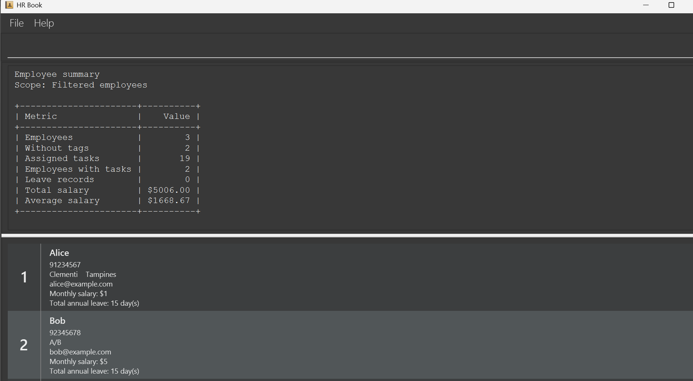
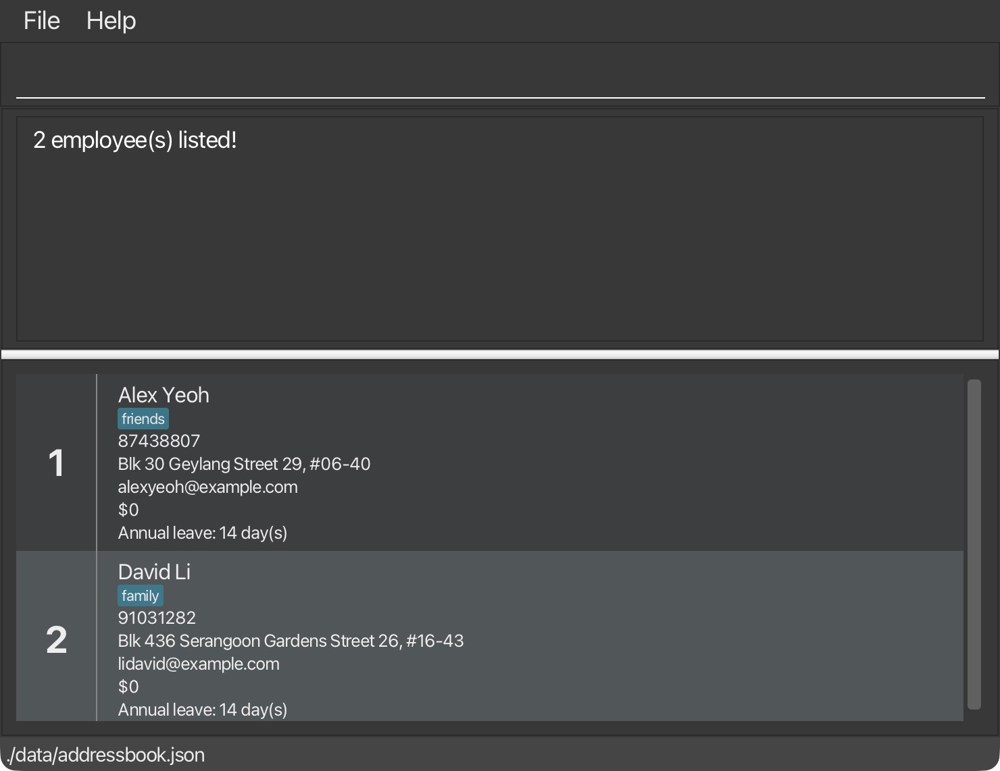
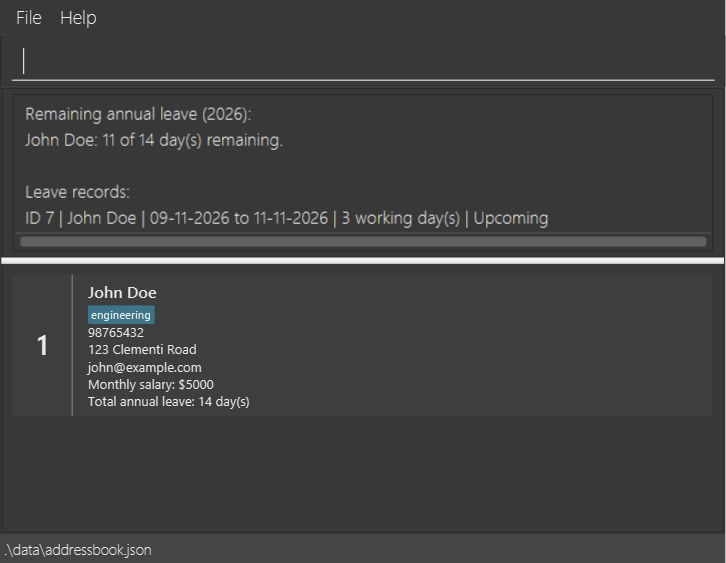

HR Book is a **desktop application for managing employee records and leave through a Command Line Interface (CLI)**.
Its command box supports fast keyboard entry, while the Graphical User Interface (GUI) presents employee and leave
information that you can scroll and inspect.

* Table of Contents
{:toc}

--------------------------------------------------------------------------------------------------------------------

## Quick start

1. Ensure that Java `25` or later is installed on your computer.<br>
   **Mac users:** Ensure you have the precise JDK version prescribed [here](https://se-education.org/guides/tutorials/javaInstallationMac.html).

1. Download the latest HR Book `.jar` file from the [team's releases page](https://github.com/AY2627S1-CS2103T-T16-3/tp/releases).

1. Copy the file to the folder you want to use as the _home folder_ for your HR Book.

   HR Book keeps its data, preferences, and logs in this folder, even when launched from another folder.
   Choose a folder where the app is allowed to create files.

1. Open a terminal, `cd` to the folder containing the JAR file, and run `java -jar JAR_FILE_NAME`, replacing
   `JAR_FILE_NAME` with the downloaded file's complete name, including the `.jar` extension.<br>
   A GUI similar to the one below should appear in a few seconds. Note how the app contains some sample data.<br>
   

1. Type a command in the command box and press Enter to execute it. For example, type **`help`** and press Enter to open the help window.<br>
   Some example commands you can try:

   * `list` : Lists all employees.

   * `add n/John Doe p/98765432 e/johnd@example.com a/John street, block 123, #01-01 le/14` : Adds an
     employee named `John Doe` with 14 days of annual leave entitlement.

   * `leave add 1 from/20-10-2026 to/22-10-2026` : Records leave for the first employee currently shown.

   * `leave list` : Shows current-year remaining balances and leave records for the employees currently displayed.

   * `delete 3` : Deletes the 3rd employee shown in the current list and their leave records.

   * `clear` : Deletes all employee and leave records and resets their identifier sequences.

   * `exit` : Exits the app.

1. Refer to the [Features](#features) section below for details of each command.

--------------------------------------------------------------------------------------------------------------------

## Features

<div markdown="block" class="alert alert-info">

**:information_source: Notes about the command format:**<br>

* Words in `UPPER_CASE` are the parameters to be supplied by the user.<br>
  For example, in `add n/NAME`, replace `NAME` with a value such as `John Doe`.

* Items in square brackets are optional.<br>
  For example, `n/NAME [t/TAG]` can be used as `n/John Doe t/friend` or as `n/John Doe`.

* Items followed by `…`​ can appear zero or more times.<br>
  For example, `[t/TAG]…​` may be omitted, or written as `t/friend` or `t/friend t/family`.

* Parameters with prefixes can generally be in any order.<br>
  For example, if the command specifies `n/NAME p/PHONE_NUMBER`, `p/PHONE_NUMBER n/NAME` is also acceptable.
  Unprefixed parameters, such as `INDEX`, must remain in the position shown in the command format. Any exceptions are
  stated in the relevant command section.

* Extraneous parameters for commands that take no parameters, such as `help`, `list`, `leave list`, `exit`, and
  `clear`, are ignored.<br>
  For example, `help 123` is interpreted as `help`.
  Exception: `/summary` and `summary` accept an optional scope followed by index selections using `i/` and `e/`.

* If you are using a PDF version of this document, be careful when copying and pasting commands that span multiple lines as space characters surrounding line-breaks may be omitted when copied over to the application.
</div>

### Viewing help: `help`

Shows a message explaining how to access the help page.


Format: `help`


### Adding an employee: `add`

Adds an employee to HR Book.

Format: `add n/NAME p/PHONE_NUMBER e/EMAIL a/ADDRESS le/ANNUAL_LEAVE_DAYS [s/SALARY] [t/TAG]…​`

Employees may share the same name, but each employee must have a unique phone number and email address.
Adding an employee is rejected if either contact detail is already used by another employee, including one
hidden by a search or filter. Email comparison ignores case. Phone numbers are compared as digit strings
after surrounding spaces are removed.

For example, `090000002` and `90000002` are different phone values; numbers are not compared numerically.
Rejection messages identify each conflicting contact and its existing owner, for example:
`Phone number 90000002 is already used by Bob.` If both contacts conflict, both are reported.
For older saved files, see [Editing the data file](#editing-the-data-file).

* For literal prefix-like text in addresses, follow the [escaping rules under `filter`](#escaping-prefix-like-text).

`NAME` must not be blank and may contain only English letters (`A`-`Z`, `a`-`z`), digits (`0`-`9`), and spaces.
Hyphens, apostrophes, accented letters, and characters from other writing systems are not accepted.

`PHONE_NUMBER` must contain only digits and be at least three digits long.

`EMAIL` must be a complete valid email address and must not exceed 254 characters. Its local part may use
alphanumeric characters, with `+`, `_`, `.`, or `-` only between alphanumeric groups. Domain labels may contain
internal hyphens, must start and end with alphanumeric characters, and the final label must contain at least two
characters.

`ADDRESS` must not be blank.

Each `TAG` must contain only alphanumeric characters without spaces.

Monthly salary is optional and defaults to `0`. It must be a whole number from `0` to `50000`.
Leading zeros are accepted and removed: `s/000000001` is stored as `1`.
Employee cards display salary with a monthly label, for example `Monthly salary: $5000`.

Annual leave entitlement is compulsory. It must be a whole number from `0` to `365`. A value of `0` is valid for an
employee who is not entitled to annual leave. Leading zeros are accepted and removed: for example, `le/00014` is
stored as `14`. The value after removing leading zeros must still be within the allowed range.

<div markdown="span" class="alert alert-primary">:bulb: **Tip:**
An employee can have any number of tags, including zero.
</div>

After a successful addition, all employees are displayed again, clearing any active `find` or `filter` results while
retaining the active sort. Displayed indexes may change, so recheck them before entering another index-based command.

Examples:
* `add n/John Doe p/98765432 e/johnd@example.com a/John street, block 123, #01-01 le/14 s/5000`
* `add n/Betsy Crowe t/friend e/betsycrowe@example.com a/Newgate Prison p/1234567 le/20 t/criminal`

### Listing all employees: `list`

Shows a list of all employees in HR Book.

Format: `list`

### Viewing the workforce summary: `summary`

Shows employee and tag counts, task assignments, leave records, and total/average salary.

Format: `summary [scope/all|scope/filtered] [i/INDEX...] [e/INDEX...]` (alias: `/summary`)

The `|` means "or": use either `scope/all` or `scope/filtered`, or omit the scope.

| Option | Meaning |
| --- | --- |
| `scope/filtered` (default) | Summarize the currently displayed employees, including results of `find` or `filter`. |
| `scope/all` | Summarize all employees in the current sort order. |
| `i/INDEX...` | Include only the listed indexes. |
| `e/INDEX...` | Exclude the listed indexes. |

Indexes refer to positions in the selected scope. Run `list` to view the numbering used by `scope/all`.

* Put the optional scope first and use each option at most once. Scope values are case-sensitive.
* Indexes must be positive integers within the selected scope, separated by spaces. Repeated indexes count once;
  empty or out-of-range index lists are rejected.
* Exclusions win when an index appears in both `i/` and `e/`. Every statistic uses the same selection.

Examples:

* `summary i/1 2 3 e/2` summarizes displayed employees 1 and 3.
* `summary scope/all e/1` summarizes everyone except the first employee in the full sorted list.

Example output:

```text
Employee summary
Scope: Filtered employees

+----------------------+-----------+
| Metric               |     Value |
+----------------------+-----------+
| Employees            |         5 |
| Without tags         |         1 |
| Assigned tasks       |         6 |
| Employees with tasks |         3 |
| Leave records        |         3 |
| Total salary         | $15000.00 |
| Average salary       |  $3000.00 |
+----------------------+-----------+

+-------------+-----------+
| Tag         | Employees |
+-------------+-----------+
| engineering |         2 |
| intern      |         1 |
| remote      |         2 |
+-------------+-----------+
```

* **Leave records:** each saved period counts once, regardless of duration or year. Includes past, current,
  and future records; this is not a count of leave days or remaining entitlement.
* **Tasks:** pending and completed tasks both count. The same description assigned to two employees counts twice.
* **Tags:** grouped without regard to case and shown in lowercase alphabetical order. Each employee counts once
  per group but may belong to several groups. The tag table is omitted when there are no tags.
* **Salary:** zero salaries are included. Averages round half up to two decimal places. An empty selection shows
  zero counts, total salary `$0.00`, and average `N/A`.

The command preserves employee data and the current filter. Run it again after changes to refresh the figures.
Scroll within the result panel or drag its lower divider to see the full tables.

### Changing an employee's salary: `salary`

Changes the monthly salary of an existing employee in HR Book.

Format: `salary INDEX s/SALARY`

* Updates the employee at the specified `INDEX` in the currently displayed employee list, including search results. The index **must be a positive integer** 1, 2, 3, …​
* The salary is required and must contain only digits, representing a whole number from `0` to `50000` inclusive. Do not include a `$` sign, commas, or decimal points.
* Supply `s/` exactly once. The new salary replaces the employee's existing salary; other employee details are preserved.
* Other fields, such as `n/`, are rejected with "Unsupported field. The salary command only accepts s/." This check happens before salary validation, so only the unsupported-field error is shown when both the field and amount are invalid.
* Leading zeros are accepted and removed: `s/005000` is stored as `5000` and displayed as `$5000`.
* When the salary changes, the feedback shows the employee's name and both amounts, for example: `Updated Betsy's salary from $5000 to $6000.`
* After a successful salary change, all employees are displayed again, clearing any active `find` or `filter` results while retaining the active sort. Displayed indexes may change, so recheck them before entering another command.
* If the employee already has the requested salary, the feedback reports that no changes were made, for example: `Betsy's salary is already $6000. No changes made.` The currently displayed employee list is preserved.

Examples:
* `salary 1 s/5000` changes the 1st employee's salary in the displayed list to `$5000`.
* `find Betsy` followed by `salary 1 s/6000` changes the salary of the 1st employee in the search results to `$6000`.

### Editing an employee: `edit`

Edits an existing employee in HR Book.

Format: `edit INDEX [n/NAME] [p/PHONE] [e/EMAIL] [a/ADDRESS] [le/ANNUAL_LEAVE_DAYS] [t/TAG]…​`

Contact conflicts are checked against all other employees, including hidden employees. Errors identify the
conflicting phone number or email and its existing owner. Phone comparison uses digit strings after trimming
surrounding spaces; email comparison ignores case.

Salary is preserved when editing other details. The `edit` command rejects `s/`.
Use `salary INDEX s/SALARY` to change salary.

* Edits the employee at the specified `INDEX`. The index refers to the index number shown in the displayed employee list. The index **must be a positive integer** 1, 2, 3, …​
* An employee may be renamed to match another employee's name.
* An employee's phone number or email address cannot be changed to one used by another employee, including
  one hidden by a search or filter. Email comparison ignores case.
* The selected employee may retain their existing phone number and email address. A rejected edit leaves
  their details unchanged.
* At least one of the optional fields must be provided.
* Existing values will be updated to the input values.
* For literal prefix-like text in addresses, follow the [escaping rules under `filter`](#escaping-prefix-like-text).
* When changing the name, `NAME` must follow the restrictions described under [`add`](#adding-an-employee-add).
* Phone numbers, email addresses, addresses, and tags must follow the restrictions described under
  [`add`](#adding-an-employee-add).
* `le/ANNUAL_LEAVE_DAYS` changes the employee's annual entitlement and accepts a whole number from `0` to `365`.
  Leading zeros are accepted and removed: for example, `le/00021` is stored as `21`.
  Existing leave records are not deleted if the entitlement is reduced below the number of days already used. Until
  enough leave is deleted or the entitlement is increased, no further leave can be added for that year.
  This is intentional: changing entitlement does not rewrite historical leave records. If a recorded leave was a
  mistake, delete that leave record separately.
* When editing tags, all of the employee's existing tags are removed; adding tags is not cumulative.
* To remove all of an employee's tags, enter `t/` without a tag after it.
* After a successful edit, all employees are displayed again, clearing any active `find` or `filter` results while
  retaining the active sort. Displayed indexes may change, so recheck them before entering another index-based command.

Examples:
*  `edit 1 p/91234567 e/johndoe@example.com` Edits the phone number and email address of the 1st employee to be `91234567` and `johndoe@example.com` respectively.
*  `edit 2 n/Betsy Crower t/` Edits the name of the 2nd employee to be `Betsy Crower` and clears all existing tags.
*  `edit 3 le/00021` Changes the 3rd employee's annual leave entitlement to 21 days.

### Locating employees by name: `find`

Finds employees whose names contain any of the given keywords.

Format: `find KEYWORD [MORE_KEYWORDS]`

* The search is case-insensitive; for example, `hans` matches `Hans`.
* Keyword order does not matter; for example, `Hans Bo` matches `Bo Hans`.
* The search considers only names.
* Only full words match; for example, `Han` does not match `Hans`.
* Employees matching at least one keyword are returned (an `OR` search); for example, `Hans Bo` returns `Hans Gruber` and `Bo Yang`.

Examples:
* `find John` returns `john` and `John Doe`
* `find alex david` returns `Alex Yeoh`, `David Li`<br>
  

### Filtering employees by supported fields: `filter`

Lists employees who match **all** supplied criteria (`AND`).

Format: `filter [n/NAME] [p/PHONE] [e/EMAIL] [a/ADDRESS] [t/TAG]... [task/DETAILS]... [s/SALARY] [le/DAYS]`

#### General rules

* Supply at least one non-empty criterion. Invalid values return the corresponding field's error message.
* Each of `n/`, `p/`, `e/`, `a/`, `s/`, and `le/` may appear only once. Unsupported prefixes are rejected.
* Repeat `t/` to require every specified tag. Repeat `task/` to require a matching task for each query; the same task or different tasks may satisfy the queries.
* Each command searches all stored employees, including those hidden by an earlier search.
* Filtering does not modify employee details. Use `list` to show all employees again.

#### Text filters

All text matching ignores case.

| Field | Valid query | Matching rule |
| --- | --- | --- |
| Name (`n/`) | Alphanumeric characters and spaces | Contains the query: `n/ali` matches `Alice Pauline`. |
| Phone (`p/`) | At least 3 digits; digits only | Contains the query: `p/912` matches a number containing `912`. Leading zeroes are allowed. |
| Email (`e/`) | A complete valid email, such as `alice@example.com`; fragments such as `@example.com` are rejected | Contains the query. |
| Address (`a/`) | Any non-blank text | Contains the query. |
| Tag (`t/`) | Alphanumeric characters; no spaces | Matches the whole tag: `t/friend` does not match `friends`. |
| Task (`task/`) | Non-blank text, up to 120 characters | Contains the query: `task/report` matches a task containing `report`. |

Text queries must not start with `<`, `>`, `=`, or `!=`. For example, `n/>Alice` returns a comparator error.

#### Escaping prefix-like text

These rules apply to addresses in `add`, `edit`, and `filter`, and task descriptions in `task add` and `filter`.

* Text consisting of letters followed by `/` at the start of input or after whitespace can be interpreted as a
  command prefix. Escape the slash as `\/` when that text is intended literally, including unknown prefixes.
* Recognised unescaped prefixes remain command fields and must follow that command's field rules.
  Unknown unescaped prefixes are rejected. All four commands ask you to check supported prefixes for a typo
  or escape the slash if the text is literal.
* The escape backslash is removed before storing or matching address or task text. Other field validation
  rules still apply.

| Enter | Literal text stored or searched |
| --- | --- |
| `a/10 Road c\/o` | `10 Road c/o` |
| `a/Block p\/777` | `Block p/777` |
| `task/Review p\/details` (in `filter`) | `Review p/details` |
| `d/Review d\/DETAILS` (in `task add`) | `Review d/DETAILS` |

#### Salary and annual leave entitlement filters

Only salary and annual leave entitlement support comparisons and ranges.

| Field | Allowed values |
| --- | --- |
| Salary (`s/`) | Whole numbers from 0 to 50000 |
| Annual leave entitlement (`le/`) | Whole numbers from 0 to 365; filters annual entitlement, not remaining leave or leave dates |

Both fields support the following formats:

| Format | Meaning | Salary example | Leave example |
| --- | --- | --- | --- |
| `VALUE` | Exactly the value; omit `=` | `s/4000` | `le/14` |
| `<VALUE` | Less than; excludes the value | `s/<4000` | `le/<14` |
| `<=VALUE` | At most; includes the value | `s/<=4000` | `le/<=14` |
| `>VALUE` | Greater than; excludes the value | `s/>4000` | `le/>14` |
| `>=VALUE` | At least; includes the value | `s/>=4000` | `le/>=14` |
| `MIN-MAX` | Inclusive range; minimum must not exceed maximum | `s/3000-5000` | `le/14-21` |

* Spaces around comparison operators and range separators are allowed. Both range endpoints must satisfy the field's allowed values.
* The `=` operator is not supported. Use `s/4000` or `le/14` for an exact match.
* **Leading zeroes are not allowed**, including in comparison amounts and either range endpoint. A single `0` is valid. This restriction does not apply to phone queries.

| Rejected input | Use instead |
| --- | --- |
| `filter s/003000` | `filter s/3000` |
| `le/014` | `le/14` |
| `filter le/>014` | `filter le/>14` |
| `filter s/03000-5000` | `filter s/3000-5000` |

#### Examples

**Text and combined criteria**

| Command | Employees matched |
| --- | --- |
| `filter p/91235321` | Phone number contains `91235321`. |
| `filter e/alice@example.com` | Email contains the valid address `alice@example.com`. |
| `filter n/Alice a/Jurong` | Name contains `Alice` and address contains `Jurong`. |
| `filter t/friends t/owesMoney` | Has both tags. |
| `filter task/report task/review` | Has tasks matching both descriptions. |
| `filter task/report s/3000` | Has a task containing `report` and salary of 3000. |
| `filter n/Alice s/<4000 le/>10` | Name contains `Alice`, salary is below 4000, and annual entitlement exceeds 10 days. |
| `filter n/Alice p/912 s/<4000` | Name contains `Alice`, phone contains `912`, and salary is below 4000. |

**Numeric criteria**

| Command | Employees matched |
| --- | --- |
| `filter le/14` | Annual entitlement is exactly 14 days. |
| `filter le/<14` | Annual entitlement is below 14 days. |
| `filter s/<4000` | Salary is below 4000. |
| `filter s/>4000` | Salary is above 4000. |
| `filter s/<=4000` | Salary is at most 4000. |
| `filter s/>=4000` | Salary is at least 4000. |
| `filter s/<=4000 le/>=14` | Salary is at most 4000 and annual entitlement is at least 14 days. |
| `filter s/3000-5000 le/14-21` | Salary is 3000–5000 and annual entitlement is 14–21 days, including all endpoints. |

### Sorting the displayed employees: `sort`

Sorts the currently displayed list by exactly one field, keeping the active `find` or `filter` criteria.

Format: `sort FIELD/ORDER`

* Fields: `n/` (name), `p/` (phone), `e/` (email), `a/` (address), `s/` (salary), or `le/` (annual leave entitlement).
* Order: `asc` for ascending or `des` for descending. Supply exactly one field and order.
* Salary, phone numbers, and annual leave entitlement sort numerically. Text sorts alphabetically, ignoring case.
* When values tie, `summary scope/all` uses the same employee order as `list`. Earlier sorts can affect this order.
* Sorting changes the display only; employee details and their stored order stay unchanged.
* The chosen sort stays active when you filter, find, edit, or list employees. `list` shows all employees in that order. Another `sort` replaces it; restarting the app restores the stored order.
* Index commands such as `edit`, `salary`, and `delete` use the positions in the sorted displayed list.
* Sorting an empty list is allowed.

Examples:
* `sort s/asc` sorts the displayed employees from lowest to highest salary.
* `sort p/des` sorts the displayed employees by phone number in descending order.
* `filter t/friends`, followed by `sort le/des`, shows only employees tagged `friends`, ordered from highest to lowest annual leave entitlement.

### Deleting an employee: `delete`

Deletes the specified employee from HR Book.

Format: `delete INDEX`

* Deletes the employee at the specified `INDEX`.
* The index refers to the index number shown in the displayed employee list.
* The index **must be a positive integer** 1, 2, 3, …​
* All leave records belonging to the employee are also deleted. They cannot become orphaned records that refer to a
  missing employee.
* The current `find` or `filter` remains active after deletion. Any remaining matching employees stay displayed, but
  their indexes may shift.

Examples:
* `list` followed by `delete 2` deletes the 2nd employee in HR Book.
* `find Betsy` followed by `delete 1` deletes the 1st employee in the results of the `find` command.

### Managing employee leave

Use the employee's displayed index to record leave, and the leave ID to delete it:

| Command | Which number should I use? |
| --- | --- |
| `leave add INDEX ...` | The employee index currently shown on the employee card. |
| `leave delete LEAVE_ID` | The stable leave ID shown by `leave list`. |

Leave results show the employee's email beside their name so that employees with the same name can be told apart.

The examples below use John Doe at employee index `1`, with an annual entitlement of 14 days and no existing leave
for 2026. The newly recorded leave has leave ID `7` in this example; your assigned leave ID and balance may differ.

#### Recording leave: `leave add`

Records one leave period for the employee at the displayed index.

Format: `leave add INDEX from/START_DATE to/END_DATE`

Example command:

```text
leave add 1 from/09-11-2026 to/11-11-2026
```

Example output:

```text
Leave recorded: Leave ID 7 for John Doe (john@example.com); period 09-11-2026 to 11-11-2026; 3 working day(s); 11 day(s) remaining in 2026.
```

This records three weekdays and leaves John with 11 days for 2026. Keep the returned leave ID (`7`) if you later
need to cancel this record. Employee index `1` and leave ID `7` identify different things.

Rules:

* `INDEX` refers to the index shown in the current employee list and must be a positive integer.
* Dates must use the `DD-MM-YYYY` format. Years from `0001` to `9999` are accepted; year `0000` is invalid. Valid
  past and future dates are allowed for record keeping. Both dates are included in the leave period.
* The start date must be on or before the end date, and both dates must be in the same calendar year.
* Only Mondays to Fridays count against the employee's entitlement. Saturdays and Sundays are excluded.
* Public holidays are not excluded. A public holiday that falls from Monday to Friday counts as a working
  leave day.
* A period containing no weekday is rejected.
* Leave periods for the same employee cannot overlap, including on a weekend or boundary date. Leave periods belonging
  to different employees may overlap.
* The number of weekdays requested cannot exceed the employee's remaining entitlement for that calendar year.

For example, `leave add 1 from/13-11-2026 to/16-11-2026` requests two working days, excluding the weekend.

If a request overlaps John's existing record, the app reports:

```text
This leave period overlaps an existing leave record for the employee.
```

If another request needs 12 working days while John has only 11 remaining, the app reports:

```text
John Doe (john@example.com) has only 11 annual leave day(s) remaining in 2026, but this request needs 12.
```

Neither rejection adds a leave record. Check `leave list` for overlaps or request fewer working days.

#### Listing leave: `leave list`

Shows the current-year remaining balance for each displayed employee, followed by their leave records in leave ID
order. Balances appear in the same employee order as the cards. Each employee's email is shown beside their name
so that employees with the same name can be told apart.

Format: `leave list`

Continuing the three-day example above, run:

```text
leave list
```

Example output, assuming today's date is 3 November 2026:

```text
Remaining annual leave (2026):
John Doe (john@example.com): 11 of 14 day(s) remaining.

Leave records:
Leave ID 7 | John Doe (john@example.com) | 09-11-2026 to 11-11-2026 | 3 working day(s) | Upcoming
```

| Output field | Meaning |
| --- | --- |
| `Remaining annual leave (2026)` | The calendar year used for all balances in this result. |
| `11 of 14 day(s) remaining` | Remaining days and total annual entitlement for the named employee. |
| `Leave ID 7` | The leave ID to use with `leave delete`. |
| `John Doe (john@example.com)` | The employee's current name and unique email address. |
| `09-11-2026 to 11-11-2026` | The inclusive start and end dates. |
| `3 working day(s)` | Days charged against annual entitlement. |
| `Upcoming` | The leave's status relative to today. |

Rules:

* The year in the balance header is the current year according to your computer's date. Extra arguments after
  `leave list` are ignored and cannot select a different year.
* Each balance deducts all recorded working leave days in that year, including upcoming leave. Records from other
  years do not affect it. If recorded days exceed the employee's current entitlement, the balance is shown as `0`.
* An employee with no leave records in the current year is shown with their full annual entitlement remaining.
* `find` and `filter` restrict both balances and records to the displayed employees. Run `list` before `leave list`
  to show everyone's balances and records.
* The record list still includes all years. If there are no matching records, balances are followed by
  `No leave records found.` If no employees are displayed, the result is `No employees displayed.`
* Listing balances and records does not add or delete leave, change employee details, or reset the current filter
  or sort order.

Statuses:

* `Upcoming`: today's date is before the start date.
* `Ongoing`: today's date falls within the inclusive date range.
* `Past`: today's date is after the end date.

The status is calculated whenever the command runs and is not saved. An ongoing period remains `Ongoing` when today is
a weekend inside that period, even though weekends do not consume entitlement.

#### Checking an employee's remaining leave

To check an employee's current-year balance without recording or cancelling leave:

1. Use `find` or `filter` to locate the employee, for example `find John`.
2. Run `leave list` and read that employee's line under **Remaining annual leave**. Check the year in the header.

In the example above, John has **11 days remaining in 2026**, including the deduction for his upcoming three-day
leave. The card's **Total annual leave** is his entitlement of 14 days; it is not the remaining balance.



*The result box shows the balance separately from leave ID `7`. The employee's displayed index is `1`.
This screenshot was captured on 3 November 2026, so the leave is `Upcoming`.*

#### Deleting leave: `leave delete`

Deletes the leave record with the specified leave ID.

Format: `leave delete LEAVE_ID`

To cancel the record from the example above, run:

```text
leave delete 7
```

Example output:

```text
Deleted leave: Leave ID 7 for John Doe (john@example.com); period 09-11-2026 to 11-11-2026; 14 day(s) remaining in 2026.
```

The three charged days are released. As John has no other leave in 2026 in this example, his remaining balance
returns to 14 days. Use the leave ID returned by your own `leave list` output if it differs from `7`.

Rules:

* `LEAVE_ID` must be a positive integer displayed by `leave list`; it is not an employee list index.
* Deleting a record restores those days to the employee's remaining entitlement for that calendar year because the
  balance is recalculated from the records that remain.
* Leave IDs removed using `leave delete` are not reused while the current HR Book data remains in use. The `clear`
  command starts a fresh data set and resets the leave ID sequence.

### Listing tasks on an employee: `task list`

Lists the tasks related to an employee.

Format: `task list EMPLOYEE_INDEX`

* `EMPLOYEE_INDEX` refers to the employee's index in the currently displayed
  employee list and must be a positive integer.
* Tasks are displayed in the order in which they were added.
* Pending tasks are displayed with `[ ]`, while completed tasks are displayed with `[x]`.
* `TASK_INDEX` refers to the number displayed next to the task.
* The active filter and sort order remain in effect after the command.

Example:

* `task list 1` lists the tasks related to the first displayed employee, for example:

  ```text
  Tasks for Alice Pauline:
  1. [ ] Prepare monthly report
  2. [x] Submit access request
  ```

### Adding tasks to an employee: `task add`

Adds a task to an employee.

Format: `task add EMPLOYEE_INDEX d/DETAILS`

* `EMPLOYEE_INDEX` refers to the employee's index in the currently displayed
  employee list and must be a positive integer.
* `DETAILS` must not be blank, and it must not exceed 120 characters.
* For literal prefix-like task text, follow the [escaping rules under `filter`](#escaping-prefix-like-text).
* A task that already exists for the employee cannot be added again.
  * Task comparisons ignore leading/trailing whitespace, repeated whitespace, and capitalization.
  * For example, `Prepare report` and `prepare REPORT` are treated as duplicates.
* The active filter and sort order remain in effect after the command.

Examples:

* `task add 1 d/Prepare monthly report` adds the task to the first displayed
  employee.
* `find Alex` followed by `task add 1 d/Prepare monthly report` adds the
  task to the first employee in the filtered results.

### Deleting tasks on an employee: `task delete`

Deletes a task related to an employee.

Format: `task delete EMPLOYEE_INDEX i/TASK_INDEX`

* `EMPLOYEE_INDEX` refers to the employee's index in the currently displayed
  employee list and must be a positive integer.
* `TASK_INDEX` refers to the number shown by `task list EMPLOYEE_INDEX` and must be a positive integer.
* The active filter and sort order remain in effect after the command.
  * If the deleted task matched an active task-based filter, the employee may no longer be displayed.

Examples:

* `task delete 1 i/2` deletes the second task assigned to the first displayed
  employee.
* `find Alex` followed by `task delete 1 i/1` deletes the first task from the
  first employee in the filtered results.

### Marking a task as done: `task mark`

Marks a task as completed.

Format: `task mark EMPLOYEE_INDEX i/TASK_INDEX`

* `EMPLOYEE_INDEX` refers to the employee's index in the currently displayed
  employee list and must be a positive integer.
* `TASK_INDEX` refers to the number shown by `task list EMPLOYEE_INDEX` and must be a positive integer.
* The `i/` prefix is required for the task index.
* The active filter and sort order remain in effect after the command.
* Marking an already completed task succeeds without changing its state.

Examples:

* `task mark 1 i/1` marks the first task assigned to the first displayed employee as done.
* `find Alex` followed by `task mark 1 i/2` marks the second task assigned to the first employee in the filtered results as done.

### Marking a task as pending: `task unmark`

Marks a completed task as pending.

Format: `task unmark EMPLOYEE_INDEX i/TASK_INDEX`

* `EMPLOYEE_INDEX` refers to the employee's index in the currently displayed
  employee list and must be a positive integer.
* `TASK_INDEX` refers to the number shown by `task list EMPLOYEE_INDEX` and must be a positive integer.
* The `i/` prefix is required for the task index.
* The active filter and sort order remain in effect after the command.
* Unmarking an already pending task succeeds without changing its state.

Examples:

* `task unmark 1 i/1` marks the first task assigned to the first displayed employee as pending.
* `find Alex` followed by `task unmark 1 i/2` marks the second task assigned to the first employee in the filtered results as pending.

### Clearing all entries: `clear`

Clears all employee and leave records from HR Book and starts a fresh data set. This also resets HR Book's
identifier sequences, so leave IDs used before `clear` may be assigned again.

Format: `clear`

### Exiting the program: `exit`

Exits the program.

Format: `exit`

### Saving the data

HR Book attempts to save its data after every valid command, including commands that do not change data. Invalid
commands do not trigger a save.

If saving fails, HR Book reports the error and restores the data, filter, and sort order. Until the problem is fixed,
other valid commands, including `exit`, will continue to report the save error.

To recover, fix the reported problem and run a command that does not change data. If no save error appears, the save
succeeded. You can then retry the original command, as its changes were not retained.

Because HR Book writes directly to the data file, a failed save may leave it incomplete or corrupted. Confirm that
saving works before restarting. If you cannot retry, close the application window, then follow the recovery
instructions under [Editing the data file](#editing-the-data-file) before reopening HR Book. There is no automatic
backup recovery.

### Editing the data file

HR Book data is saved automatically as a JSON file `[JAR file location]/data/hrbook.json`. The file contains
employees, leave records, and the next internal identifiers. Editing it manually is not recommended.

Older save files without salary values load with a salary of `0`.

**Contact uniqueness:** Saved files must follow the same contact uniqueness rules. If an older file contains shared phone numbers or emails, resolve those conflicts before loading it. Email comparison ignores case. Phone numbers are compared as digit strings after trimming surrounding spaces, so `090000002` and `90000002` are different values.

<div markdown="span" class="alert alert-warning">:exclamation: **Caution:**
If the data file is invalid or cannot be read, HR Book starts with empty data and explains the loading error in the
usual command results box. Any explicit JSON `null` anywhere in the HR Book data file is invalid, including employee
fields, leave fields, nested data, and array entries. The saved file remains unchanged until you run a successful
command, which replaces it with the current data. To recover your saved data, close HR Book without
running a command, correct the file or restore a valid backup, then reopen the app. We recommend backing up the file
before editing it.<br>
Furthermore, certain edits can cause HR Book to behave in unexpected ways (e.g., if a value entered is outside of the
acceptable range or a leave refers to a missing employee). Therefore, edit the data file only if you are confident that
you can update it correctly.
</div>

--------------------------------------------------------------------------------------------------------------------

## FAQ

**Q**: How do I transfer my data to another computer?<br>
**A**: Install the app on the other computer and overwrite the data file it creates with the data file from your previous
HR Book home folder. This transfers both employee and leave records.

**Q**: Why does an employee card show a different number from the leave ID?<br>
**A**: The employee list number is a temporary displayed index that can change after a search or filter. A leave ID is a
stable identifier for one leave record. Use the displayed index with `leave add` and the leave ID with `leave delete`.

--------------------------------------------------------------------------------------------------------------------

## Known issues

1. **When using multiple screens**, if you move the application to a secondary screen, and later switch to using only the primary screen, the GUI will open off-screen. The remedy is to delete the `preferences.json` file created by the application before running the application again.
2. **If you minimize the Help Window** and then run the `help` command (or use the `Help` menu, or the keyboard shortcut `F1`) again, the original Help Window will remain minimized, and no new Help Window will appear. The remedy is to manually restore the minimized Help Window.

--------------------------------------------------------------------------------------------------------------------

## Command summary

| Action                | Format, Examples |
|-----------------------|------------------|
| **Add employee**      | `add n/NAME p/PHONE_NUMBER e/EMAIL a/ADDRESS le/ANNUAL_LEAVE_DAYS [s/SALARY] [t/TAG]…​`<br>e.g., `add n/James Ho p/22224444 e/jamesho@example.com a/123 Clementi Rd le/14 t/friend` |
| **Clear**             | `clear` |
| **Delete employee**   | `delete INDEX`<br>e.g., `delete 3` |
| **Salary**            | `salary INDEX s/SALARY`<br>e.g., `salary 1 s/5000` |
| **Edit employee**     | `edit INDEX [n/NAME] [p/PHONE_NUMBER] [e/EMAIL] [a/ADDRESS] [le/ANNUAL_LEAVE_DAYS] [t/TAG]…​`<br>e.g., `edit 2 n/James Lee le/21` |
| **Find**              | `find KEYWORD [MORE_KEYWORDS]`<br>e.g., `find James Jake` |
| **Filter**            | `filter [n/NAME] [p/PHONE] [e/EMAIL] [a/ADDRESS] [t/TAG]... [task/DETAILS]... [s/SALARY] [le/DAYS]`<br>e.g., `filter task/report s/<=3000 le/>=14` |
| **Sort**              | `sort FIELD/ORDER`<br> e.g., `sort s/asc` or `sort p/des` |
| **List employees**    | `list` |
| **Record leave**      | `leave add INDEX from/START_DATE to/END_DATE`<br>e.g., `leave add 1 from/20-10-2026 to/22-10-2026` |
| **View leave balances and records** | `leave list` |
| **Delete leave**      | `leave delete LEAVE_ID`<br>e.g., `leave delete 2` |
| **List tasks**        | `task list EMPLOYEE_INDEX`<br>e.g., `task list 1` |
| **Add task**          | `task add EMPLOYEE_INDEX d/DETAILS`<br>e.g., `task add 1 d/Prepare report` |
| **Delete task**       | `task delete EMPLOYEE_INDEX i/TASK_INDEX`<br>e.g., `task delete 1 i/1` |
| **Mark task**         | `task mark EMPLOYEE_INDEX i/TASK_INDEX`<br> e.g., `task mark 1 i/1` |
| **Unmark task**       | `task unmark EMPLOYEE_INDEX i/TASK_INDEX`<br> e.g., `task unmark 1 i/1` |
| **Workforce summary** | <code>summary [scope/all&#124;scope/filtered] [i/INDEX...] [e/INDEX...]</code> (alias: `/summary`) |
| **Help**              | `help` |
| **Exit**              | `exit` |
