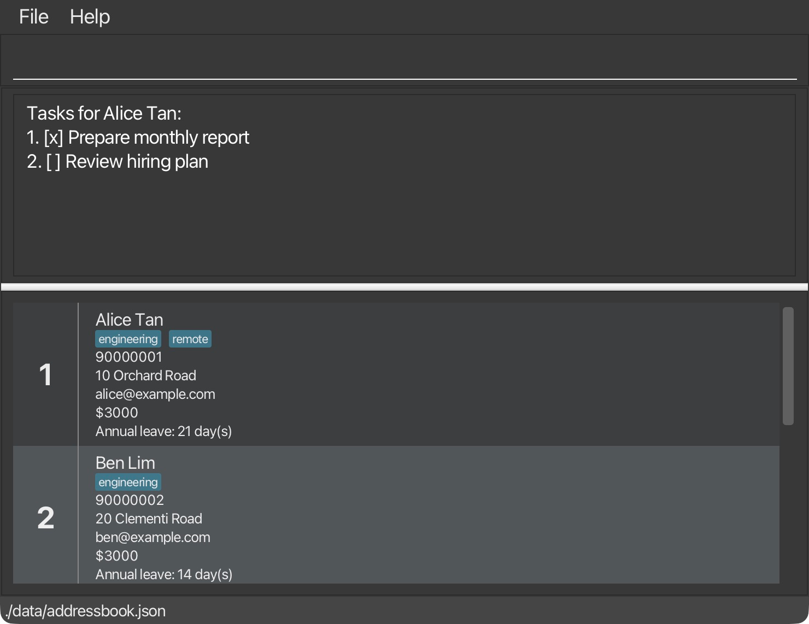
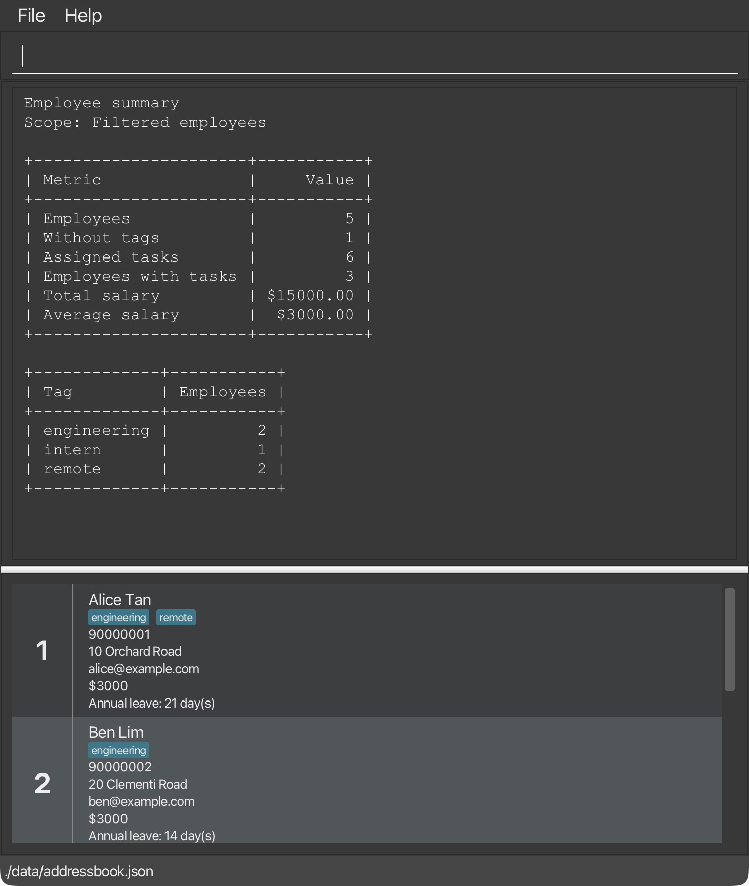
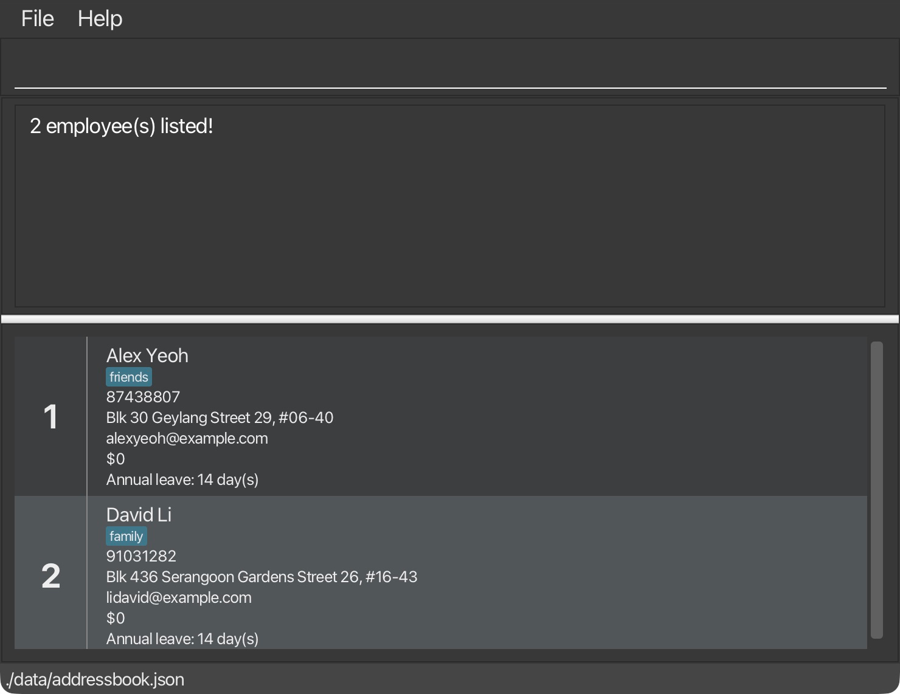

**HR Book helps HR managers keep employee records, salaries, tasks, and annual leave in one desktop app.**
Type commands to find and update records, track tasks, and view workforce summaries. The employee list and command
results appear in a graphical window. Your data is stored locally. This guide covers the released v1.4 command set.

* Table of Contents
{:toc}

--------------------------------------------------------------------------------------------------------------------

## Quick start

1. Install **Java 25**. Open a terminal and run `java -version` to check that the version starts with `25`.<br>
   **Mac users:** Follow the [Java installation guide](https://se-education.org/guides/tutorials/javaInstallationMac.html)
   for the prescribed JDK.

1. Download the HR Book `.jar` file from the [latest release](https://github.com/AY2627S1-CS2103T-T16-3/tp/releases/latest).
   No extra data files are needed for the first launch.

1. Put the JAR in a folder where you have permission to create and change files. Avoid write-protected folders.
   HR Book saves employee data and window preferences in the folder from which it is launched.

1. Open a terminal in that folder and launch the JAR with its actual file name, surrounded by double quotes.
   For the v1.4 release, run:

   ```text
   java -jar "hr-book-v1.4.jar"
   ```

   If the downloaded file has a different name, use that name in the command. Launching from the terminal uses the
   Java version checked above; double-clicking may use another Java version or fail on some systems.<br>
   On Linux, if launching fails with a `Gdk-CRITICAL` error, try:

   ```text
   GDK_BACKEND=x11 java -jar "hr-book-v1.4.jar"
   ```

1. The app opens with sample employees when no saved data file is found. The screenshot below shows the v1.4 app
   with fictional example records and the result of `list-tasks 1`. Window decorations may differ on your computer.

   

1. Type a command in the command box and press Enter to execute it. For example, type **`help`** and press Enter to open the help window.<br>
   Some example commands you can try:

   * `list` : Lists all employees.

   * `add n/John Doe p/98765432 e/johnd@example.com a/John street, block 123, #01-01 le/14` : Adds an
     employee named `John Doe` with 14 days of annual leave entitlement.

   * `leave add 1 from/20-10-2026 to/22-10-2026` : Records leave for the first employee currently shown.

   * `leave list` : Lists leave records for the employees currently displayed and shows each record's current status.

   * `delete 3` : Deletes the 3rd employee shown in the current list and their leave records.

   * `clear` : Deletes all employees, their tasks, and leave records.

   * `exit` : Exits the app.

1. Refer to the [Features](#features) section below for details of each command.

--------------------------------------------------------------------------------------------------------------------

## Features

<div markdown="block" class="alert alert-info">

**:information_source: Notes about the command format:**<br>

* Words in `UPPER_CASE` are the parameters to be supplied by the user.<br>
  For example, in `add n/NAME`, replace `NAME` with a value such as `John Doe`.

* Items in square brackets are optional.<br>
  For example, `n/NAME [t/TAG]` can be used as `n/John Doe t/friend` or as `n/John Doe`.

* Items followed by `…`​ can appear zero or more times.<br>
  For example, `[t/TAG]…​` may be omitted, or written as `t/friend` or `t/friend t/family`.

* Named fields can be in any order after the employee index, if the command takes one.<br>
  For example, if the command specifies `n/NAME p/PHONE_NUMBER`, `p/PHONE_NUMBER n/NAME` is also acceptable.

* Extraneous parameters for commands that take no parameters, such as `help`, `list`, `exit`, and `clear`, are ignored.<br>
  For example, `help 123` is interpreted as `help`.
  `leave list` requires no extra text in v1.4. `/summary` and `summary` accept an optional scope before
  index selections using `i/` and `e/`.

* If you are using a PDF version of this document, be careful when copying and pasting commands that span multiple lines as space characters surrounding line-breaks may be omitted when copied over to the application.
</div>

### Viewing help: `help`

Opens a separate window with the User Guide link and a **Copy URL** button. Paste the copied link into your browser
to read the guide. On macOS, keep secondary windows such as Help in windowed mode.


Format: `help`


### Adding an employee: `add`

Adds an employee to the address book.

Format: `add n/NAME p/PHONE_NUMBER e/EMAIL a/ADDRESS le/ANNUAL_LEAVE_DAYS [s/SALARY] [t/TAG]…​`

Salary is optional and defaults to `0`. It must be a whole number from `0` to `50000`.
Leading zeros are accepted and removed: `s/000000001` is stored as `1`.
Employee cards display salary with a `$` prefix, for example `$5000`.

Annual leave entitlement is compulsory. It must be a whole number from `0` to `365`. A value of `0` is valid for an
employee who is not entitled to annual leave. Leading zeros are accepted and removed: for example, `le/00014` is
stored as `14`. The value after removing leading zeros must still be within the allowed range.

<div markdown="span" class="alert alert-primary">:bulb: **Tip:**
An employee can have any number of tags, including zero.
</div>

Examples:
* `add n/John Doe p/98765432 e/johnd@example.com a/John street, block 123, #01-01 le/14`
* `add n/Betsy Crowe t/friend e/betsycrowe@example.com a/Newgate Prison p/1234567 le/20 t/criminal`

### Listing all employees: `list`

Shows a list of all employees in the address book.

Format: `list`

### Viewing the workforce summary: `summary`

Shows employee counts by tag, task-assignment counts, and recorded salary statistics in the selected scope.

Format: `summary [scope/all|scope/filtered] [i/INDEX...] [e/INDEX...]` (alias: `/summary`)

Omit the scope or use `scope/filtered` to summarize the currently displayed employees after `find`
or `filter`. For example, run `filter t/engineering` then `summary`. Use `summary scope/all` to summarize
all stored employees while keeping the current filter active.
Values are case-sensitive and must immediately follow `scope/`; surrounding whitespace is allowed.
Empty, unknown, repeated parameters and extra text are rejected, e.g. `summary t/engineering`.

To select particular employees for the summary:

* Use `i/` to include only the listed indexes, e.g. `summary i/1 3` summarizes employees 1 and 3.
* Use `e/` to exclude the listed indexes, e.g. `summary e/2 4` summarizes everyone except employees 2 and 4.
* You can combine them: `summary i/1 2 3 e/2` summarizes employees 1 and 3. Exclusions take precedence.
* Indexes must be positive integers separated by whitespace. Repeated indexes count only once.
  Supply each prefix at most once; an empty list or any index outside the selected scope is rejected.
  For an out-of-range index, the error shows that index, the selected scope, and its valid index range.
* Indexes refer to positions in the selected scope, not employee IDs. By default they refer to the currently
  displayed list. With `scope/all`, they refer to the full employee list; run `list` first to view that numbering.
  Put the optional scope before `i/` and `e/`; the two index prefixes may appear in either order.
  **v1.4 limitation:** after sorting, `scope/all` still uses stored order for index selections. To summarize rows
  using their displayed indexes, run `list` followed by `summary i/...` or `summary e/...` without `scope/all`.
* Every statistic uses the resulting selection. The output shows the included/excluded indexes in ascending order.
  Excluding everyone produces an empty summary. Selections apply only to this invocation.

Without a parameter the summary includes **only the currently displayed employees**. Run `list` first
to display and summarize everyone, or use `summary scope/all` without changing the displayed list.
The output labels its scope explicitly. An empty filtered result produces zero counts, not a fallback
to the full book. Neither scope changes employee records or the current filter. Run the command again
after changes to see fresh counts; with no active filter, both scopes include the same employees.

Example output:

```text
Employee summary
Scope: Filtered employees

+----------------------+-----------+
| Metric               |     Value |
+----------------------+-----------+
| Employees            |         5 |
| Without tags         |         1 |
| Assigned tasks       |         6 |
| Employees with tasks |         3 |
| Total salary         | $15000.00 |
| Average salary       |  $3000.00 |
+----------------------+-----------+

+-------------+-----------+
| Tag         | Employees |
+-------------+-----------+
| engineering |         2 |
| intern      |         1 |
| remote      |         2 |
+-------------+-----------+
```



* The first table shows headcount, employees without tags, assigned tasks, employees with tasks,
  and total/average recorded salary. The tag table appears only when there are tags.
* Tags are grouped case-insensitively, displayed in lowercase, and sorted alphabetically.
  An employee tagged with both `Engineering` and `engineering` counts once in that group.
  Employees with several tags count in each group, so tag counts can overlap.
* Identical task descriptions assigned to different employees count as separate assignments.
  Task counts do not indicate completion, deadlines, effort, or productivity.
* Salary figures include zero salaries. An empty selection shows zero counts, a total salary of `$0.00`,
  and an average of `N/A`. Amounts use two decimal places; averages round half up.
  These are recorded amounts, not payroll, tax, benefits, or payments.
* These figures describe stored records, not attendance or active employment. Tags are not interpreted
  as structured departments; leave balances and reminders are not included.

The tables use a monospaced font with right-aligned values. Columns expand to fit long tags and large amounts.
Scroll within the result area or drag the divider below it to see more rows; wide tables can be scrolled horizontally.
Run the command again after employee, task, or salary changes to refresh the figures.

### Changing an employee's salary: `salary`

Changes the salary of an existing employee in the address book.

Format: `salary INDEX s/SALARY`

* Updates the employee at the specified `INDEX` in the currently displayed employee list, including search results. The index **must be a positive integer** 1, 2, 3, …​
* The salary is required and must contain only digits, representing a whole number from `0` to `50000` inclusive. Do not include a `$` sign, commas, or decimal points.
* Supply `s/` exactly once. The new salary replaces the employee's existing salary; other employee details are preserved.
* Leading zeros are accepted and removed: `s/005000` is stored as `5000` and displayed as `$5000`.

Examples:
* `salary 1 s/5000` changes the 1st employee's salary in the displayed list to `$5000`.
* `find Betsy` followed by `salary 1 s/6000` changes the salary of the 1st employee in the search results to `$6000`.

### Editing an employee: `edit`

Edits an existing employee in the address book.

Salary is preserved when editing other details. The `edit` command rejects `s/`;
Use `salary INDEX s/SALARY` to change salary.

Format: `edit INDEX [n/NAME] [p/PHONE] [e/EMAIL] [a/ADDRESS] [le/ANNUAL_LEAVE_DAYS] [t/TAG]…​`

* Edits the employee at the specified `INDEX`. The index refers to the index number shown in the displayed employee list. The index **must be a positive integer** 1, 2, 3, …​
* At least one of the optional fields must be provided.
* Existing values will be updated to the input values.
* `le/ANNUAL_LEAVE_DAYS` changes the employee's annual entitlement and accepts a whole number from `0` to `365`.
  Leading zeros are accepted and removed: for example, `le/00021` is stored as `21`.
  Existing leave records are not deleted if the entitlement is reduced below the number of days already used. Until
  enough leave is deleted or the entitlement is increased, no further leave can be added for that year.
* When editing tags, all of the employee's existing tags are removed; adding tags is not cumulative.
* To remove all of an employee's tags, enter `t/` without a tag after it.

Examples:
*  `edit 1 p/91234567 e/johndoe@example.com` Edits the phone number and email address of the 1st employee to be `91234567` and `johndoe@example.com` respectively.
*  `edit 2 n/Betsy Crower t/` Edits the name of the 2nd employee to be `Betsy Crower` and clears all existing tags.
*  `edit 3 le/00021` Changes the 3rd employee's annual leave entitlement to 21 days.

### Locating employees by name: `find`

Finds employees whose names contain any of the given keywords.

Format: `find KEYWORD [MORE_KEYWORDS]`

* The search is case-insensitive; for example, `hans` matches `Hans`.
* Keyword order does not matter; for example, `Hans Bo` matches `Bo Hans`.
* The search considers only names.
* Only full words match; for example, `Han` does not match `Hans`.
* Employees matching at least one keyword are returned (an `OR` search); for example, `Hans Bo` returns `Hans Gruber` and `Bo Yang`.

Examples:
* `find John` returns `john` and `John Doe`
* `find alex david` returns `Alex Yeoh`, `David Li`<br>
  

### Filtering employees by any field: `filter`

Lists employees who match all supplied criteria.

Format: `filter [n/NAME] [p/PHONE] [e/EMAIL] [a/ADDRESS] [t/TAG]... [task/DETAILS]... [s/SALARY] [le/DAYS]`

* Supply at least one non-empty criterion.
* Name, phone, email, and address use case-insensitive substring matching. For example, `n/ali` matches `Alice Pauline`, and `p/912` matches a phone number containing `912`.
* Task descriptions use case-insensitive substring matching. `task/report` matches an employee with a task containing `report`.
* Salary accepts an exact amount (`s/4000`), strictly less than (`s/<4000`), or strictly greater than (`s/>4000`). Comparisons exclude the specified amount itself. Amounts must be whole numbers from 0 to 50000. Leading zeros are allowed: `s/003000` matches salary 3000. Operators such as `<=`, `>=`, and `=` are not supported.
* Annual leave entitlement accepts an exact number of days (`le/14`), strictly less than (`le/<14`), or strictly greater than (`le/>14`). This filters the annual entitlement, not the remaining balance or leave dates. Days must be whole numbers from 0 to 365. Leading zeros are accepted and removed, as with `add` and `edit`. Operators such as `<=`, `>=`, and `=` are not supported.
* Tags match the whole tag name, ignoring case. For example, `t/friend` does not match the tag `friends`.
* All supplied criteria must match (`AND`). Repeated `t/` criteria require every specified tag; repeated `task/` criteria require a matching task for each query. Different queries may match different tasks or the same task.
* Each of `n/`, `p/`, `e/`, `a/`, `s/`, and `le/` may appear only once. Unsupported prefixes are rejected.
* Every filter searches the entire address book, including employees hidden by an earlier search.
* In v1.4, a word followed by `/` after a space in a text query can be read as another parameter. For example,
  `filter task/Coordinate w/Finance` is rejected. Search a shorter part, such as `filter task/Coordinate`, instead.
  Double quotes do not escape parameter prefixes.
* Use `list` to show all employees again. Filtering does not modify employee details.

Examples:
* `filter p/91235321` lists employees whose phone number contains `91235321`.
* `filter e/@example.com` lists employees with an email address containing `@example.com`.
* `filter n/Alice a/Jurong` lists employees whose name contains `Alice` and whose address contains `Jurong`.
* `filter t/friends t/owesMoney` lists employees with both tags.
* `filter task/report task/review` lists employees with tasks matching both descriptions.
* `filter task/report s/3000` lists employees with a matching task and salary 3000.
* `filter le/14` lists employees with an annual leave entitlement of exactly 14 days.
* `filter le/<14` lists employees with an annual leave entitlement below 14 days.
* `filter n/Alice s/<4000 le/>10` lists employees whose name contains `Alice`, salary is below 4000, and annual leave entitlement is above 10 days.
* `filter s/<4000` lists employees earning less than 4000.
* `filter s/>4000` lists employees earning more than 4000.
* `filter n/Alice p/912 s/<4000` lists employees whose name contains `Alice`, whose phone number contains `912`, and whose salary is less than 4000.

### Sorting the displayed employees: `sort`

Sorts the currently displayed list by exactly one field, keeping the active `find` or `filter` criteria.

Format: `sort FIELD/ORDER`

* Fields: `n/` (name), `p/` (phone), `e/` (email), `a/` (address), `s/` (salary), or `le/` (annual leave entitlement).
* Order: `asc` for ascending or `des` for descending. Supply exactly one field and order.
* Salary, phone numbers, and annual leave entitlement sort numerically. Text sorts alphabetically, ignoring case.
* Employees with equal values retain their original address book order.
* Sorting changes the display only; employee details and the stored address book order stay unchanged.
* The chosen sort stays active when you filter, find, edit, or list employees. `list` shows all employees in that order. Another `sort` replaces it; restarting the app restores the stored order.
* Index commands such as `edit`, `salary`, and `delete` use the positions in the sorted displayed list.
* Sorting an empty list is allowed.

Examples:
* `sort s/asc` sorts the displayed employees from lowest to highest salary.
* `sort p/des` sorts the displayed employees by phone number in descending order.
* `filter t/friends`, followed by `sort le/des`, shows only employees tagged `friends`, ordered from highest to lowest annual leave entitlement.

### Deleting an employee: `delete`

Deletes the specified employee from the address book.

Format: `delete INDEX`

* Deletes the employee at the specified `INDEX`.
* The index refers to the index number shown in the displayed employee list.
* The index **must be a positive integer** 1, 2, 3, …​
* All leave records belonging to the employee are also deleted. They cannot become orphaned records that refer to a
  missing employee.

Examples:
* `list` followed by `delete 2` deletes the 2nd employee in the address book.
* `find Betsy` followed by `delete 1` deletes the 1st employee in the results of the `find` command.

### Managing employee leave

Leave records are stored separately from employee records and linked internally to the correct employee. You select an
employee using the index currently displayed in the employee list. Internal employee IDs are not shown and are not
accepted by leave commands.

Each recorded leave has a stable, public leave ID. Use `leave list` to find this ID before deleting a leave record. As
`leave list` follows the currently displayed employee list, run `list` first if you need to find a leave record for any
employee.

#### Recording leave: `leave add`

Records one leave period for the employee at the displayed index.

Format: `leave add INDEX from/START_DATE to/END_DATE`

* `INDEX` refers to the index shown in the current employee list and must be a positive integer.
* Dates must use the `DD-MM-YYYY` format. Both dates are included in the leave period.
* The start date must be on or before the end date, and both dates must be in the same calendar year.
* Only Mondays to Fridays count against the employee's entitlement. Saturdays and Sundays are excluded.
* Public holidays are not excluded in the MVP. A public holiday that falls from Monday to Friday counts as a working
  leave day.
* A period containing no weekday is rejected.
* Leave periods for the same employee cannot overlap, including on a weekend or boundary date. Leave periods belonging
  to different employees may overlap.
* The number of weekdays requested cannot exceed the employee's remaining entitlement for that calendar year.

The success message shows the new leave ID, employee name, period, charged working days, and remaining leave for the
year.

Examples:
* `list` followed by `leave add 1 from/20-10-2026 to/22-10-2026` records three working days for the first employee.
* `find Betsy` followed by `leave add 1 from/23-10-2026 to/26-10-2026` records two working days for Betsy, excluding
  the weekend.

#### Listing leave: `leave list`

Lists leave records belonging to employees in the currently displayed employee list, ordered by leave ID.

Format: `leave list`

The command uses whichever employees are currently displayed. For example, after `find Betsy` or a `filter` command,
only leave records belonging to the matching employees are listed. Run `list` before `leave list` to display leave
records for all employees. If none of the displayed employees has a leave record, the command reports that no leave
records were found.

Each line shows the leave ID, employee name, inclusive date range, charged working days, and one of these statuses:

* `Upcoming`: today's date is before the start date.
* `Ongoing`: today's date falls within the inclusive date range.
* `Past`: today's date is after the end date.

The status is calculated whenever the command runs and is not saved. An ongoing period remains `Ongoing` when today is
a weekend inside that period, even though weekends do not consume entitlement.

Example output when run before 20 October 2026:

```text
Leave records:
ID 1 | John Doe | 20-10-2026 to 22-10-2026 | 3 working day(s) | Upcoming
```

#### Deleting leave: `leave delete`

Deletes the leave record with the specified leave ID.

Format: `leave delete LEAVE_ID`

* `LEAVE_ID` must be a positive integer displayed by `leave list`; it is not an employee list index.
* Deleting a record restores those days to the employee's remaining entitlement for that calendar year because the
  balance is recalculated from the records that remain.
* Deleted leave IDs are not reused.

Example:
* `leave list` followed by `leave delete 2` deletes the leave record whose ID is `2`.

### Listing tasks on an employee: `list-tasks`

Lists the tasks related to an employee.

Format: `list-tasks EMPLOYEE_INDEX`

* `EMPLOYEE_INDEX` refers to the employee's index in the currently displayed
  employee list and must be a positive integer.
* Tasks are displayed in the order in which they were added.
* Pending tasks are displayed with `[ ]`, while completed tasks are displayed with `[x]`.
* `TASK_INDEX` refers to the number displayed next to the task.
* The current filtered employee list is preserved after the command.

Example:

* `list-tasks 1` lists the tasks related to the first displayed employee, for example:

  ```text
  Tasks for Alice Pauline:
  1. [ ] Prepare monthly report
  2. [x] Submit access request
  ```

### Adding tasks to an employee: `add-task`

Adds a task to an employee.

Format: `add-task EMPLOYEE_INDEX d/DETAILS`

* `EMPLOYEE_INDEX` refers to the employee's index in the currently displayed
  employee list and must be a positive integer.
* `DETAILS` must not be empty, and it must not exceed 120 characters.
* In v1.4, `d/` after a space inside the description is treated as another parameter, even inside double quotes.
  Rephrase the description to avoid this pattern.
* A task that already exists for the employee cannot be added again.
  Task comparisons ignore leading/trailing ordinary whitespace, repeated ordinary whitespace,
  and capitalization. For example, `Prepare report` and `  prepare   REPORT  ` are treated as duplicates.
  Unicode spaces such as EM SPACE are not treated as ordinary spaces in v1.4.
* The current filtered employee list is preserved after the command.

Examples:

* `add-task 1 d/Prepare monthly report` adds the task to the first displayed
  employee.
* `find Alex` followed by `add-task 1 d/Prepare monthly report` adds the
  task to the first employee in the filtered results.

### Deleting tasks on an employee: `delete-task`

Deletes a task related to an employee.

Format: `delete-task EMPLOYEE_INDEX i/TASK_INDEX`

* `EMPLOYEE_INDEX` refers to the employee's index in the currently displayed
  employee list and must be a positive integer.
* `TASK_INDEX` refers to the task's index in that employee's task list and
  must be a positive integer.
* The current filtered employee list is preserved after the command.

Examples:

* `delete-task 1 i/2` deletes the second task assigned to the first displayed
  employee.
* `find Alex` followed by `delete-task 1 i/1` deletes the first task from the
  first employee in the filtered results.

### Marking a task as done: `mark-task`

Marks a task as completed.

Format: `mark-task EMPLOYEE_INDEX i/TASK_INDEX`

* `EMPLOYEE_INDEX` refers to the employee's index in the currently displayed
  employee list and must be a positive integer.
* `TASK_INDEX` refers to the task's index in that employee's task list and
  must be a positive integer.
* The `i/` prefix is required for the task index.
* The current filtered employee list is preserved after the command.
* Marking an already completed task succeeds without changing its state.

Examples:

* `mark-task 1 i/1` marks the first task assigned to the first displayed employee as done.
* `find Alex` followed by `mark-task 1 i/2` marks the second task assigned to the first employee in the filtered results as done.

### Marking a task as pending: `unmark-task`

Marks a completed task as pending.

Format: `unmark-task EMPLOYEE_INDEX i/TASK_INDEX`

* `EMPLOYEE_INDEX` refers to the employee's index in the currently displayed
  employee list and must be a positive integer.
* `TASK_INDEX` refers to the task's index in that employee's task list and
  must be a positive integer.
* The `i/` prefix is required for the task index.
* The current filtered employee list is preserved after the command.
* Unmarking an already pending task succeeds without changing its state.

Examples:

* `unmark-task 1 i/1` marks the first task assigned to the first displayed employee as pending.
* `find Alex` followed by `unmark-task 1 i/2` marks the second task assigned to the first employee in the filtered results as pending.

### Clearing all entries: `clear`

Clears all employees, their tasks, and leave records from HR Book. This cannot be undone in the app.

Format: `clear`

### Exiting the program: `exit`

Exits the program.

Format: `exit`

### Saving the data

HR Book automatically saves employee records, salaries, tasks and their completion status, and leave records after
each successful command. You do not need to save manually. If saving fails, the app shows an error. Address the
reported problem, such as insufficient folder permissions, before continuing.

Older save files without salary values load with a salary of `0`.

### Editing the data file

HR Book data is saved as `data/addressbook.json` relative to the folder from which you launch the app. If you follow
the quick start and launch from the JAR folder, the file is inside that folder. It contains employee details, salaries,
tasks and completion status, leave records, and the next internal identifiers. `preferences.json` stores window size
and position. Editing these files manually is not recommended.

<div markdown="span" class="alert alert-warning">:exclamation: **Caution:**
If your changes make the data file invalid, HR Book starts with empty data at the next run. The invalid file remains on
disk until a successful command saves the in-memory data over it. Still, we recommend backing up the file before
editing it.<br>
Furthermore, certain edits can cause HR Book to behave in unexpected ways (e.g., if a value entered is outside of the
acceptable range or a leave refers to a missing employee). Therefore, edit the data file only if you are confident that
you can update it correctly.
</div>

--------------------------------------------------------------------------------------------------------------------

## FAQ

**Q**: How do I transfer my data to another computer?<br>
**A**: Close HR Book on both computers. Copy `data/addressbook.json` from the old launch folder into the `data` folder
of the new launch folder, replacing its data file if one exists. Keep a backup before replacing it. This transfers
employee details, salaries, tags, tasks and their completion status, and leave records.

**Q**: Why does an employee card show a different number from the leave ID?<br>
**A**: The employee list number is a temporary displayed index that can change after a search or filter. A leave ID is a
stable identifier for one leave record. Use the displayed index with `leave add` and the leave ID with `leave delete`.

--------------------------------------------------------------------------------------------------------------------

## Known issues

1. **When using multiple screens**, if you move the application to a secondary screen, and later switch to using only the primary screen, the GUI will open off-screen. The remedy is to delete the `preferences.json` file created by the application before running the application again.
2. **If you minimize the Help Window** and then run the `help` command (or use the `Help` menu, or the keyboard shortcut `F1`) again, the original Help Window will remain minimized, and no new Help Window will appear. The remedy is to manually restore the minimized Help Window.

--------------------------------------------------------------------------------------------------------------------

## Command summary

| Action                | Format, Examples |
|-----------------------|------------------|
| **Add employee**      | `add n/NAME p/PHONE_NUMBER e/EMAIL a/ADDRESS le/ANNUAL_LEAVE_DAYS [s/SALARY] [t/TAG]…​`<br>e.g., `add n/James Ho p/22224444 e/jamesho@example.com a/123 Clementi Rd le/14 t/friend` |
| **Clear**             | `clear` |
| **Delete employee**   | `delete INDEX`<br>e.g., `delete 3` |
| **Salary**            | `salary INDEX s/SALARY`<br>e.g., `salary 1 s/5000` |
| **Edit employee**     | `edit INDEX [n/NAME] [p/PHONE_NUMBER] [e/EMAIL] [a/ADDRESS] [le/ANNUAL_LEAVE_DAYS] [t/TAG]…​`<br>e.g., `edit 2 n/James Lee le/21` |
| **Find**              | `find KEYWORD [MORE_KEYWORDS]`<br>e.g., `find James Jake` |
| **Filter**            | `filter [n/NAME] [p/PHONE] [e/EMAIL] [a/ADDRESS] [t/TAG]... [task/DETAILS]... [s/SALARY] [le/DAYS]`<br>e.g., `filter task/report s/3000` |
| **Sort**              | `sort FIELD/ORDER`<br> e.g., `sort s/asc` or `sort p/des` |
| **List employees**    | `list` |
| **Record leave**      | `leave add INDEX from/START_DATE to/END_DATE`<br>e.g., `leave add 1 from/20-10-2026 to/22-10-2026` |
| **List leaves**       | `leave list` |
| **Delete leave**      | `leave delete LEAVE_ID`<br>e.g., `leave delete 2` |
| **List tasks**        | `list-tasks EMPLOYEE_INDEX`<br>e.g., `list-tasks 1` |
| **Add task**          | `add-task EMPLOYEE_INDEX d/DETAILS`<br>e.g., `add-task 1 d/Prepare report` |
| **Delete task**       | `delete-task EMPLOYEE_INDEX i/TASK_INDEX`<br>e.g., `delete-task 1 i/1` |
| **Mark task**         | `mark-task EMPLOYEE_INDEX i/TASK_INDEX`<br> e.g., `mark-task 1 i/1` |
| **Unmark task**       | `unmark-task EMPLOYEE_INDEX i/TASK_INDEX`<br> e.g., `unmark-task 1 i/1` |
| **Workforce summary** | `summary [scope/all\|scope/filtered] [i/INDEX...] [e/INDEX...]` (alias: `/summary`) |
| **Help**              | `help` |
| **Exit**              | `exit` |
